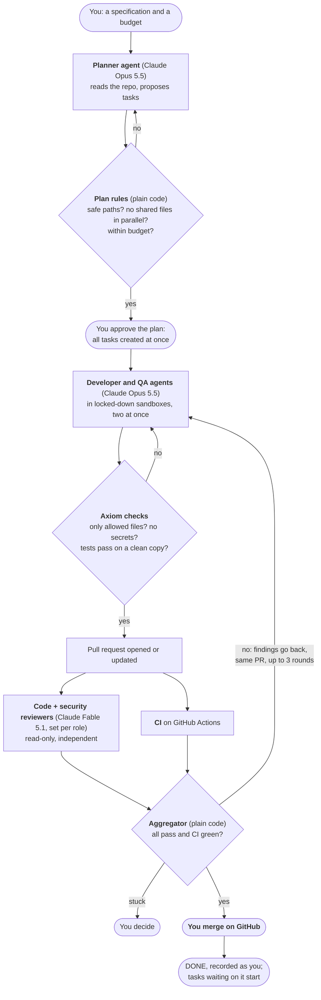
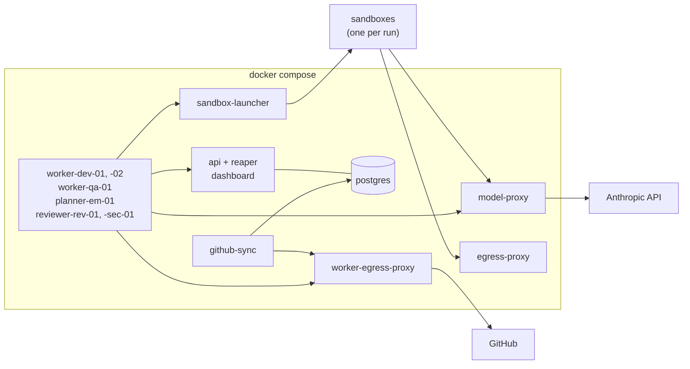

# Axiom

*Intelligence, orchestrated.* An AI engineering organization: a control plane that runs a team of
coding agents on real software work, with you as CTO. See [SPEC.md](SPEC.md).

**[Executive summary](docs/exec-summary.md)** · **[User guide](docs/user-guide.md)** ·
**[Admin guide](docs/admin-guide.md)** · [The guide](docs/guide/README.md) ·
[Blog post](https://bharathcmbox.github.io/posts/axiom/) ·
[LinkedIn post](https://lnkd.in/p/g3ztk7ZB)

**Status: Phases 1–4 complete.** You give Axiom a specification. A planner agent splits it into tasks;
you approve the plan. Developer and QA agents implement them in locked-down sandboxes, in parallel where
the work is independent. Independent reviewers on a different model and your CI judge each change,
sending it back until it passes. **You merge. Axiom never does.**

Proof: the [Phase 4 exit run](docs/runs/2026-11-07-phase-4-exit-run.md). A five-task spec on
`tiny-agenticsoc` was planned, approved, built by two developers and a QA agent, reviewed and merged in
65 minutes, for $8.29. Earlier, a planted one-character bug that passed every test and CI was caught by
a reviewer and fixed on the same PR ([PR #2](https://github.com/bharathcmbox/tiny-agenticsoc/pull/2)).

## How it works



**The rules that make it safe:**

| Rule | How it's enforced |
|---|---|
| A model gives opinions; code makes decisions | State machines, plan rules and the aggregator are plain, tested code |
| Nothing runs before you approve | Only a human's approval turns a plan into tasks, all or none |
| Nobody approves their own work | No agent can approve; reviewers run on a different model, and the registry enforces it |
| Agents hold no credentials | The model runs in a sandbox with only a short-lived run token; one proxy holds the API key, one launcher the Docker socket; networks are allowlisted |
| Agents never merge | No merge code exists. Workers push only `axiom/*` branches |
| Claims are not evidence | Axiom re-runs tests itself; CI is judged on the exact commit reviewed |
| Budgets stop work | Per run, per task, per day; reserved before spending, metered by the proxy |
| Nothing is lost in a crash | All state is in Postgres; every change writes an event in the same transaction |

## The pieces



## Learn it

- **[Executive summary](docs/exec-summary.md):** one page: what, results, risks, next.
- **[User guide](docs/user-guide.md):** specs, plans, tasks, PRs, and what to do when something comes to you.
- **[Admin guide](docs/admin-guide.md):** install, credentials, services, models, budgets, security operations.
- **[The guide](docs/guide/README.md):** 16 chapters on how it's built, with diagrams checked by the Mermaid
  parser. Short on time? Read [the big picture](docs/guide/01-big-picture.md), the
  [scenario atlas](docs/guide/13-scenarios.md) (every situation a task can meet, with its proof) and
  [how it was built](docs/guide/14-how-it-was-built.md).

Reference: [state machines](docs/state-machines.md) · [architecture](docs/architecture.md) ·
[API](docs/api.md) · [decisions (ADRs)](docs/decisions/) · [phase plans and evidence](docs/plan/) ·
[runs and drills](docs/runs/) · [SPEC](SPEC.md)

## Run it

Requires Docker, and [uv](https://docs.astral.sh/uv/) for development.

```bash
docker compose up -d --build --wait    # Postgres + API on http://127.0.0.1:8000 (docs at /docs)
```

To run real agents, put two secrets in `.env` (git-ignored, `chmod 600`; see `.env.example`):
`AXIOM_GITHUB_TOKEN` (fine-grained, one repository: Contents and Pull requests read/write, Actions
read) and `ANTHROPIC_API_KEY` (ideally a dedicated key with a spend limit). Then:

```bash
make worker-tokens   # once: tokens for the agents and the model proxy, added to .env
make workers         # sandbox image, developers, QA, planner, reviewers, GitHub sync
docker compose exec api python -m axiom.registry.tokens issue human:you   # your API token
```

Register a project, then give it a specification to plan or a single task. The
[user guide](docs/user-guide.md) walks through both, and the [admin guide](docs/admin-guide.md)
covers configuration:

```bash
H=(-H "Authorization: Bearer $TOKEN" -H "Content-Type: application/json")
curl "${H[@]}" localhost:8000/projects -d '{"key": "APP", "name": "my app",
  "repo_url": "https://github.com/you/app.git",
  "test_command": "pytest -q", "require_ci": true}'
curl "${H[@]}" localhost:8000/projects/APP/tasks -d '{"title": "…", "specification": "…",
  "acceptance_criteria": ["…"], "allowed_paths": ["src/app/**", "tests/**"], "budget_usd": 3}'
curl "${H[@]}" localhost:8000/projects/APP/plans -d '{"specification": "…", "budget_usd": 15}'
open http://127.0.0.1:8000/ui    # the dashboard: what needs you, every task's timeline
```

**On the PR:** merge it, comment `/axiom changes <what to change>`, or close it to cancel. Axiom
picks that up within 30 seconds.

**Costs real money** once workers run with a real key. `make workers-down` stops them.

## Develop

```bash
make db             # Postgres only
make test           # 1600+ tests against real Postgres, under 3 minutes
make lint           # ruff + mypy (strict)
make test-docker    # sandbox isolation against the real image (free)
make test-live      # real Claude runs in the sandbox (a few cents; announce first)
make smoke          # `docker compose up` from a clean clone
make demo-restart   # SIGKILL api + db mid-flight, restart, show nothing was lost
```

Configuration: `AXIOM_*` environment variables, in `src/axiom/config.py`. Conventions for working
on the code: [CLAUDE.md](CLAUDE.md).

**If Docker builds fail with "error getting credentials"** on WSL, Docker Desktop's Windows
credential helper isn't reachable: try `wsl --shutdown` from Windows. Base images are public, so
`DOCKER_CONFIG` pointing at a directory with a `{}` `config.json` also works.

## Limits

GitHub doesn't enforce the merge gate on a free private repository, so an early merge is possible
(it's recorded and flagged). Eight merged tasks and one planted bug show the system works, not yet how
well at scale: whether it beats one person driving one session needs the hand-driven baselines Phase 5
collects. Full lists: [phase 3](docs/plan/phase-3.md#9-known-limitations) and the
[exit run](docs/runs/2026-11-07-phase-4-exit-run.md#what-the-run-taught).
