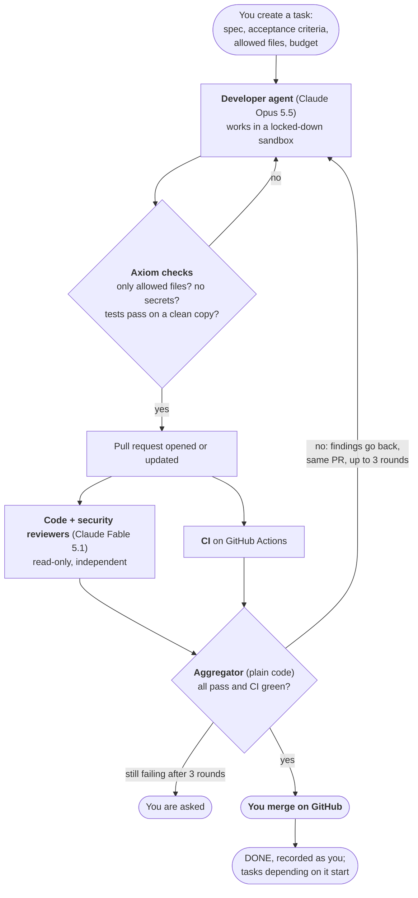
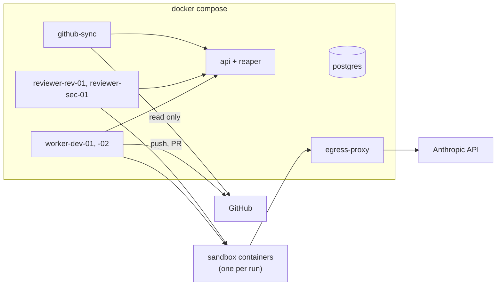

# Axiom

*Intelligence, orchestrated.* An AI engineering organization: a control plane that runs a team of
coding agents on real software work, with you as CTO. See [SPEC.md](SPEC.md).

**Status: Phases 1–3 complete.** You give Axiom a task. A developer agent implements it in a sandbox;
Axiom checks the work and opens a pull request. Independent reviewers on a different model and
your CI judge it, sending it back until it passes. **You merge. Axiom never does.**

Proof: [PR #2 on tiny-agenticsoc](https://github.com/bharathcmbox/tiny-agenticsoc/pull/2). A planted
one-character bug passed every test and CI; a reviewer caught it; a developer agent fixed it on
the same PR; it was merged by a human. $1.19, about 2.5 minutes of agent time.

## How it works



**The rules that make it safe:**

| Rule | How it's enforced |
|---|---|
| A model gives opinions; code makes decisions | State machines and the aggregator are plain, tested code |
| Nobody approves their own work | No agent can approve; reviewers are separate, on another model |
| Agents never touch GitHub or Axiom directly | The LLM runs in a sandbox holding only the Anthropic key; network limited to an allowlist |
| Agents never merge | No merge code exists. The worker pushes only `axiom/*` branches |
| Claims are not evidence | Axiom re-runs tests itself; CI is judged on the exact commit reviewed |
| Budgets stop work | Per run, per task, per day; refused or stopped, not just reported |
| Nothing is lost in a crash | All state is in Postgres; every change writes an event in the same transaction |

## The pieces



## Learn it

**[The guide](docs/guide/README.md)** has 14 chapters and over 100 diagrams, all checked by the
Mermaid parser. Short on time? Read these three:

1. [The big picture](docs/guide/01-big-picture.md): what Axiom is and why.
2. **[Scenario atlas](docs/guide/13-scenarios.md): every situation a task can meet, with a diagram
   and the test that proves it.**
3. **[How it was built](docs/guide/14-how-it-was-built.md): the process, decisions, mistakes and cost.**

Reference: [state machines](docs/state-machines.md) · [architecture](docs/architecture.md) ·
[API](docs/api.md) · [decisions (ADRs)](docs/decisions/) · [phase plans and evidence](docs/plan/) ·
[SPEC](SPEC.md) · [Agent SDK notes](docs/spikes/claude-agent-sdk.md)

## Run it

Requires Docker, and [uv](https://docs.astral.sh/uv/) for development.

```bash
docker compose up -d --build --wait    # Postgres + API on http://127.0.0.1:8000 (docs at /docs)
```

To run real agents, put two secrets in `.env` (git-ignored, `chmod 600`; see `.env.example`):
`AXIOM_GITHUB_TOKEN` (fine-grained, one repository: Contents and Pull requests read/write, Actions
read) and `ANTHROPIC_API_KEY` (ideally a dedicated key with a spend limit). Then:

```bash
make worker-tokens   # once: API tokens for the agents, added to .env
make workers         # sandbox image, developers, reviewers, GitHub sync
docker compose exec api python -m axiom.registry.tokens issue human:you   # your API token
```

Register a project and create a task (full walkthrough in [docs/api.md](docs/api.md)):

```bash
H=(-H "Authorization: Bearer $TOKEN" -H "Content-Type: application/json")
curl "${H[@]}" localhost:8000/projects -d '{"key": "APP", "name": "my app",
  "repo_url": "https://github.com/you/app.git",
  "test_command": "pytest -q", "require_ci": true}'
curl "${H[@]}" localhost:8000/projects/APP/tasks -d '{"title": "…", "specification": "…",
  "acceptance_criteria": ["…"], "allowed_paths": ["src/app/**", "tests/**"], "budget_usd": 3}'
curl "${H[@]}" localhost:8000/tasks/APP-001/events    # watch what happens
```

**On the PR:** merge it, comment `/axiom changes <what to change>`, or close it to cancel. Axiom
picks that up within 30 seconds.

**Costs real money** once workers run with a real key. `make workers-down` stops them.

## Develop

```bash
make db             # Postgres only
make test           # 1000+ tests against real Postgres, about 90 seconds
make lint           # ruff + mypy (strict)
make test-docker    # sandbox isolation against the real image (free)
make test-live      # real Claude runs in the sandbox (a few cents; announce first)
make smoke          # `docker compose up` from a clean clone
make demo-restart   # SIGKILL api + db mid-flight, restart, show nothing was lost
```

Configuration: `AXIOM_*` environment variables, in `src/axiom/config.py`. Conventions for working
on the code: [CLAUDE.md](CLAUDE.md).

**If Docker builds fail with "error getting credentials"** on WSL, Docker Desktop's Windows
credential helper isn't reachable: try `wsl --shutdown` from Windows. Base images are public, so
`DOCKER_CONFIG` pointing at a directory with a `{}` `config.json` also works.

## Limits

GitHub doesn't enforce the merge gate on a free private repository, so an early merge is possible
(it's recorded). One reviewed task proves the loop works, not how well it works: the measured answer
to whether this beats one driven session is what Phases 4 and 5 are for. Full list:
[phase 3 limitations](docs/plan/phase-3.md#9-known-limitations).
