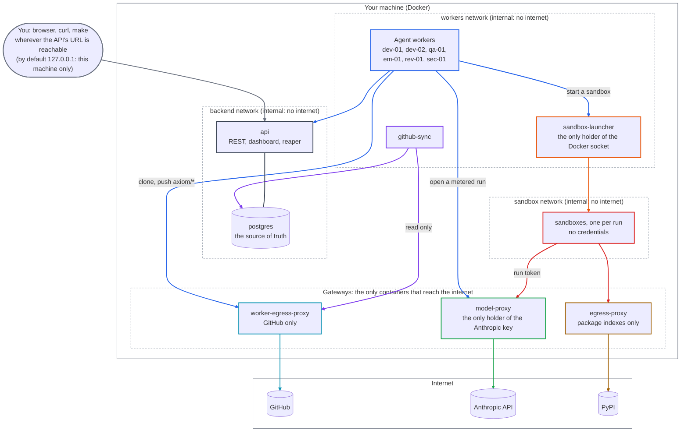

# Axiom admin guide

How to install, configure, run and secure Axiom. For the day-to-day work of giving Axiom specs and
merging what it delivers, see the [user guide](user-guide.md). For why it's built this way, see the
[guide](guide/README.md).

Axiom runs on one machine with Docker. Everything below assumes you're in the repository root.

## 1. What runs where



Each box's outgoing arrows share its border color: blue for the agent workers, red for sandboxes, and so on.

Everything inside "Your machine" runs there. You reach it through the API's URL, which listens on 127.0.0.1
only, so by default from that machine (or an SSH tunnel to it). Only the three gateways reach the internet, each for one
purpose. The three networks are Docker `internal` networks, with no route out. A few services sit on more than one
of them, and are drawn in the one that matters most: `api` and `github-sync` join both `backend` and `workers`; the
`model-proxy` joins `workers` and `sandbox`; `worker-egress-proxy` joins `workers`, and `egress-proxy` joins
`sandbox`. So a worker can't reach the database, and a sandbox can reach only the model proxy and the package proxy
(ADR-017).

| Service | Holds | Reaches |
|---|---|---|
| `api` | database password | Postgres |
| `db` | all state, the event log | nothing |
| `worker-dev-01/02`, `worker-qa-01` | GitHub token, its agent token, proxy and launcher tokens | API, GitHub (through `worker-egress-proxy`), model proxy, launcher |
| `reviewer-rev-01/sec-01`, `planner-em-01` | the same; they read the repository but never push | the same |
| `github-sync` | GitHub token, database | GitHub (read only), Postgres |
| `model-proxy` | `ANTHROPIC_API_KEY` | Anthropic |
| `sandbox-launcher` | Docker socket | Docker |
| sandboxes | a short-lived run token for one model and budget | model proxy, PyPI |

The model never runs outside a sandbox, and no sandbox holds a credential: see
[chapter 11](guide/11-workers-and-sandbox.md) and ADRs 008, 014–017.

## 2. Install

Requirements: Docker with Compose, `make`, `curl`, `openssl`, `python3`; [uv](https://docs.astral.sh/uv/) for
development. On Windows, use WSL 2.

```bash
docker compose up -d --build --wait   # Postgres + API on http://127.0.0.1:8000 (OpenAPI at /docs)
curl -s localhost:8000/healthz         # {"status":"ok","database":"ok"}
make seed                              # register the agents in config/agents.toml
```

Migrations in `migrations/` run when the API starts (`make migrate` runs them by hand). The API listens on
127.0.0.1 only. It speaks plain HTTP and is not meant to be exposed beyond your machine.

## 3. Credentials

Two secrets come from outside, and everything else is generated. All of them live in `.env` (git-ignored). Keep
it `chmod 600`, and never paste its values into a chat, a task or an issue.

| Secret | Where from | Scope |
|---|---|---|
| `AXIOM_GITHUB_TOKEN` | GitHub, fine-grained token | One repository per token if you can: Contents and Pull requests read/write, Actions read. Nothing else |
| `ANTHROPIC_API_KEY` | Anthropic Console | A dedicated key with a spend limit. Only `model-proxy` sees it |
| `AXIOM_MODEL_PROXY_ADMIN_TOKEN`, `AXIOM_LAUNCHER_TOKEN` | `make worker-tokens` | Let workers open model runs and ask for sandboxes |
| `AXIOM_DEV01_TOKEN` … `AXIOM_QA01_TOKEN` | `make worker-tokens` | Each agent's API identity |
| your human token | `tokens issue human:<name>` | You, over the API and dashboard |

```bash
cp .env.example .env && chmod 600 .env   # then fill in the two outside secrets
make worker-tokens                        # generates the rest, appends them to .env
make hooks                                # once per clone: refuse commits containing a value from .env
```

### Your human token

```bash
docker compose exec api python -m axiom.registry.tokens issue human:you   # printed once
```

Keep it in a file only you can read. The `make` targets below read it from `~/.axiom/human.env` (change
with `HUMAN_ENV=`):

```bash
install -m 600 /dev/null ~/.axiom/human.env
echo "HTOK=<the token>" >> ~/.axiom/human.env     # paste it in an editor rather than the shell history
```

Tokens are stored hashed. List and revoke them with
`docker compose exec api python -m axiom.registry.tokens list` and `... revoke <id>`.

### Rotating

| What | How |
|---|---|
| GitHub token | Create a new one, replace it in `.env`, `make workers` (recreates the workers and sync), revoke the old one on GitHub |
| Anthropic key | Create a new one, replace it in `.env`, `docker compose up -d --force-recreate model-proxy`, delete the old one in the Console once its usage stops |
| Agent tokens | Delete the `AXIOM_*_TOKEN` lines from `.env`, `make worker-tokens`, `make workers`, then revoke the old ones by id |
| Your token | Issue a new one, update `human.env`, revoke the old one |

Compare old and new values by a fingerprint (for example, the last four characters of a SHA-256 hash), never by
printing them.

## 4. Running

```bash
make workers        # builds the sandbox image, starts developers, QA, planner, reviewers, sync
make workers-down   # stops them all (the API and database keep running)
docker compose logs -f worker-dev-01 reviewer-rev-01   # what they're doing
```

**Workers spend money** as soon as there's READY work. Stop them when you're not using them. Always start
with `--build` (as `make workers` does): workers started on stale images have refused to run, or run old code.

To work on one project only, set `AXIOM_PROJECT_KEY=APP` before `make workers`. To keep finished workspaces for
inspection, set `AXIOM_KEEP_WORKSPACES=1`. They're under `~/.axiom/work` (`AXIOM_WORKSPACES_DIR`).

## 5. Projects

A project is one GitHub repository.

```bash
H=(-H "Authorization: Bearer $HTOK" -H "Content-Type: application/json")
curl "${H[@]}" localhost:8000/projects -d '{"key": "APP", "name": "my app",
  "repo_url": "https://github.com/you/app.git", "default_branch": "main",
  "test_command": "pytest -q", "require_ci": true}'
curl "${H[@]}" localhost:8000/projects/APP/test-paths -d '{"test_paths": ["tests/**"]}'
curl "${H[@]}" localhost:8000/projects/APP/python-version -d '{"python_version": "3.12"}'
```

| Setting | Meaning |
|---|---|
| `test_command` | What Axiom runs on a clean copy before opening a PR. It's the developer's claim checked, not trusted |
| `require_ci` | A task reaches AWAITING_MERGE only once GitHub Actions is green on the exact commit reviewed |
| `test_paths` | The only paths a QA task may change (plans are checked against it) |
| `python_version` | Which Python uv uses in the sandbox: 3.12, 3.13 or 3.14 |

The repository needs CI on pull requests if `require_ci` is on. Protect `main` on GitHub: Axiom pushes only
`axiom/*` branches and has no code path that merges, but branch protection makes that true for anyone else too.

## 6. Agents and models

```bash
make agents
```

```text
EM-01    engineering_manager  (worker-default)  True
DEV-01   developer            claude-opus-5-5   True
DEV-02   developer            claude-opus-5-5   True
QA-01    qa                   (worker-default)  True
SEC-01   security_reviewer    claude-fable-5-1  True
REV-01   code_reviewer        claude-fable-5-1  True
```

Change a model with one command. It takes effect at that agent's next run, without a restart:

```bash
make set-model AGENT=SEC-01 MODEL=claude-sonnet-5-5   # security reviews on Sonnet
make set-model AGENT=SEC-01 MODEL=default             # back to the worker's default
```

The registry refuses a reviewer on a model that any developer or QA agent uses, and the reverse: work is always
reviewed on a different model from the one that wrote it (ADR-009). An agent with no model runs on its worker's
default: Opus 5.5 for developers, QA and the planner, Fable 5.1 for reviewers.

Which model for which role? Sonnet 5.5 reviews cost about a seventh of Fable 5.1's. In a side-by-side test it
caught the same serious bug and reached the same verdicts, but missed about half of Fable's smaller findings,
mostly on test quality ([comparison](runs/2026-11-07-reviewer-comparison.md)). A reasonable split is Sonnet for
security reviews and Fable for code reviews.

Disable an agent (it stops claiming work) with `POST /agents/{key}/disable`, and enable it again with `/enable`.
New agents can be added to `config/agents.toml` and seeded. A new worker also needs a service in
`docker-compose.yml` and a token.

## 7. Budgets

Money is checked before it's spent, not reported afterwards ([chapter 15](guide/15-metrics.md), ADR-013).

| Setting (environment variable) | Default | What it limits |
|---|---|---|
| `AXIOM_DAILY_BUDGET_USD` | $15 | All tasks, reviews and plans in a UTC day |
| `AXIOM_DEFAULT_TASK_BUDGET_USD` | $3 | A task without its own budget: developer runs and reviews together |
| `AXIOM_MAX_RUN_BUDGET_USD` | $6 | One developer run |
| `AXIOM_REVIEW_BUDGET_USD` | $1 | The least a review run asks for |
| `AXIOM_REVIEW_MAX_RUN_USD` | $2.50 | The most a review run may get (its share of what the task has left) |
| `AXIOM_REVIEW_MIN_RUN_USD` | $0.85 | Below this a review waits, or goes to you, rather than start |
| `AXIOM_PLAN_RUN_BUDGET_USD` / `AXIOM_PLAN_MIN_RUN_USD` | $1 / $0.50 | One planning attempt |
| `AXIOM_MAX_REVIEW_ROUNDS` | 3 | Rework rounds before a task comes to you |
| `AXIOM_MAX_CONCURRENT_DEVELOPERS` | 2 | Developer runs at once |

Set them in `.env` and recreate the API (`docker compose up -d --force-recreate api`). Every run is metered by
the model proxy, and that metered cost is what's recorded. Also set a spend limit on the Anthropic key itself:
it's the last line if everything else fails.

One exception: drills such as the reviewer comparison (`src/axiom/drills/`) aren't tasks, so the daily budget
doesn't see them. They have their own caps, and are announced before they run.

## 8. Watching it

| Where | What |
|---|---|
| <http://127.0.0.1:8000/ui> | Dashboard: what needs you, tasks, plans, each with its timeline. Sign in with your token |
| `make report` (`PROJECT=APP`) | Daily report: what needs you, today's spend, delivery metrics |
| `GET /metrics?project=APP` | The same metrics as JSON |
| `GET /tasks/{key}/events`, `/events` | The event log: every change, who made it, when |
| `GET /invariants` | Cross-table consistency; expect `[]` |

## 9. Security operations

| Check | When |
|---|---|
| `make check-boundaries` | After changing compose, networks or images: runs inside real worker and sync containers and checks what a compromised worker could reach |
| `make test-docker` | After changing the sandbox: isolation tests against real containers |
| `scripts/check_secrets.py` | Before every commit (`make hooks` installs it) |

**If a credential may have leaked** (in a log, a PR, a task's text, a sandbox's output):

1. Stop the workers: `make workers-down`.
2. Find out what was exposed, and where, without printing the value. Compare by fingerprint.
3. Rotate it (section 3), and revoke the old value at its source.
4. Look at what the old value could reach in the meantime: GitHub's audit log, the Anthropic Console's usage.
5. Record what happened. A run that saw a credential should be treated as compromised.

What a compromised sandbox could still do is listed in [chapter 11](guide/11-workers-and-sandbox.md). The
largest remaining way out is GitHub, through what a worker legitimately pushes. That's why reviews, CI, and a
human merge stand between a branch and `main`.

## 10. Troubleshooting

| Symptom | Cause and fix |
|---|---|
| A worker exits saying it's misconfigured | A token is missing from `.env`: `make worker-tokens` |
| Workers run old code, or refuse to start for want of a key | Stale images: start with `make workers` (it builds) |
| A task stays READY | No worker for its role is running, the agent is disabled or at capacity, or the day's budget is spent (`make report`) |
| A review waits with "reserved by runs in flight" | Other runs hold the task's or the day's money; it continues when they finish |
| A task went to WAITING_FOR_HUMAN | Its timeline says why: see the [user guide](user-guide.md#when-something-comes-to-you) |
| Sandboxes fail on paths "outside the workspaces root" | The launcher started without `AXIOM_WORKSPACES_DIR`; start services through `make`, which exports it |
| The API port doesn't answer after a restart | `docker compose up -d --force-recreate --no-deps api` |
| Tests fail to connect | `make db` first: tests use a real Postgres database, `axiom_test` |

## 11. Upgrading and backups

Pull, then `docker compose up -d --build --wait` and `make workers`. New migrations apply on API start. They're
numbered and never edited once applied. Postgres keeps its data in the `pgdata` volume. Back it up with
`docker compose exec db pg_dump -U axiom axiom > axiom.sql`. The event log is append-only, so a dump is a
complete history.
