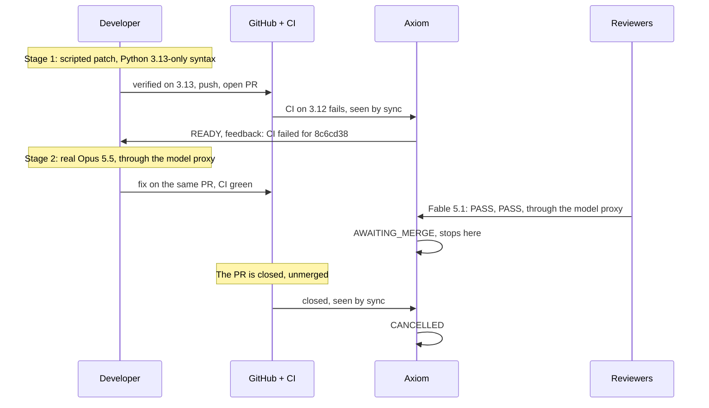

# Edge drill, 2026-11-06 (Phase 4 T5)

**Result:** real CI sent bad work back, a real agent fixed it on the same PR from that feedback alone,
reviews and CI approved it, Axiom stopped and waited for a human, and closing the PR cancelled the task.
It was also the first full run through the [hardened layout](../plan/phase-4-hardening.md).

Live cost: **$0.70** (developer $0.13, reviews $0.58). SOC-003, [PR #5](https://github.com/bharathcmbox/tiny-agenticsoc/pull/5), closed unmerged.

## What it showed

| Check | Result |
|---|---|
| Red CI sends the task back, without a reviewer | Yes, within 30 s of the run finishing |
| A real agent fixes it from `CI failed` and the task text | Yes: removed the syntax, added a test, same PR |
| Reviewers can't merge, and nothing else does | Stopped at AWAITING_MERGE; `main` didn't move |
| Closing the PR cancels the task | Yes, seen by sync (see below for how it closed) |
| Real runs with no key in the worker or sandbox | Yes, costs metered by the proxy, none estimated |
| Sandboxes started only by the launcher | Yes |
| GitHub push, PR and CI read through the worker proxy, with the rotated token | Yes |
| Real secrets in 218 workspace files, service logs, PR text | None |

## What went wrong on the way

- **The drill's first patch was rejected by verification.** It used 3.14-only syntax, and the sandbox
  now runs 3.13: adding 3.12 and 3.13 to the image in T3 had quietly moved `uv` off 3.14. Nothing had
  noticed, and a note in the code was wrong. The gap with CI was smaller than planned but real, so the
  patch moved to 3.13-only syntax. SOC now sets `python_version` to 3.12, matching its CI.
- **The reviewers restarted for 8 minutes.** I started them with `--no-build`, on images from before
  the model proxy, and they refused to run without a key. They failed safely, and the task waited.
  `make workers` always rebuilds.

- **`gh pr close` failed with a network error,** after posting its comment. Deleting the branch is what
  closed the PR, two seconds before I stopped sync, so the task stayed AWAITING_MERGE until sync
  was restarted. Nothing was lost: sync reads the PR's state, and it cancelled the task on its next pass.

## What this doesn't show

One task is one task. Stage 1's feedback only said that CI failed, and the task text happened to mention
CI's Python version, which probably helped the agent. The reviewers weren't given a bug to find here.
