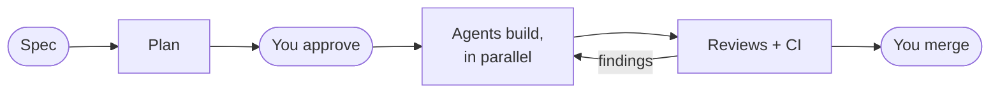
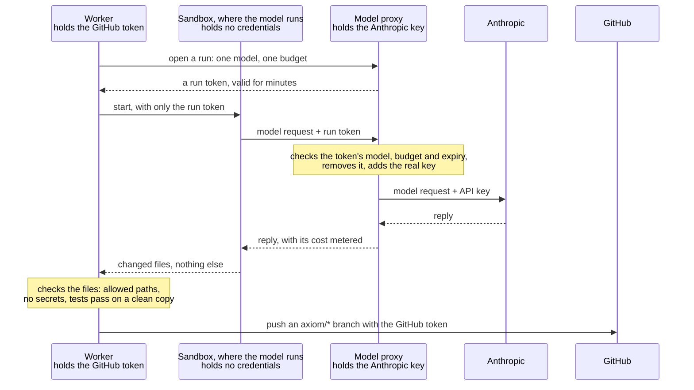

# Axiom: executive summary

*November 2026, at the end of Phase 4.*

## What it is

Axiom runs a small team of AI coding agents on real software work, with a human as CTO. You give it a
specification. A planner agent splits it into tasks, and you approve the plan. Developer and QA agents implement
the tasks in locked-down sandboxes. Two reviewer agents, on a different model, judge every change with your CI.
**You merge. Axiom never does.** Every decision about what happens next is made by plain, tested code, never by a
model, and every step is recorded in an append-only event log.

## Where it stands

All four phases planned so far are built and proven on a real repository (`tiny-agenticsoc`):

| Phase | Proven by |
|---|---|
| 1. Control plane | Tasks driven through every state; killed and restarted mid-work with nothing lost |
| 2. First worker | A real task went from READY to an open PR with no human input |
| 3. Quality | A planted one-character bug passed every test and CI; a reviewer caught it; an agent fixed it on the same PR |
| 4. Engineering management | A five-task spec planned, approved, built in parallel, reviewed and merged end to end |

## Results so far

| Measure | Value |
|---|---|
| Real tasks merged | 8, with no defect recorded after merge |
| Cost per merged task, everything included | $1.40 |
| First-pass review acceptance | 75% |
| A five-task spec, request to last merge | 65 minutes, $8.29 |
| Agent time per task | about 3 minutes |
| Waiting for the human to merge | 13–27 minutes per PR |
| Reviews' share of cost | about three quarters |

**Two findings stand out.** The human is the bottleneck, by about tenfold. And reviews are most of the cost:
Claude Sonnet 5.5 as a reviewer cost about a seventh of Claude Fable 5.1 and agreed on every verdict, including
catching the planted bug. But it missed about half of Fable's smaller findings on test quality
([comparison](runs/2026-11-07-reviewer-comparison.md)). The reviewer model is now a one-line setting per role.

## Security

The model never holds a credential. It runs in a sandbox that reaches the model only through a metered proxy
holding the API key, and other sites only through an allowlist. GitHub and the Docker socket are held by separate
services.

A stolen run token is worth one model and one budget for a few minutes, and works only from inside Axiom's internal
networks: the proxy isn't reachable from outside.
The sandbox has no route to GitHub at all: only the worker pushes, after checking the work.

A prompt-injection drill was refused at every step. Preparing for it found a real sandbox escape (through
git), which was fixed before it could be used. A live check (`make check-boundaries`) proves 33 limits from
inside real containers. The largest remaining exposure is GitHub itself: a compromised agent could push harmful
code to its branch. Reviews, CI and a human merge stand between that branch and `main`.

## Cost to build

The API cost of building and proving all four phases was about $23: under $2 for Phases 1–3, and $21.79 for
Phase 4, including drills and the reviewer comparison. That's within a $35 cap. Every figure comes from the
metered proxy and the event log.

## Limits and risks

- **Small sample.** Eight tasks, one planted bug. The numbers describe the system, not yet its quality at scale.
- **The main question is open.** Whether agents beat one person with one AI session needs hand-driven baselines,
  which Phase 5 collects.
- **One machine, one operator.** The API is local, and GitHub's own merge protection isn't enforced yet.
- **Unverified paths.** The OpenRouter provider change in `tiny-agenticsoc` was tested offline only.

## Next: Phase 5

A second runtime (Codex) for cross-model review, more developers, delivering `tiny-agenticsoc` end to end,
continuous operation, and baselines to answer whether this beats doing it yourself.

More: [user guide](user-guide.md) · [admin guide](admin-guide.md) · [the guide](guide/README.md) ·
[exit run](runs/2026-11-07-phase-4-exit-run.md) · [SPEC](../SPEC.md)
