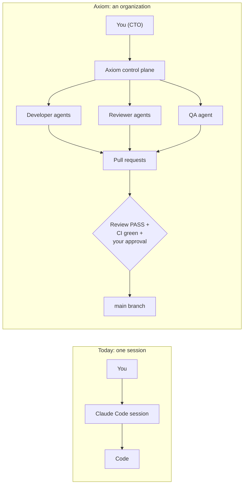
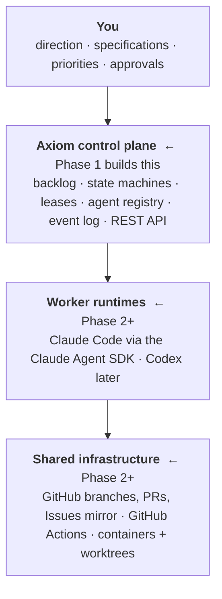
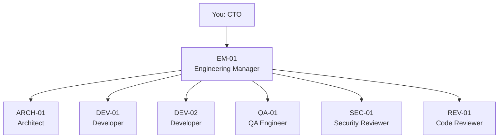
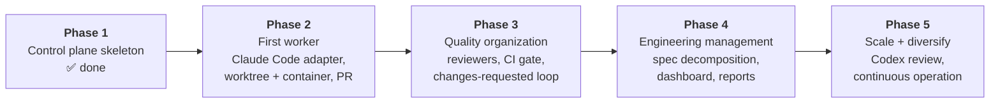
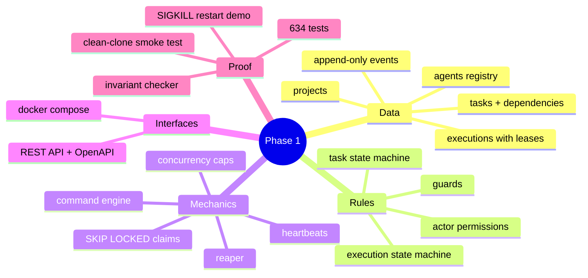

# 1. The big picture

## The problem Axiom solves

When you use Claude Code today, you drive **one** agent through **one** session. It plans,
edits, runs tests and gives you code. People who say they "manage 40 agents" are doing
something different. They run an **organization**: a backlog, people with roles, hand-offs,
reviews, gates and reports, where the workers happen to be coding agents.

The coding agents can be identical in both cases. What differs is the machinery around them.
**Axiom is that machinery.**

## The four layers

Two rules shape everything else (see [ADR-002](../decisions/ADR-002-deterministic-orchestrator.md)):

1. **The control plane is ordinary deterministic code, not an LLM.** Who may do what, which
   task goes next, when to retry and when to give up are all plain Python and SQL. LLMs are
   used only where judgment is needed: writing code, reviewing, decomposing specs.
2. **All state is in PostgreSQL** ([ADR-001](../decisions/ADR-001-postgres-source-of-truth.md)).
   No agent's chat history, and nothing in process memory, is needed to know where things stand.

## The organization (roles)

These seven are registered from [config/agents.toml](../../config/agents.toml) at startup. In
Phase 1 they are only rows in the `agents` table. You "become" one by using that agent's API
token (`python -m axiom.registry.tokens issue agent:DEV-01`). From Phase 2, a worker process
holds the token and does that for real.

## Phases

## What Phase 1 actually contains

What Phase 1 deliberately did **not** contain: any LLM call, any worker, or any GitHub access.
Those arrive in Phase 2. (Bearer-token authentication was added at the start of Phase 2.)

## Try it

1. `docker compose up -d --build --wait`, then open <http://127.0.0.1:8000/docs>. Every
   endpoint in the guide can be tried from that page.
2. Issue yourself a token (`docker compose exec api python -m axiom.registry.tokens issue human:me`),
   then `curl -s -H "Authorization: Bearer <token>" localhost:8000/agents | python3 -m json.tool`
   lists your seven employees.
3. Read [SPEC.md](../../SPEC.md) sections 1–4. Then find each of the two rules above in the
   code: search for `check(` in `orchestrator/commands.py`, and look for any in-memory state in
   `api/app.py` (there is none apart from the connection pool).
