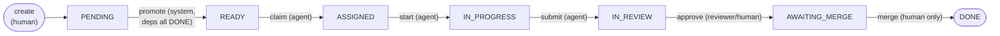
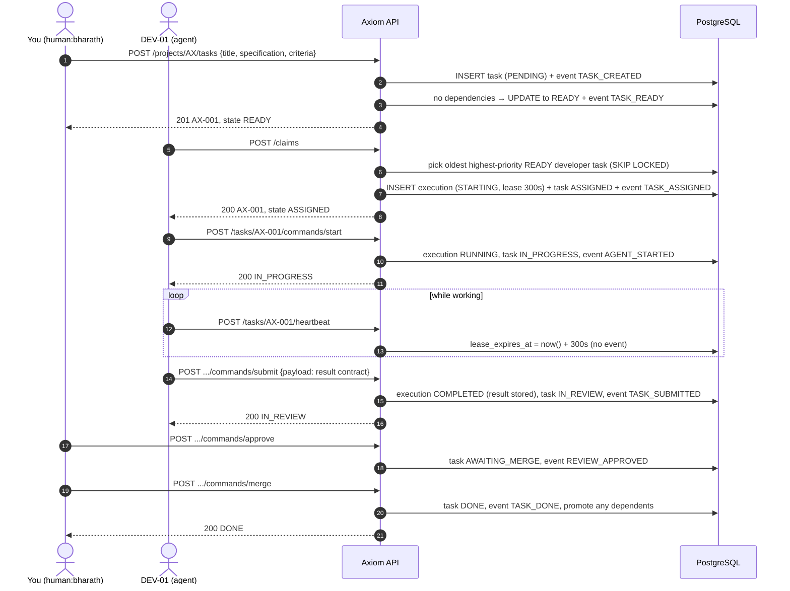
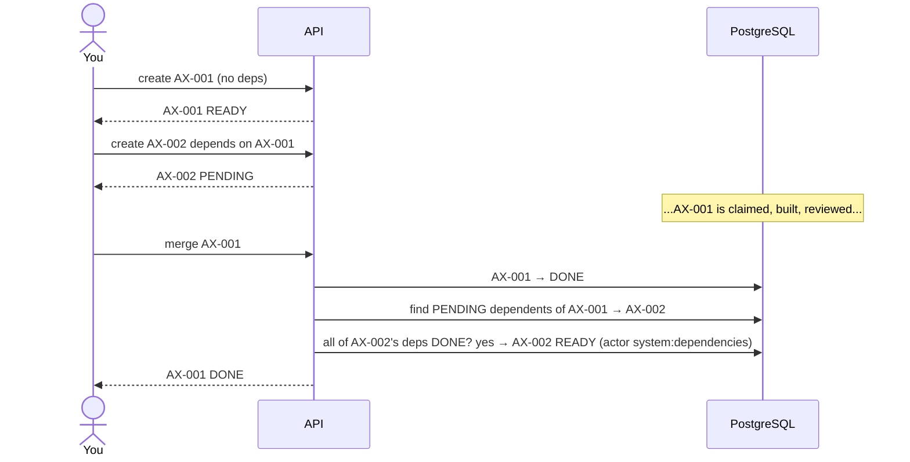
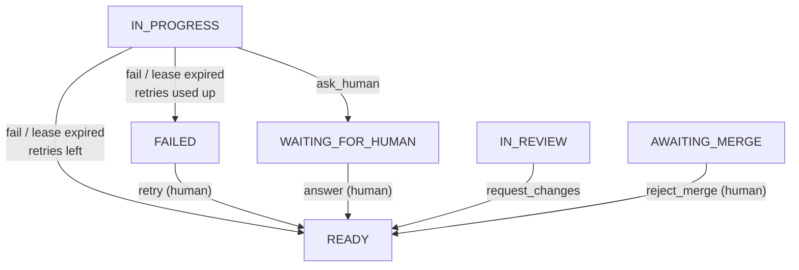

# 2. The life of a task

The best way to understand Axiom is to follow one task from creation to DONE. In Phase 1 you
play every part: the human, the developer agent and the reviewer. From Phase 2, real agents
will make the agent calls.

## The journey at a glance



The task never "decides" to move. Every arrow is a **command** issued by an **actor**, and
the command is checked against the rules before anything changes.

## Step by step



## What the database looks like afterwards

**`tasks`**: one row, `state = DONE`, `attempt_count = 0`, `review_rounds = 0`.

**`executions`**: one row, the developer's single attempt:

| id | task | agent | attempt | status | lease_expires_at | ended_at | result |
|---|---|---|---|---|---|---|---|
| 1 | AX-001 | DEV-01 | 1 | COMPLETED | *null* | 10:07 | `{"summary": "done", ...}` |

**`events`**: seven rows. Together they are the complete history:

| id | type | from → to | actor |
|---|---|---|---|
| 1 | TASK_CREATED | — → PENDING | human:bharath |
| 2 | TASK_READY | PENDING → READY | system:dependencies |
| 3 | TASK_ASSIGNED | READY → ASSIGNED | agent:DEV-01 |
| 4 | AGENT_STARTED | ASSIGNED → IN_PROGRESS | agent:DEV-01 |
| 5 | TASK_SUBMITTED | IN_PROGRESS → IN_REVIEW | agent:DEV-01 |
| 6 | REVIEW_APPROVED | IN_REVIEW → AWAITING_MERGE | human:bharath |
| 7 | TASK_DONE | AWAITING_MERGE → DONE | human:bharath |

Notice that the `to` of each event is the `from` of the next. That chain is what lets Axiom
(and you, later, for metrics) reconstruct exactly what happened. The test suite checks the
chain after every test (chapter 9).

## A task with a dependency



The promotion happens **inside the same transaction as the merge**. There is never a moment
where AX-001 is DONE but AX-002 is still waiting for a background job to notice.

## When things go wrong

The happy path is only part of the story. These are the detours a task can take; chapter 3
covers them in detail.



Every detour ends at READY. The task goes back to the queue and any agent of the right role
can pick it up. A new execution is created each time, so the history of attempts is kept.

## Try it

With the stack running (`make up`), paste the walkthrough from
[api.md](../api.md#walkthrough-one-task-from-creation-to-done-by-hand) one line at a time.
After each line, run:

```bash
curl -s "${H[@]}" localhost:8000/tasks/AX-001 | python3 -c 'import json,sys; t=json.load(sys.stdin); print(t["state"])'
curl -s "${H[@]}" localhost:8000/tasks/AX-001/events | python3 -c 'import json,sys; [print(e["id"], e["type"], e["from_state"], "->", e["to_state"]) for e in json.load(sys.stdin)]'
```

Then try to break it:
- send `merge` twice (409, with the allowed commands);
- `start` with DEV-02's token (403, not the owner);
- `cancel` as an agent (403, only humans cancel).

Each time, confirm the event list did not grow.
