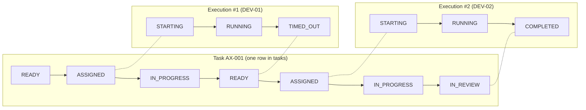
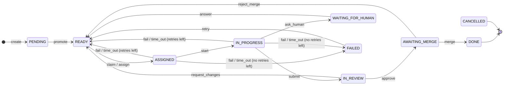
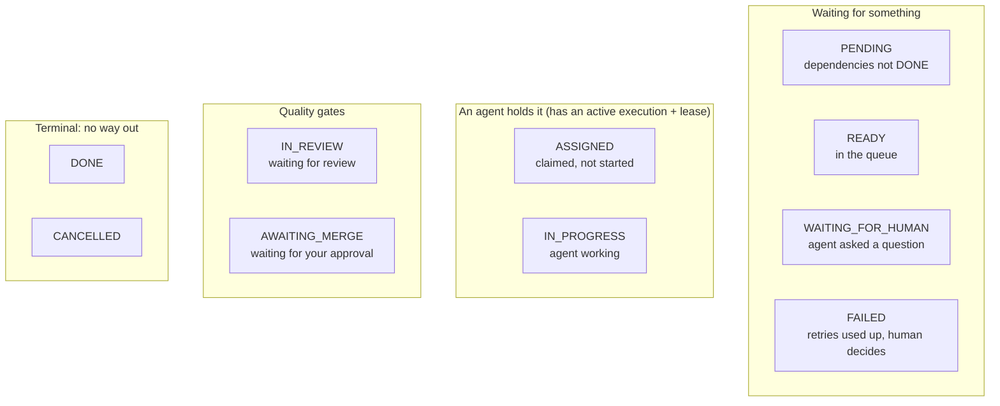
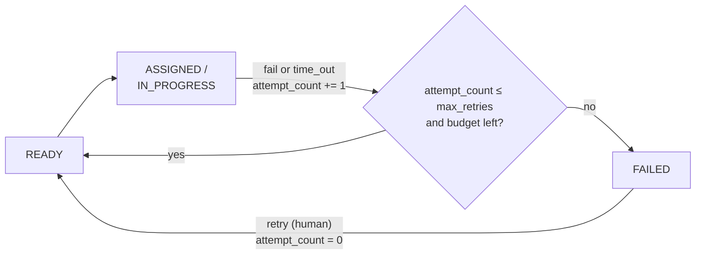
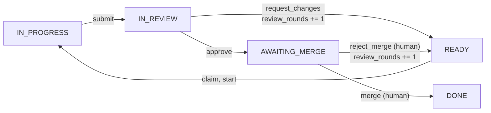
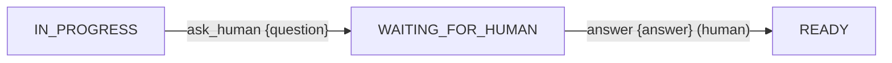
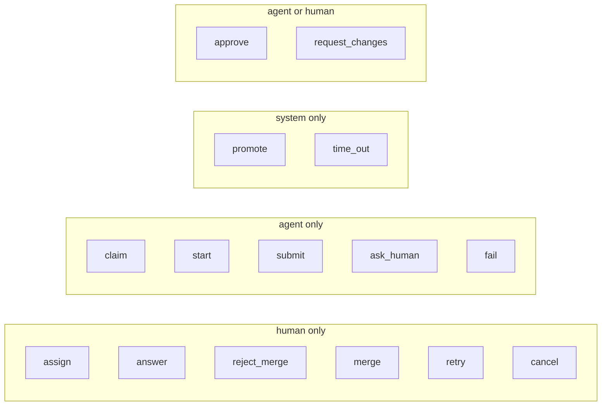
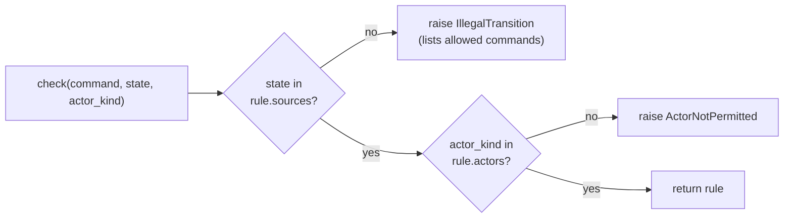
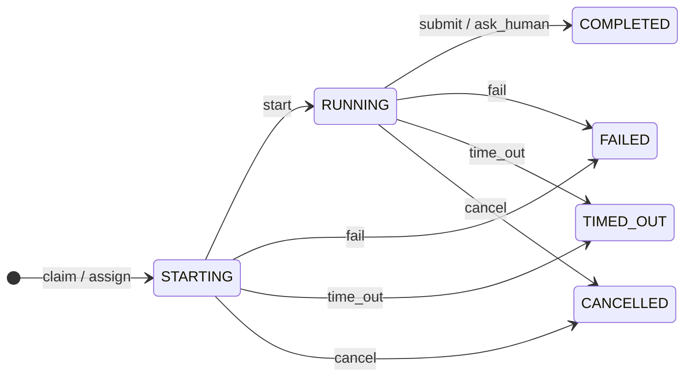

# 3. State machines

A **state machine** is a fixed list of states plus a fixed list of allowed moves between them.
Anything not on the list is rejected. For an orchestrator this is the most important design
tool: it turns "what could possibly happen?" into a table you can read, test and reason about.

## Why two machines, not one

The original design had a single "agent lifecycle" (CREATED, STARTING, RUNNING, WAITING,
REVIEW, FAILED, COMPLETED). It mixed two different questions:

- *Where is this piece of work?* (waiting for review? done?)
- *What is this particular attempt doing?* (still running? crashed?)

A task can be attempted many times (a crash, then a retry, then a rework after review), and
each attempt has its own life. So Axiom separates them:



Here DEV-01's worker died, its lease expired, and the task went back to READY. DEV-02 then
picked it up and finished. **One task, two executions.**

## The task machine



(`cancel` is legal from every state except DONE and CANCELLED; it is left out of the diagram
to keep it readable.)

### The states, grouped by meaning



The "working" group matters: a task is in ASSIGNED or IN_PROGRESS **if and only if** it has
exactly one active execution. That is one of the invariants (chapter 4).

## The three loops

Most of the interesting behaviour lives in the loops back to READY.

### Retry loop: failures and dead workers



With the default `max_retries = 2`, a task gets **3 attempts**. A lease timeout counts as an
attempt (decision D7). Without that rule, a task that crashes its worker every time would loop
forever and burn money.

Since Phase 2 the loop also stops when the task's **budget** is spent: the summed cost of its
executions reaches `budget_usd` (default $3). Re-queuing such a task would be pointless, since
claims are refused once the budget is spent. A human can raise the budget
(`POST /tasks/{key}/budget`) and `retry`.

### Rework loop: review says no



Rework is **not** a failure: it bumps `review_rounds`, not `attempt_count`. They are counted
separately because they mean different things in the metrics. "First-pass review acceptance"
is `review_rounds == 0` at merge.

### Human-input loop: the agent has a question



The execution ends (COMPLETED) when the agent asks, which releases its lease and its capacity
slot. Nobody sits idle holding a task while you think. When you answer, the task is requeued.

## Who may do what

Each command allows only certain **kinds** of actor:



The most important line in that picture is **`merge` is human only**. It is how the principle
"agents never merge their own work" is enforced in code. In Phase 3, `approve` will
additionally require a *different* agent from the one that did the work.

## How the rules are written down in code

The whole task machine is one dictionary in
[`domain/task_machine.py`](../../src/axiom/domain/task_machine.py):

```python
Rule(TaskCommand.SUBMIT, frozenset({S.IN_PROGRESS}), (S.IN_REVIEW,), _A, "TASK_SUBMITTED")
#    command             legal from              → target         actors  event type
Rule(TaskCommand.FAIL,   EXECUTING_STATES,          (S.READY, S.FAILED), _A, "EXECUTION_FAILED")
#                                                    ↑ retries left  ↑ retries used up
```



This module is **pure**: no database, no I/O. That is why it can be tested exhaustively in
milliseconds (all 15 commands × 10 states, and all 15 commands × 3 actor kinds), and why
`docs/state-machines.md` can be checked against it automatically.

## The execution machine



You never send commands to an execution directly. It moves only as a **side effect** of task
commands, inside the same transaction, so the two machines cannot drift apart.

## Try it

1. Run only the pure state-machine tests: `uv run pytest tests/unit -q`. Count how many run, and
   notice how fast they are.
2. Edit `docs/state-machines.md` and change one target state in the table, e.g. `submit` →
   `DONE`. Run `uv run pytest tests/unit -q` and watch the doc-sync test fail. Then revert.
3. Drive a task into FAILED by hand: create it with `"max_retries": 0`, then claim, start and
   `fail`. Then `retry` it and check `attempt_count` went back to 0.
