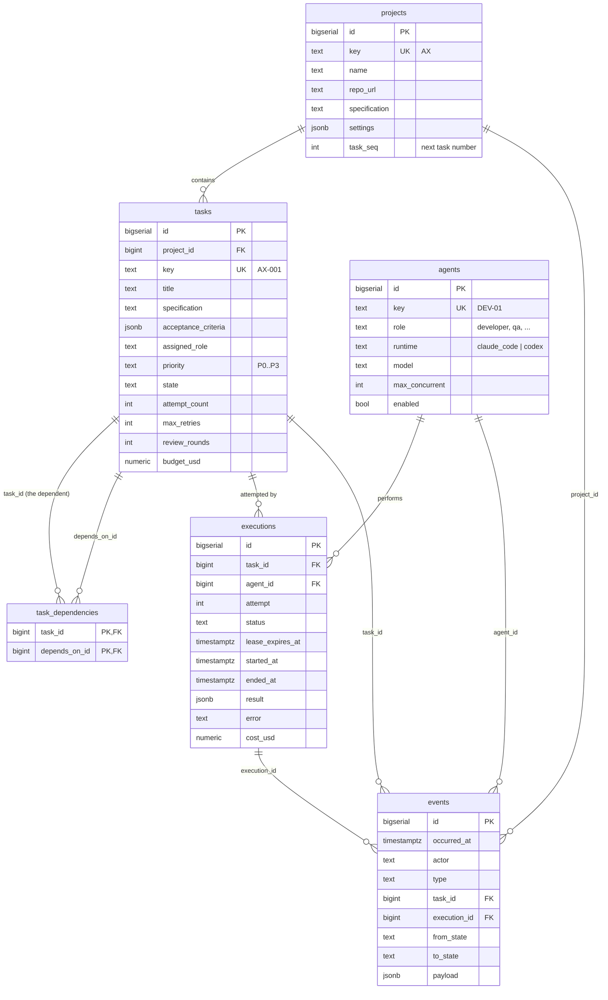
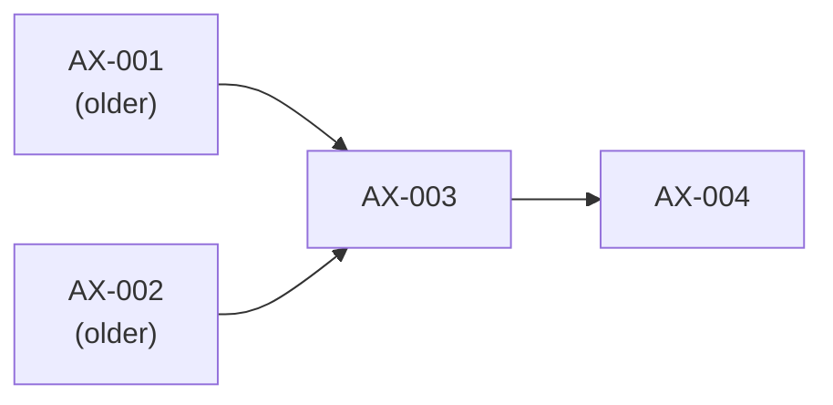
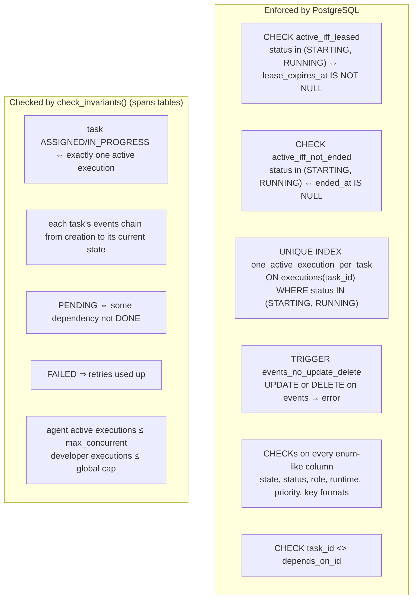
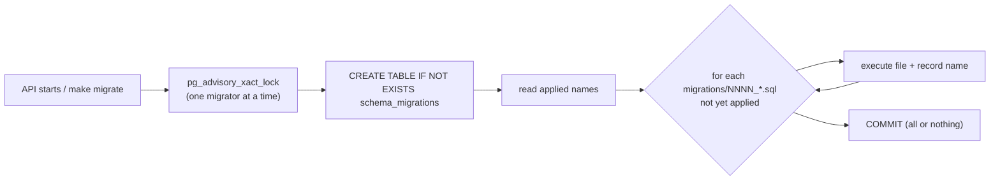

# 4. The data model

Everything Axiom knows is in Postgres. This chapter covers the six core tables from
[`migrations/0001_init.sql`](../../migrations/0001_init.sql). Later migrations added `api_tokens`
(0002), budget and contract fields (0003), `reviews` (0004, see chapter 12), CI fields (0005), task
`tags` (0006, see chapter 15), and budget reservations, estimated costs and per-project Python
(0007, see ADR-013).

## Entity-relationship diagram

## The tables, one at a time

### `projects`
A product Axiom delivers work for: a name, a repository, a specification. `task_seq` is a
per-project counter. Creating a task does `UPDATE projects SET task_seq = task_seq + 1 …
RETURNING task_seq` to mint keys AX-001, AX-002, …. Because that UPDATE locks the project row,
two tasks created at the same moment can never get the same number.

### `agents`: the registry
The organization chart. `role` decides which tasks an agent may take (it must equal the task's
`assigned_role`). `max_concurrent` caps how many tasks it may hold at once. `runtime` and
`model` decide how the worker runs it (developers on Opus 5.5, reviewers on Fable 5.1).

### `tasks`
The contract from the spec (title, specification, acceptance criteria, role, priority,
retries, budget) plus the moving parts: `state`, `attempt_count` and `review_rounds`.
`branch` and `pull_request_url` stay empty until Phase 2.

### `task_dependencies`
Edges in a dependency graph. Dependencies are given at creation and must already exist, so
**a cycle is impossible by construction**: a task can only depend on older tasks.

### `executions`
One row per attempt. While active (STARTING or RUNNING) it carries a **lease**
(`lease_expires_at`). When it ends it gets `ended_at`, and the lease is cleared. `result`
holds what the agent submitted; `error` says why it failed. The cost and token columns are
ready for Phase 2.

### `events`: the append-only log
One row for every change. `type` says what happened, `from_state`/`to_state` say how the task
moved, `actor` says who did it, and `payload` holds the details (result, question, answer,
findings). This table is the raw material for all the metrics in SPEC.md section 2.

## What the database guarantees for us

Constraints are rules Postgres enforces on every write, whoever writes. Even a bug in Axiom
cannot break them.

The partial unique index (c3) is worth studying. It is a normal unique index, but only over
rows that match the `WHERE`. So a task can have any number of finished executions, but at
most one active one. Postgres rejects a second active execution even if two transactions try
at exactly the same moment.

The trigger (c4) is what makes the event log trustworthy as history. Nobody, not even Axiom,
can rewrite or delete an event.

## Why some rules live in code instead

A CHECK constraint can only look at one row. "A task is IN_PROGRESS iff it has an active
execution" spans two tables, so it lives in
[`state/invariants.py`](../../src/axiom/state/invariants.py). That function runs after every
integration test and at startup, and it is exposed at `GET /invariants`.

## Migrations

Rule: **never edit an applied migration.** To change the schema, add `0002_….sql`.

## Try it

1. `docker compose exec db psql -U axiom -d axiom -c '\d executions'` shows the constraints.
2. Prove the log is append-only:
   `docker compose exec db psql -U axiom -d axiom -c "DELETE FROM events WHERE id = 1"`.
3. Try to give a task two active executions directly in SQL and watch the unique index stop
   you. (The test `test_second_active_execution_for_same_task_is_rejected` does this.)
