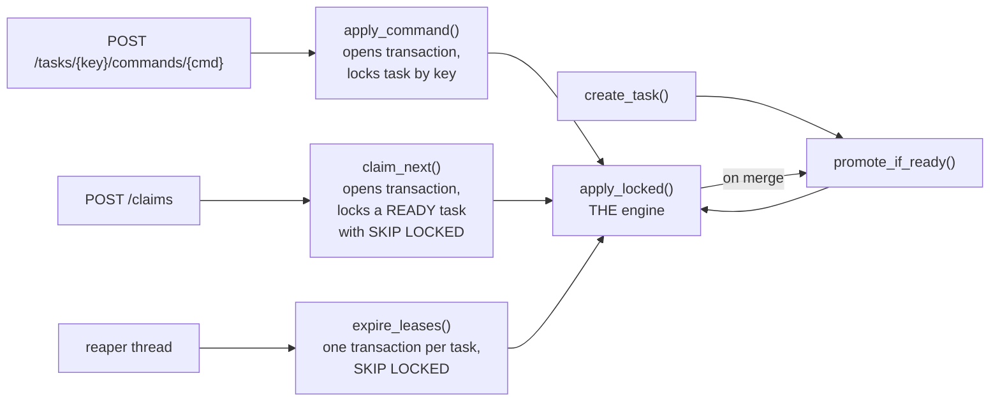
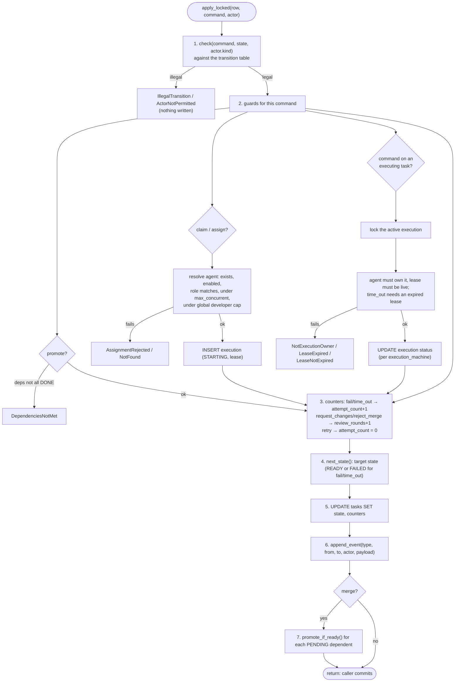
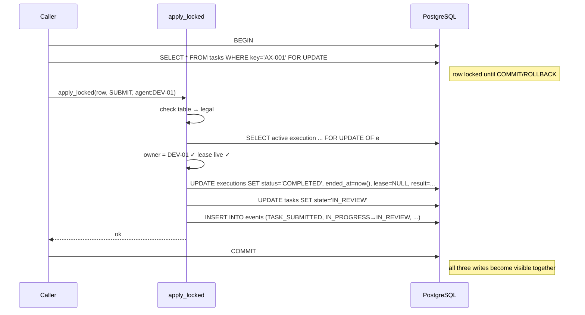
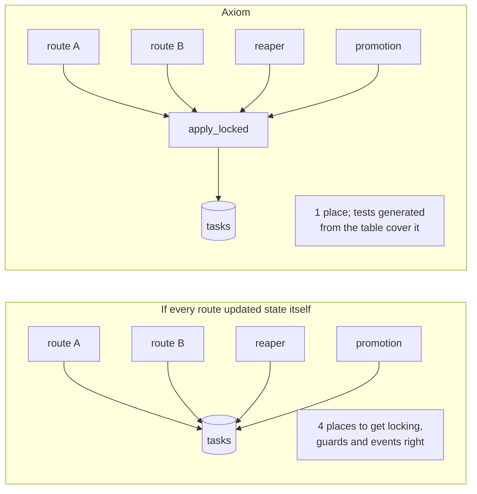

# 5. The command engine

There is exactly **one** function that changes the state of a task or an execution:
`apply_locked` in [`orchestrator/commands.py`](../../src/axiom/orchestrator/commands.py).
Every route, the reaper, `claim_next` and dependency promotion all go through it. If you
understand this function, you understand Axiom's core.

## Who calls it

The callers differ only in **how they find and lock the task row**. After that, they all
hand the locked row to `apply_locked`.

## What happens inside, step by step

Every arrow that ends in an error **raises an exception before anything is committed**. The
caller's `with conn.transaction():` block then rolls back, so a rejected command leaves no
trace: no state change, no execution row, no event.

## The transaction, as the database sees it

**Atomicity** is the key property: the three writes (execution, task, event) become visible
together or not at all. A test proves it by making `append_event` throw: the task stays READY
and no execution row appears (`test_event_write_failure_rolls_back_the_transition`).

## Why "one function" matters so much

Because there is a single path, "every transition writes an event" is true by construction.
It doesn't depend on remembering to do it in each feature.

## Side effects per command

| Command | Execution side effect | Task counters | Other |
|---|---|---|---|
| `claim`, `assign` | create (STARTING, lease) | — | capacity checks |
| `start` | STARTING → RUNNING, lease renewed | — | |
| `submit` | RUNNING → COMPLETED, `result` stored | — | |
| `ask_human` | RUNNING → COMPLETED, question stored | — | |
| `fail` | → FAILED, `error` stored | `attempt_count + 1` | target READY or FAILED |
| `time_out` | → TIMED_OUT, `error = "lease expired"` | `attempt_count + 1` | target READY or FAILED |
| `request_changes`, `reject_merge` | — | `review_rounds + 1` | findings in event payload |
| `retry` | — | `attempt_count = 0` | |
| `cancel` | active one → CANCELLED | — | |
| `merge` | — | — | promote dependents |
| `promote`, `answer`, `approve` | — | — | |

## Try it

1. Open `orchestrator/commands.py` and find each numbered step of the flowchart in
   `apply_locked`.
2. Set a breakpoint (or add a `print`) in `apply_locked`, run
   `uv run pytest tests/integration/test_tasks.py::test_full_happy_path_event_history -s`,
   and watch it get called once per transition.
3. Read `test_event_write_failure_rolls_back_the_transition` in
   `tests/integration/test_transitions.py`. It is eight lines and proves atomicity.
