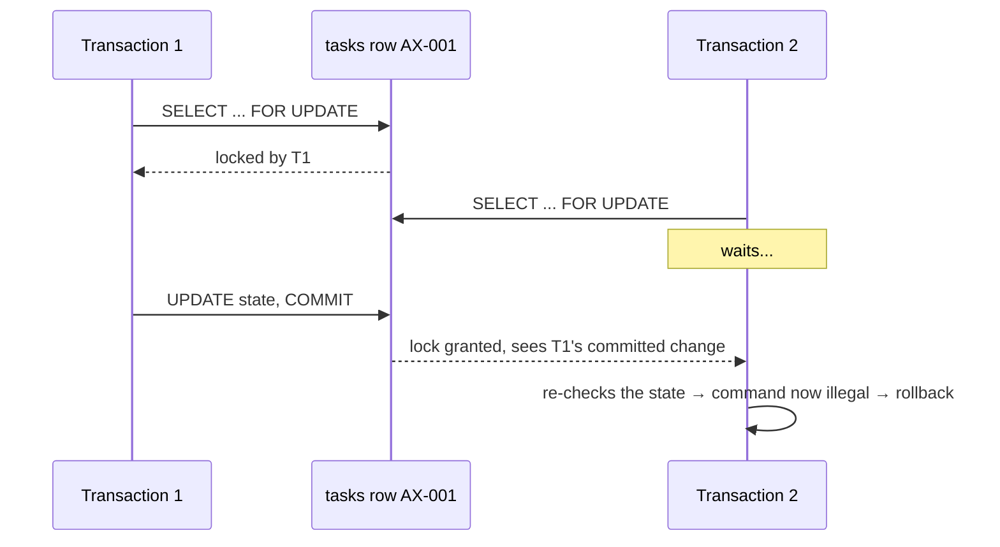
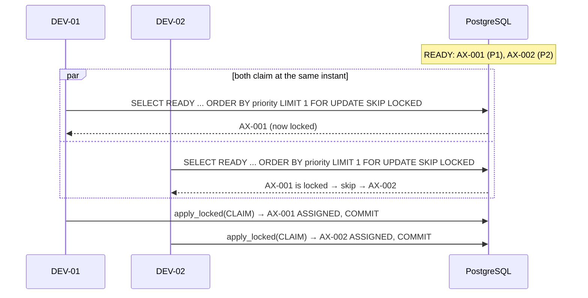
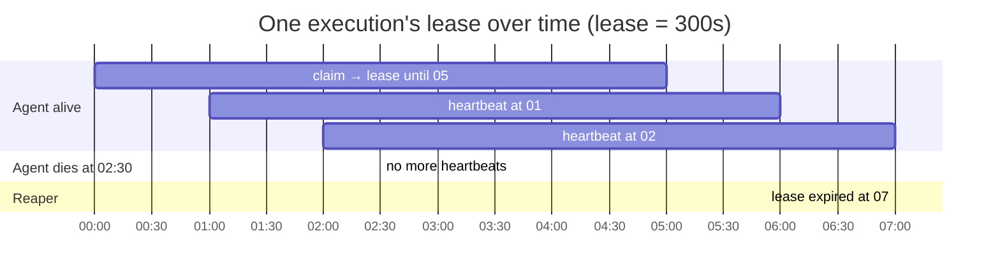
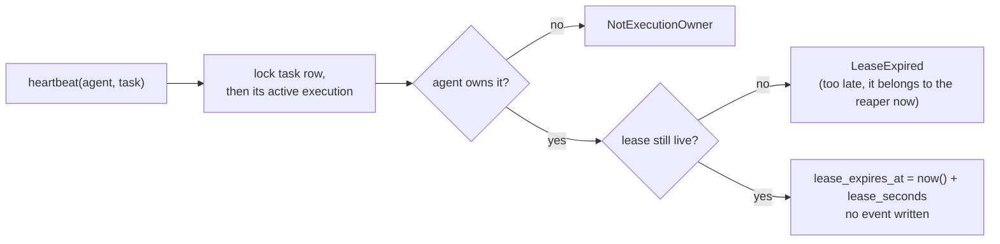
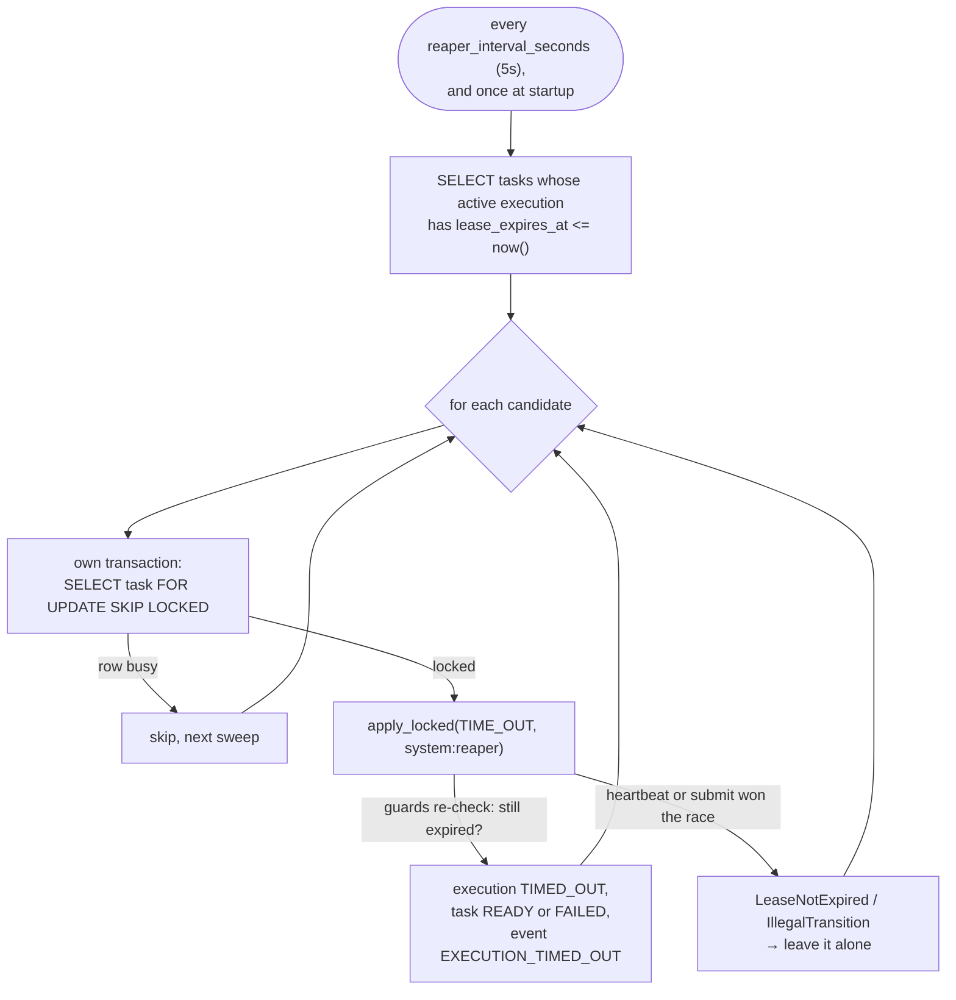
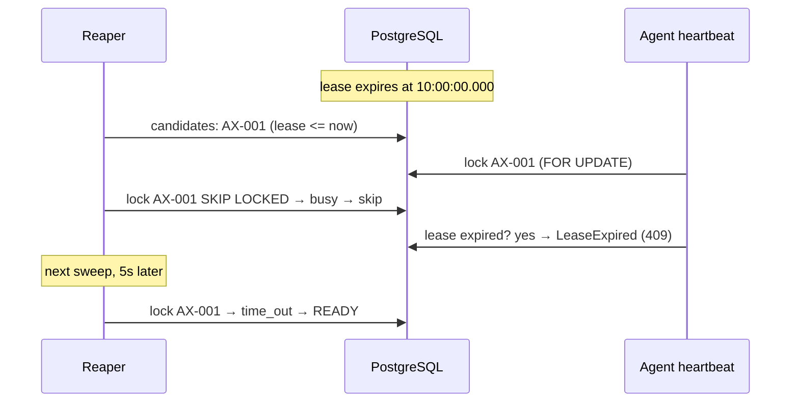
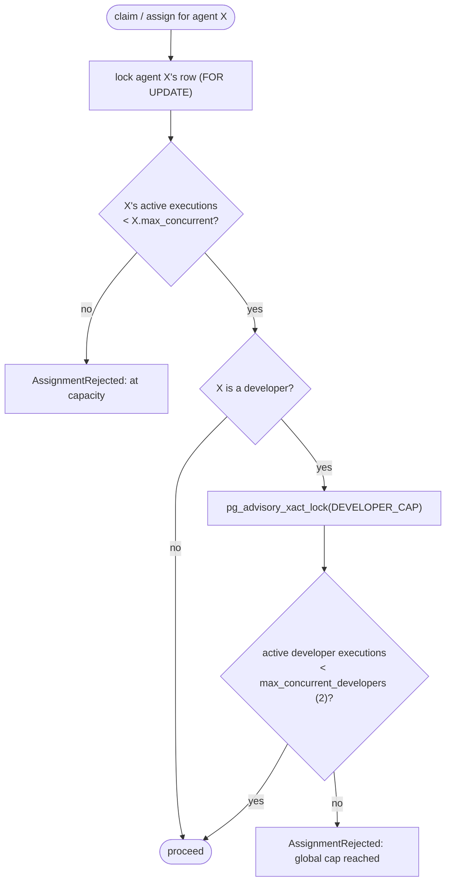
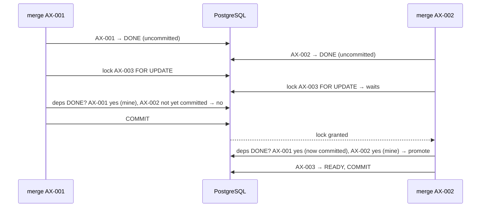
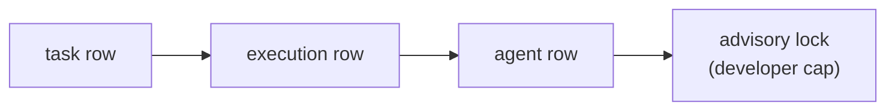

# 6. Concurrency, leases and the reaper

Several workers run at once. They race to claim work, and sometimes crash
halfway through. This chapter explains the three mechanisms that keep that safe:

- **row locks**: two agents never act on the same task at the same time;
- **leases**: a crashed agent's task comes back;
- **capacity caps**: no more agents run than you are paying for.

## Row locks in 60 seconds

`SELECT … FOR UPDATE` locks the selected rows until the transaction ends. Any other
transaction that tries to lock the same row **waits**.

This is why every command locks the task row first. Whoever gets there second sees the new
state and is rejected cleanly if its command no longer makes sense.

## Claiming work: `FOR UPDATE SKIP LOCKED`

When agents ask for "the next READY task", waiting is the wrong behaviour. Ten agents would
queue up behind the same row. `SKIP LOCKED` tells Postgres: *if the row is locked by someone
else, pretend it isn't there and give me the next one.*

The test `test_ten_agents_racing_for_three_tasks_never_double_claim` releases 10 threads at
once (with a barrier) against 3 tasks. It checks that each task was claimed exactly once and
7 agents got nothing. It runs 3 times per test session.

## Leases: detecting dead workers

An agent can die at any moment: a crash, an OOM kill, a lost network. Axiom cannot "notice" a
death directly. Instead every active execution holds a **lease**, a deadline the agent must
keep pushing forward.

Two details matter here:

- **The database clock is the only clock.** Every comparison is `lease_expires_at <= now()`
  inside Postgres. If the API server's clock drifted, nothing would break.
- **Heartbeats are not events.** They are not state changes, and logging one every minute per
  agent would drown the event log.

## The reaper

The candidate query runs **without** locks, so by the time the reaper locks a row the agent
may have renewed the lease or finished. That's fine: `apply_locked` re-checks the guard
(`time_out` requires an expired lease) under the lock. **"Check, then act" is only safe
when the check is repeated under the lock.**

### The race between the reaper and a heartbeat

Whichever side gets the lock first wins, and the other side sees a consistent state. A late
heartbeat cannot "resurrect" an expired lease, because the guard rejects it.

## Capacity caps

Why the locks? Without them, two developers could both count "1 active" at the same moment and
both proceed, giving 3 when the cap is 2. Locking the agent row serializes claims by the same
agent. The advisory lock (a named lock that isn't tied to any row) serializes all developer
claims, so the count-then-insert is effectively atomic. Test:
`test_global_developer_cap_holds_under_contention` (5 developers racing, exactly 2 win).

## Dependency promotion under concurrency

The subtle case: AX-003 depends on AX-001 and AX-002, and **both are merged at the same
instant** by two transactions.

Without the lock on AX-003, each transaction could see the other's merge as "not yet done",
and AX-003 would stay PENDING forever. The test runs this race 5 times
(`test_concurrent_merges_of_two_dependencies_promote_dependent`).

## Lock order: how deadlocks are avoided

A deadlock happens when T1 holds A and waits for B while T2 holds B and waits for A. Axiom
avoids it by always taking locks in the same order:

## Try it

1. Watch a lease expire for real: `uv run pytest tests/integration/test_leases.py::test_lease_expires_on_the_real_clock -v`.
2. By hand: claim a task with `{"lease_seconds": 20}` on `POST /claims`, start it, then do
   nothing. Within about 25s, `GET /tasks/{key}/events` shows `EXECUTION_TIMED_OUT` by
   `system:reaper`.
3. Run the race tests a few times in a row; they should never flake:
   `for i in 1 2 3 4 5; do uv run pytest tests/integration/test_leases.py -q -k "racing or contention or concurrently"; done`
4. To see why the locks matter, comment out the `pg_advisory_xact_lock` line in
   `_resolve_assignee` and rerun `test_global_developer_cap_holds_under_contention` a few
   times. It should start failing intermittently. Then restore the line.
