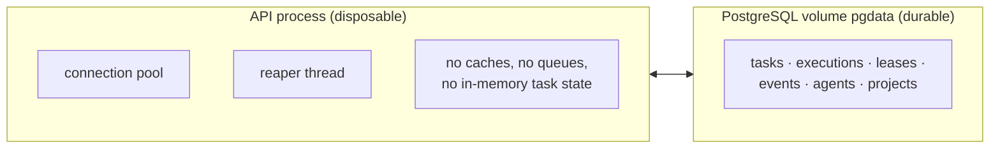
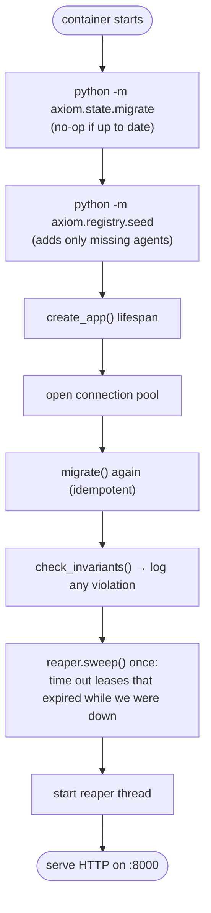
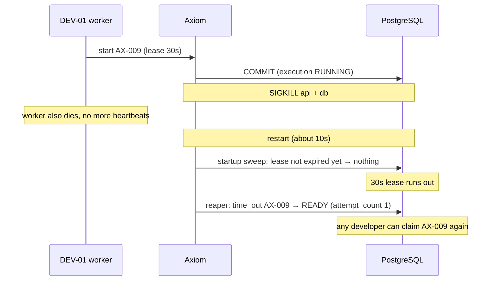
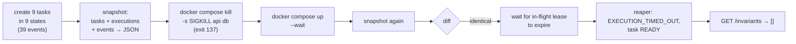

# 7. Crash recovery

The goal, from the spec: *"Axiom must recover from a restart without relying on any agent's
conversation history."* Phase 1 meets it by keeping **nothing important in memory**.

## Where state lives

Killing the process loses the pool and the thread, and both are rebuilt at startup.

Killing Postgres is safe as well. Postgres writes every commit to its write-ahead log on disk
before it acknowledges it. So anything Axiom was told "committed" survives a SIGKILL, and
anything not committed was never visible.

## What happens at startup

The **startup sweep** is the recovery step. If a worker died while Axiom was down, its lease
has expired, and the task goes back to READY straight away. It does not wait for the first
5-second tick.

## What happens to work in flight

If the worker had survived the outage, its next heartbeat would succeed (as long as the lease
had not expired), and it would carry on as if nothing happened.

## The demo, as a timeline

`make demo-restart` ([scripts/demo_restart.sh](../../scripts/demo_restart.sh)) proves all of
this against real containers:

The same guarantee is tested without Docker in `tests/integration/test_restart.py`. That test
builds the app, drives tasks, tears everything down, builds a new app, and compares.

## Try it

1. `make demo-restart` and read the output top to bottom.
2. While a task is IN_PROGRESS, run `docker compose restart api`. Then call `heartbeat` as the
   owning agent: it still works, because the lease lives in the database, not in the process.
3. `docker compose down` (without `-v`) and then `up` again: all state is still there.
   `down -v` deletes the volume and therefore everything.
