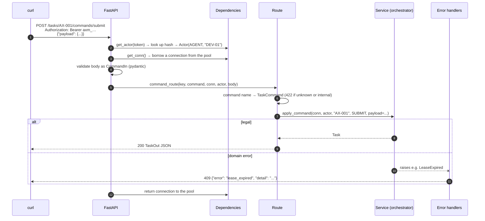
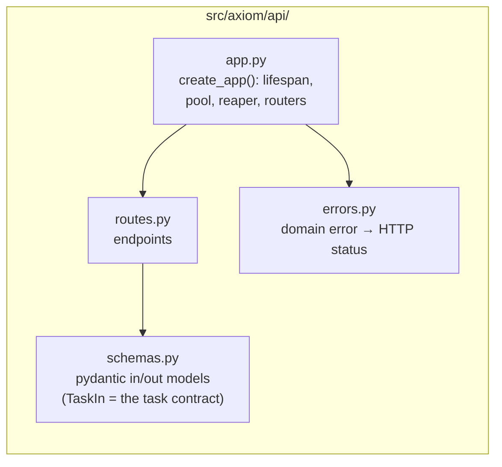
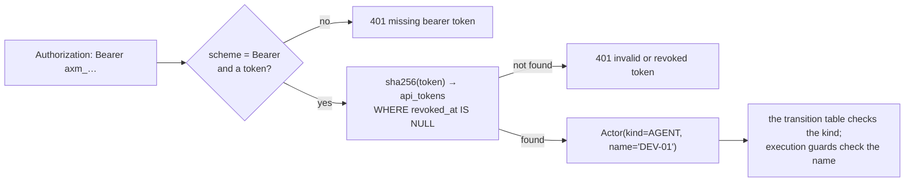
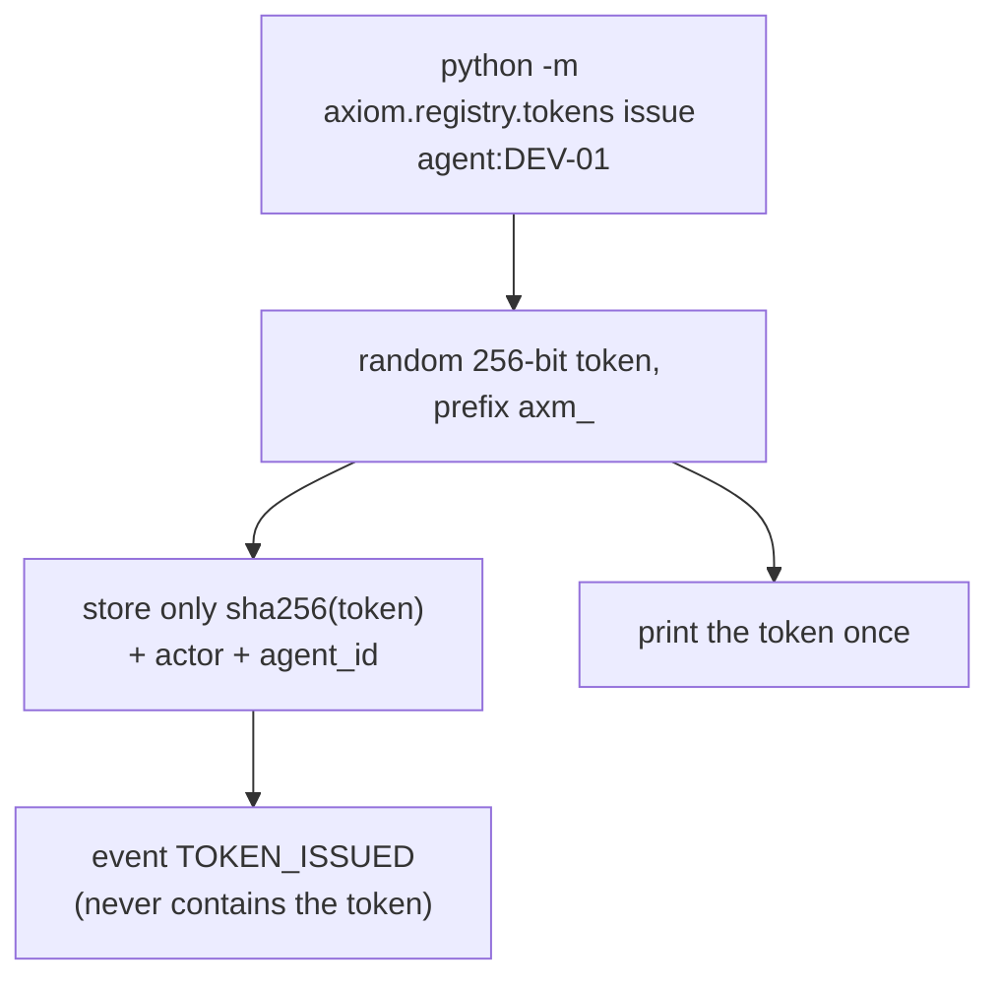
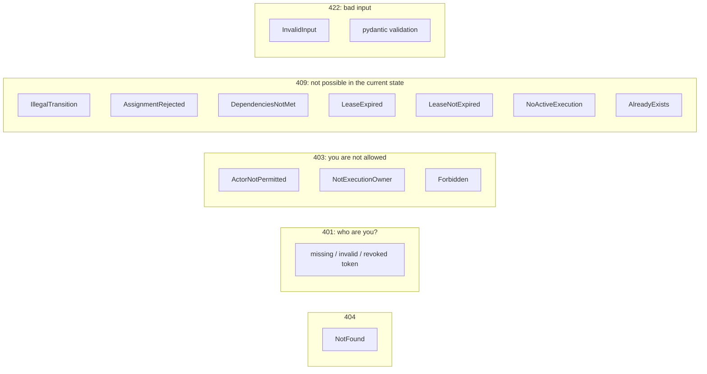

# 8. The API layer

The REST API is deliberately **thin**. Routes parse the request, call one service function and
serialize the result. No business rule lives in [`api/`](../../src/axiom/api/).

## The path of one request



## Where things live



## Authentication: the actor comes from the token

Every route except `/healthz` requires `Authorization: Bearer <token>`. The token is looked up
(by its SHA-256 hash) in `api_tokens`, and the row says who it belongs to:





Three rules matter here:
- **Clients cannot choose their actor.** A request is DEV-01 because it carries DEV-01's token.
  A test sends a spoofed `X-Axiom-Actor: human:…` header next to an agent token and checks it
  is ignored.
- **`system:` actors cannot hold tokens.** `promote` and `time_out` only ever come from inside
  the control plane, so they are not exposed over HTTP at all.
- **Agents cannot change the registry** (projects, agents, enable/disable): 403.

(Phase 1 trusted an `X-Axiom-Actor` header instead; tokens replaced it at the start of Phase 2.)

## Error mapping

Domain code raises typed exceptions (`axiom/errors.py` and `domain/task_machine.py`). Exactly
one module, `api/errors.py`, turns them into HTTP responses:



The error code in the body is derived from the class name (`IllegalTransition` →
`illegal_transition`). An illegal transition also says what *would* be legal:

```json
{
  "error": "illegal_transition",
  "detail": "cannot merge a task in READY; allowed: claim, assign, cancel",
  "state": "READY",
  "command": "merge",
  "allowed": ["claim", "assign", "cancel"]
}
```

## Endpoint map

```mermaid
flowchart TB
    root(("API"))
    root --> ops["ops"]
    ops --> hz["GET /healthz"]
    ops --> iv["GET /invariants"]
    root --> pj["projects"]
    pj --> p1["POST /projects"]
    pj --> p2["GET /projects, /projects/{key}"]
    pj --> p3["POST /projects/{key}/require-ci"]
    root --> ag["agents"]
    ag --> a1["POST /agents"]
    ag --> a2["GET /agents?role=&enabled="]
    ag --> a3["POST /agents/{key}/enable | disable | model"]
    root --> tk["tasks"]
    tk --> t1["POST /projects/{key}/tasks"]
    tk --> t2["GET /tasks?project=&state=, /tasks/{key}"]
    tk --> t3["POST /tasks/{key}/commands/{command}"]
    tk --> t4["POST /claims"]
    tk --> t5["POST /tasks/{key}/heartbeat"]
    tk --> t6["GET /tasks/{key}/executions"]
    tk --> t7["POST /tasks/{key}/budget"]
    root --> rv["reviews"]
    rv --> r1["POST /reviews/claim"]
    rv --> r2["POST /reviews/{id}/heartbeat | submit | fail"]
    rv --> r3["GET /tasks/{key}/reviews"]
    root --> ev["events"]
    ev --> e1["GET /tasks/{key}/events"]
    ev --> e2["GET /events?after_id=&limit="]
```



Full reference: [api.md](../api.md). Interactive: <http://127.0.0.1:8000/docs>.

## Sync code in an async framework

FastAPI is async, but Axiom's routes are plain `def` functions using a **synchronous** psycopg
pool. FastAPI runs `def` routes in a thread pool, so a slow query blocks only its own thread.
That kept the code simple: no `async`/`await` around every database call, and locking
behaviour that is easy to read. At Axiom's scale (a handful of agents), that is the right
trade-off.

## Try it

1. Open <http://127.0.0.1:8000/docs>, expand `POST /tasks/{key}/commands/{command}`, and send
   an illegal command. Read the 409 body.
2. Send a request without a token, then with a made-up `Bearer axm_nope`. Both should be 401.
3. Find `STATUS` in `api/errors.py`. Add a new error class to `axiom/errors.py` without
   mapping it, and work out what FastAPI would return. (Answer: 500, which is why every domain
   error must be listed.)
