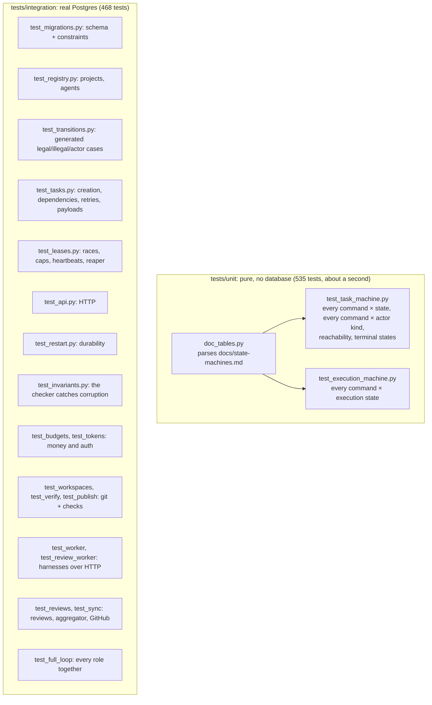
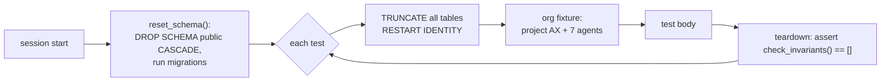
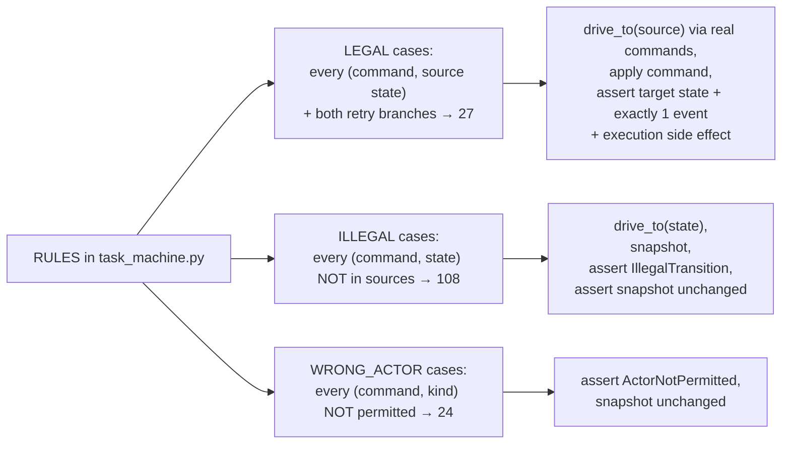
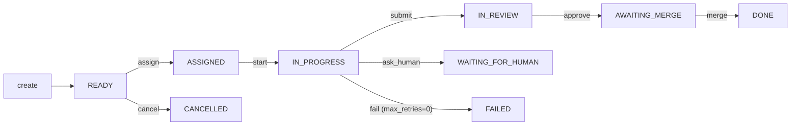
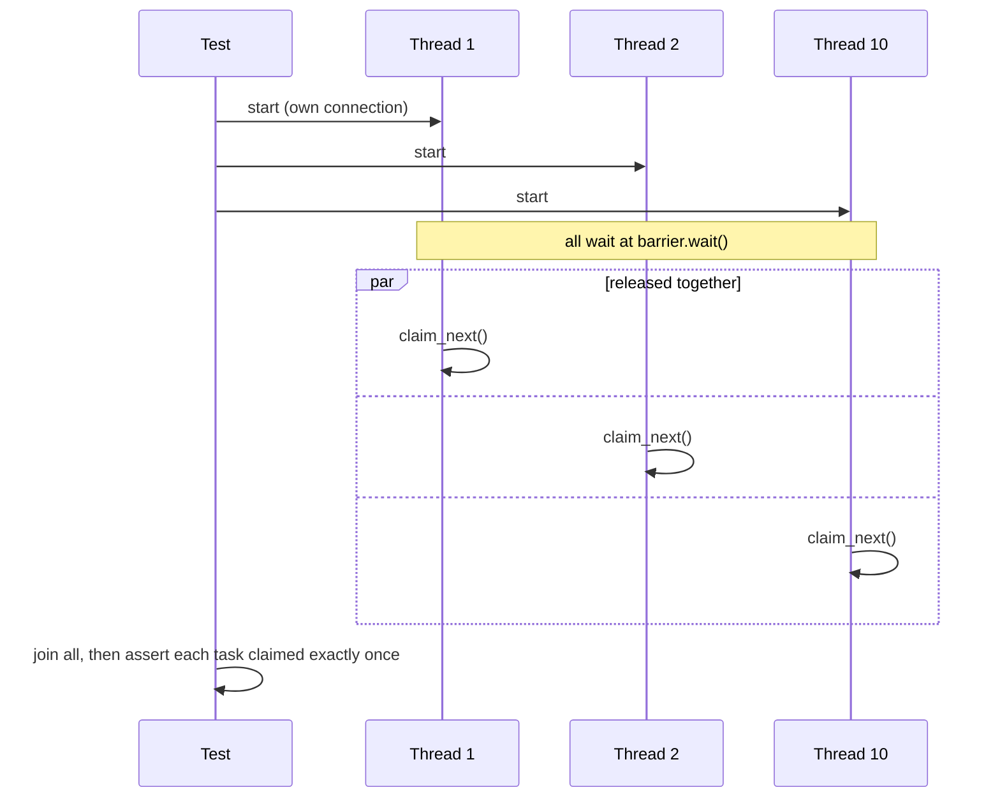
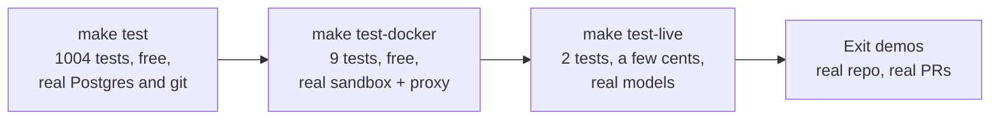

# 9. How it is tested

1004 tests run in about 90 seconds against a real PostgreSQL, plus 9 Docker tests against the real
sandbox image and 2 live tests that call the real API. This chapter explains how they
are organized, and the three techniques that give confidence beyond "the happy path works".

## The shape of the suite



**Why a real database and no mocks?** The things most likely to be wrong are exactly what a
mock would fake away: `SKIP LOCKED`, row locks, constraints, transaction rollback. The tests
use a separate `axiom_test` database inside the same compose Postgres.

## Fixtures: a clean world for every test



The teardown step means **every integration test is also an invariant test**. If any code path
ever left a task ASSIGNED without an execution, or changed state without an event, the test
that triggered it would fail, even if its own assertions passed.

## Technique 1: tests generated from the transition table

Writing tests by hand for every (command, state) pair would mean 150 tests to keep in sync.
Instead the tests **read the table** and generate themselves:



`drive_to(state)` is the key helper. It reaches any state using **only real commands**, never
by writing `state = 'X'` into the database. So the setup itself exercises the engine:



Add a new rule to the table, and new legal and illegal tests appear automatically. A guard
test (`test_legal_cases_cover_every_rule`) fails if a rule has no legal test.

## Technique 2: the documentation is tested

`tests/unit/doc_tables.py` parses the transition tables in
[docs/state-machines.md](../state-machines.md). The unit tests assert the code matches them,
row by row. The doc you read is guaranteed to describe the code you run.

## Technique 3: race tests

Concurrency bugs don't show up in sequential tests. The race tests start real threads, each
with its own database connection, and release them at the same instant with a
`threading.Barrier`:



Race tests in the suite:
- 10 agents vs 3 tasks;
- 5 developers vs the global cap of 2;
- the same agent claiming twice at once;
- two dependencies merged at once.

Each runs several rounds.

## Testing the tester

An invariant checker that never fires proves nothing. `test_invariants.py` deliberately
corrupts the database: it changes a state without an event, removes an execution, and pushes
an agent over capacity. It then asserts that `check_invariants` reports each problem.

## Beyond the default suite



Each step out found bugs the step before could not: see the list in
[chapter 14](14-how-it-was-built.md#what-went-wrong).

## Commands

```bash
make test                                    # everything (starts Postgres if needed)
uv run pytest tests/unit -q                  # pure tests only, under 1 second
uv run pytest tests/integration/test_leases.py -v
uv run pytest -k "illegal and merge" -v      # e.g. every illegal 'merge' case
make lint                                    # ruff + mypy --strict
```

## Try it

1. `uv run pytest --collect-only -q | grep "test_illegal_transition_rejected" | head` shows the
   generated case IDs, such as `merge-READY`.
2. Introduce a bug: in `apply_locked`, skip `append_event` when `command == TaskCommand.APPROVE`.
   Run `make test` and see how many different tests catch it, including the invariant teardown
   in unrelated tests. Then revert.
3. Write one new test yourself. Assert that a task in WAITING_FOR_HUMAN cannot be claimed.
   (Hint: `drive_to(org, TaskState.WAITING_FOR_HUMAN)` then `claim_next(org, DEV1) is None`.)
