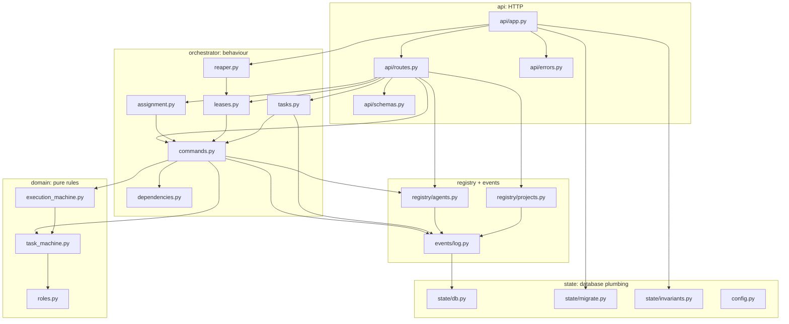
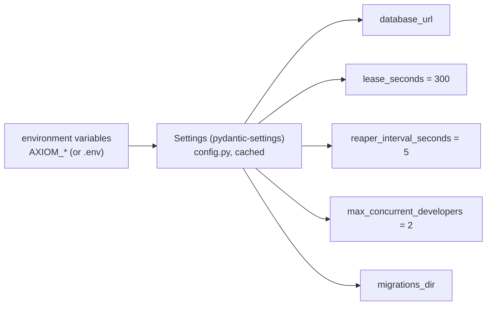
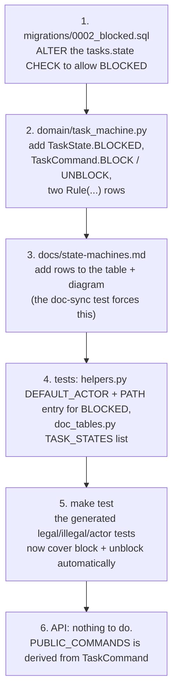
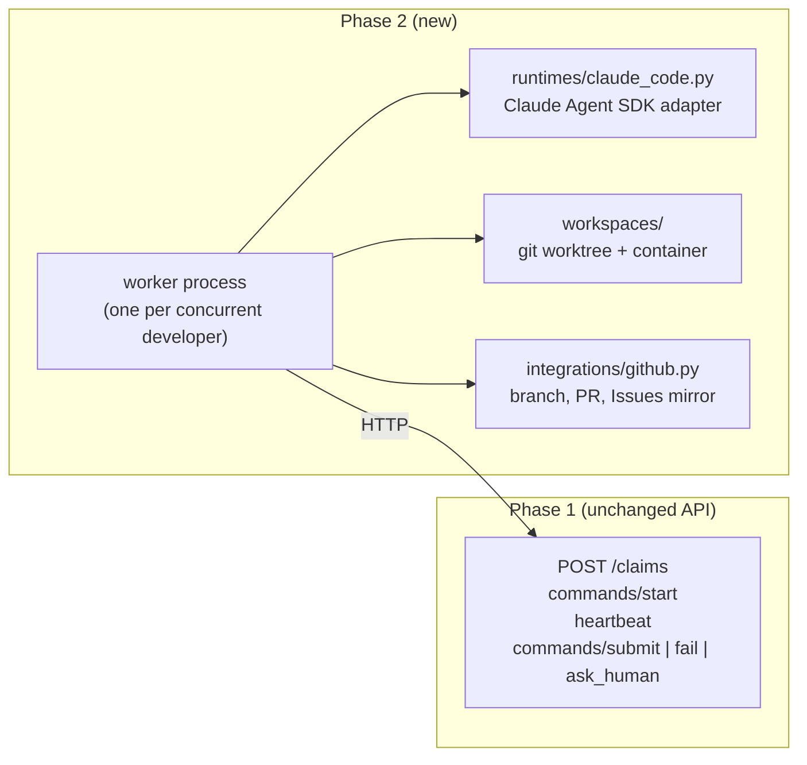

# 10. Code tour and how to extend it

About 2,000 lines of Python in `src/axiom/`. This chapter maps them and walks through a real
change.

## Module dependencies

The arrows point from a module to what it imports. The layering is strict: `domain` imports
nothing from Axiom, and nothing imports `api` except the app.

## File by file

| File | Lines (approx.) | Read it for |
|---|---|---|
| `domain/task_machine.py` | 190 | The rules. Start here. |
| `domain/execution_machine.py` | 50 | How executions follow tasks |
| `orchestrator/commands.py` | 280 | **The engine**: `apply_locked`, guards, side effects, capacity |
| `orchestrator/assignment.py` | 40 | `SKIP LOCKED` claiming |
| `orchestrator/leases.py` | 100 | Heartbeats and the reaper sweep |
| `orchestrator/tasks.py` | 190 | Task creation, keys, dependency validation |
| `state/invariants.py` | 115 | What "healthy" means |
| `migrations/0001_init.sql` | 110 | The schema and its constraints |
| `api/routes.py` | 230 | Endpoints (thin) |
| `api/app.py` | 70 | Startup and shutdown |

## Configuration

In docker compose these are set in `docker-compose.yml`. For tests, `test_database_url`
points at `axiom_test`.

## Worked example: adding a new command

Suppose Phase 3 needs a command `block` that a human uses to park a READY task (state
BLOCKED) and `unblock` to release it. These are the steps, in order:

You did not need to touch `apply_locked`, because these commands have no side effects beyond
the state change. Note the cancel rule: `NON_TERMINAL_STATES` is computed, so BLOCKED is
automatically cancellable.

## Where Phase 2 plugs in

The worker is just another API client, doing exactly what you did by hand with curl. The
control plane doesn't need to change for Phase 2 to work, apart from adding authentication and
recording cost.

## Exercises

1. **Read path:** starting from `POST /claims` in `routes.py`, follow the call chain to the
   `INSERT INTO executions`. Write down every lock taken, in order.
2. **New invariant:** add a check to `invariants.py` that every DONE task has at least one
   COMPLETED execution. Add a corruption test for it in `test_invariants.py`.
3. **New endpoint:** add `GET /agents/{key}/executions` listing an agent's executions. It is a
   read-only route, so it does not touch the engine.
4. **Thought experiment:** what would break if `expire_leases` locked with plain `FOR UPDATE`
   instead of `SKIP LOCKED`? (Hint: who would it wait for, and what happens to the other
   expired tasks meanwhile?)
