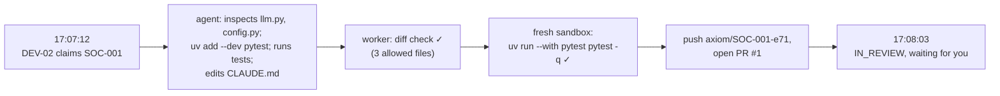
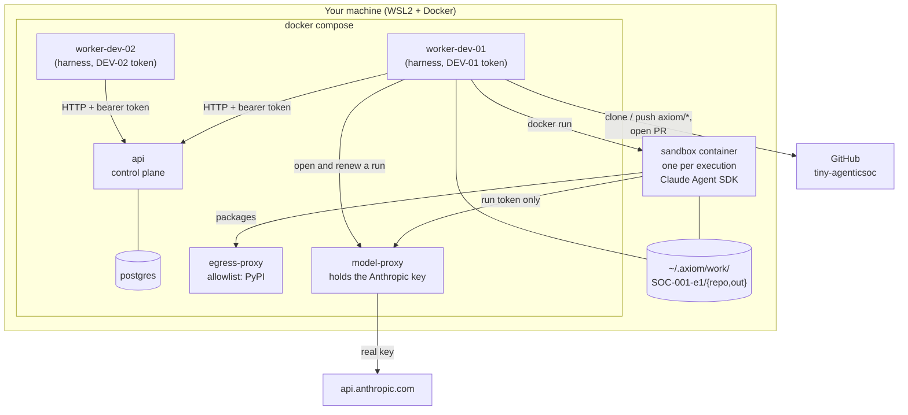
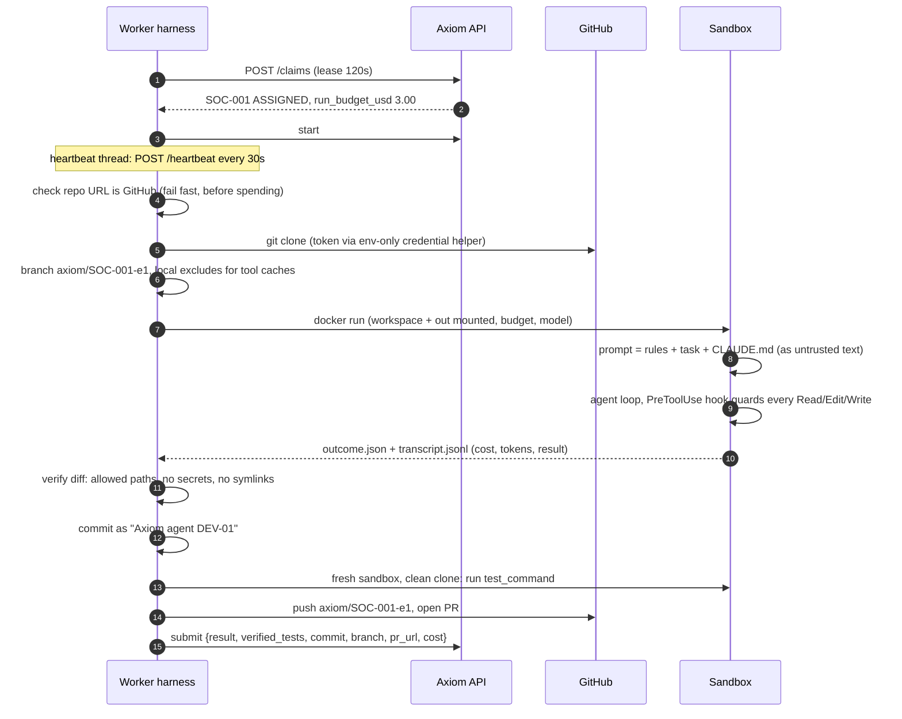
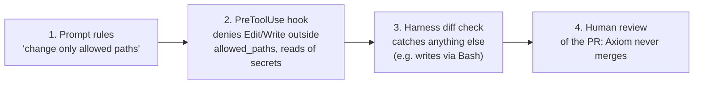
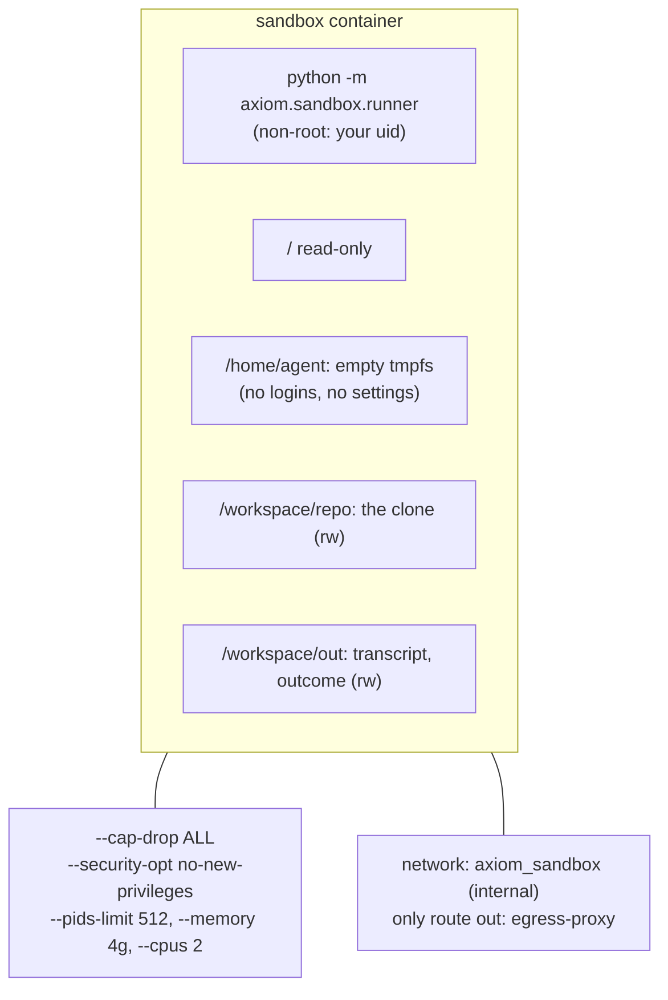
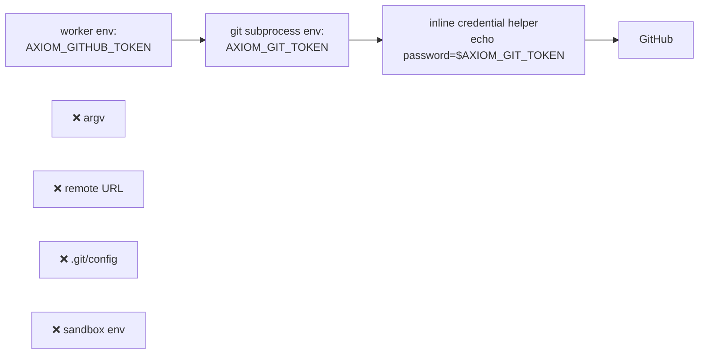
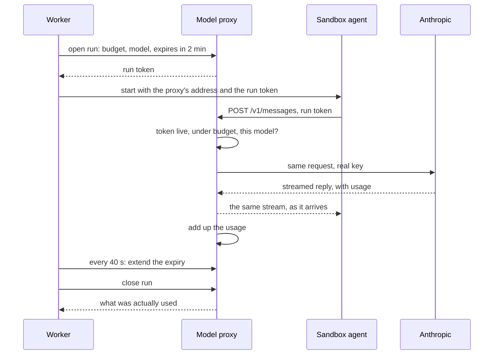
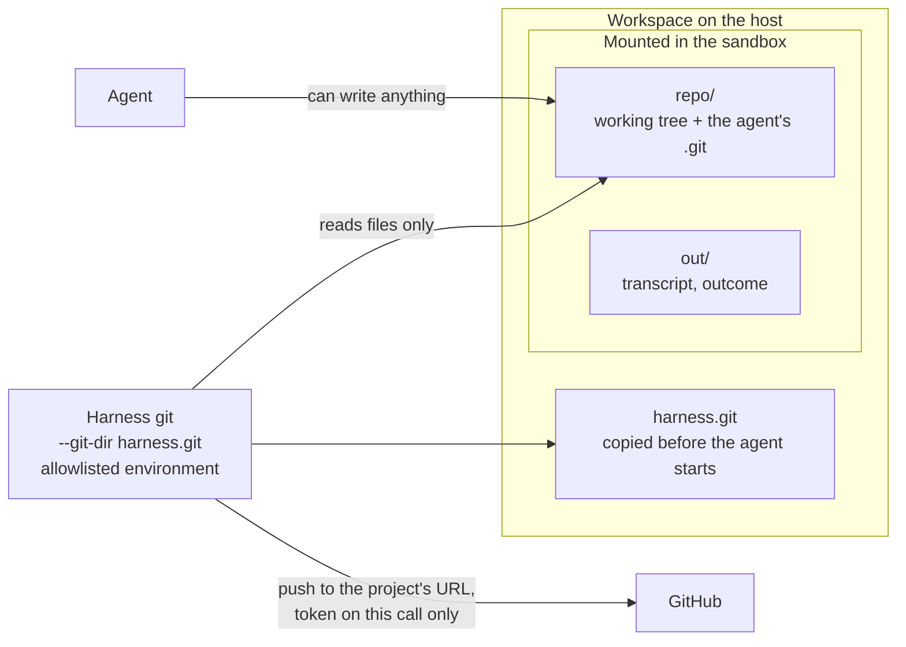
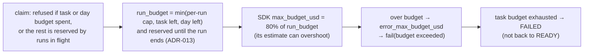

# 11. Workers, the sandbox and verification (Phase 2)

Phase 1 built the control plane, where you played every agent by hand with curl. Phase 2 adds
the first **real worker**: a process that claims a task, runs a Claude agent on it in an
isolated container, checks the result itself, and opens a pull request. You never touch it
between READY and the PR.

## The first real run

On 2026-11-03, task **SOC-001** ("make the agent test suite runnable and fix CLAUDE.md") went
from READY to [PR #1 on tiny-agenticsoc](https://github.com/bharathcmbox/tiny-agenticsoc/pull/1)
in 51 seconds for $0.15, with no human input:



## The pieces



| Piece | Code | Trusted? | Holds |
|---|---|---|---|
| Worker harness | `src/axiom/worker/` | yes, deterministic code | DEV-xx API token, GitHub token |
| Sandbox | `src/axiom/sandbox/` + `docker/sandbox/` | **no**: an LLM driven by untrusted text | Anthropic API key only |
| Egress proxy | `docker/egress-proxy/` | yes (config only) | allowlist |

## One execution, step by step



Anything going wrong along the way becomes a `fail` with a reason, or `ask_human` if the agent
returns a question.

## Defence in depth: four layers between an agent and your repository



Each layer assumes the one before it can fail:
- **Layer 1** worked in the live test: the agent *declined* to touch `other.txt`.
- **Layer 2** was proven in the SDK spike: the edit was blocked and the agent was told why.
- **Layer 3** has tests for misbehaving fake agents: a file outside the allowed paths, a leaked
  key, a symlink.
- **Layer 4** is you.

## The sandbox, locked down



What the Docker tests prove (`make test-docker`):
- **Egress:** only PyPI is reachable through the proxy. `api.anthropic.com`, github.com and
  example.com are refused ("403 Filtered"). Direct connections fail (no DNS, no route).
- **Environment:** whatever the worker's own environment holds, the sandbox receives none of it. Its
  only credential is a run token from the model proxy.
- **Filesystem:** the container runs as the workspace owner, `/` is read-only, and HOME is empty.
- **Cancel and timeout:** both kill the container.

### Why the agent loads no settings from the repository

The SDK can load a repository's `.claude/settings.json`, which may contain permission rules and
hooks. A malicious or careless repository could use that to reconfigure the agent. The runner
therefore sets `setting_sources=[]` and passes `CLAUDE.md` inside the prompt, wrapped in
`<project_guidance>` tags and labelled untrusted.

## Keeping the GitHub token away from the LLM



The worker also ignores your `~/.gitconfig`. Your `gh` login installs a credential helper there
for github.com, which git would otherwise have used: your full-access login instead of the
scoped token. A test covers this.

Because the repository is private on GitHub's free plan, branch protection isn't available
(ADR-007). The "no push to main, no merge" guarantee therefore lives in `worker/publish.py`:
- it pushes only `HEAD:refs/heads/axiom/<TASK>-e<N>`, never with force (8 unsafe refs are
  tested and refused);
- the GitHub client has exactly two methods, `find_open_pr` and `create_pr`.

## How the agent reaches the model without the key

The agent is given a run token, which is useless anywhere but the model proxy. The proxy swaps in the
real key on the way out (ADR-015).



| If the agent... | What happens |
|---|---|
| runs `env` looking for a key | It finds only the run token |
| sends the token elsewhere | It's useless there, and the sandbox can't reach other hosts anyway |
| asks for another model, or `/v1/files` | Refused (403) |
| reports its cost as $0 | Ignored: the proxy's count is the record |
| spends its whole budget | Refused; the run fails as `budget exceeded` |
| outlives a killed worker | Renewal stops, and its token dies within 2 minutes |

Tests: `test_the_real_key_is_swapped_in_and_the_run_token_stays_behind`,
`test_a_forged_cost_is_ignored`, `test_a_token_stops_working_when_it_expires`,
`test_only_the_messages_endpoints_are_forwarded`, `test_a_stream_is_not_buffered`,
`test_sandbox_receives_no_credentials_at_all`.

## The harness doesn't trust what the sandbox leaves behind

Keeping credentials out of the sandbox isn't enough if the harness then acts on what the sandbox
wrote. The checkout's `.git` is one such thing: git runs what its config says. So the harness keeps
its own copy (ADR-014). Found while preparing the Phase 4 drill; before this, a compromised agent
could reach every credential the worker holds.



Tests: `test_nothing_planted_in_git_config_runs_in_the_harness`,
`test_a_planted_url_rewrite_cannot_redirect_the_push_or_the_token`,
`test_a_nested_repository_is_refused_before_git_looks_at_it`,
`test_git_never_receives_the_workers_credentials`, and from the real sandbox,
`test_an_attack_planted_from_the_real_sandbox_does_not_reach_the_harness`.

## Budgets, end to end



## Verification: trust the worker, not the agent

The agent's report contains claims ("tests: 8 passed"). The worker:
1. stages every change and checks paths, secret files, symlinks and credential patterns in
   added lines;
2. commits;
3. clones that commit into a **clean** directory and runs the project's `test_command` in a
   **fresh sandbox with no credentials at all**.

Only if all three pass does anything get pushed. The PR body shows the agent's claims and the
verified result side by side.

## Running it

```bash
make up                 # api, db, egress-proxy
make worker-tokens      # once: agent tokens for DEV-01/02 into .env
make workers            # build sandbox image, start worker-dev-01/02
docker compose logs -f worker-dev-01
make workers-down
```

Useful environment variables: `AXIOM_PROJECT_KEY` (only claim one project),
`AXIOM_KEEP_WORKSPACES=1` (keep `~/.axiom/work/<TASK>-e<N>/` with `out/transcript.jsonl` for
inspection), `AXIOM_FAKE_SCENARIO=success` (a fake agent inside the real sandbox; no API cost).

## Try it

1. Run `make test-docker` and read `tests/docker/test_sandbox_container.py` while it runs.
2. Find the four defence layers in code: `sandbox/prompt.py` RULES, `sandbox/hooks.py`
   `decide`, `worker/verify.py` `check_changes`, and the PR on GitHub.
3. Read a transcript: `~/.axiom/work/SOC-001-e*/out/transcript.jsonl` has one JSON line per SDK
   message. Find the tool calls, and the final `ResultMessage` with `total_cost_usd`.
4. Thought experiment: the task text says "also delete README.md". Which layer stops it, and
   what does the event log show?
