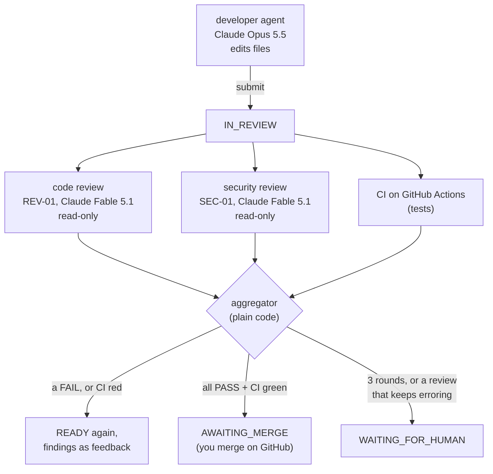
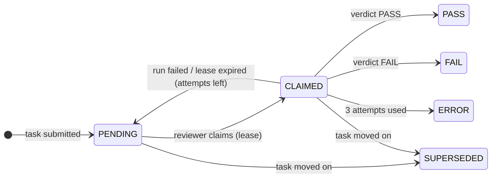
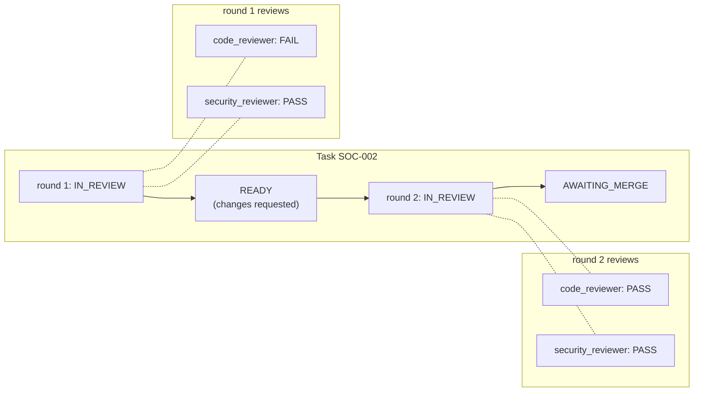

# 12. Independent review and the CI gate (Phase 3)

> This chapter grows with Phase 3. Each section was written in the same commit as the code it
> describes.

## The idea in one picture

In Phase 2, a developer agent's PR went to IN_REVIEW and waited for a human to `approve` it by
hand. Phase 3 puts an independent quality organization in that gap:

Three principles, each enforced in code rather than by a prompt:

1. **Nobody approves their own work.** Reviewers are separate agents with a separate role, on
   a different model. No agent can issue `approve` or `request_changes`.
2. **A model gives an opinion; code makes the decision.** Reviewers return a verdict and
   findings. The *aggregator* (deterministic code) combines the reviews and CI into one task
   transition.
3. **Trust CI, not claims.** The developer's "tests pass" is a claim; the CI result on GitHub
   is evidence, and it is part of the gate.

## Reviews are their own kind of work (T2)

A review is not another execution of the task. It has its own table (`reviews`) and its own
state machine:

Why a separate table, rather than reusing executions:
- A task has **one** developer execution at a time; it has **two** reviews at once (code and
  security). Keeping them apart preserves the Phase 1 invariant "a task is executing iff it has
  exactly one active execution".
- Each review **round** gets fresh reviews. A unique key `(task, round, role)` makes "one code
  review per round" a database guarantee.
- Reviews have their own cost, tokens and contract, so metrics like "cost of review per merged
  task" fall straight out of the table.

### How reviews relate to the task

Review events (REVIEW_CLAIMED, REVIEW_SUBMITTED, …) carry a `review_id` and leave the task's
`from_state`/`to_state` empty. Only the aggregator's task commands move the task, so the
event-log replay check from Phase 1 still holds.

### What changed in the task machine

| Command | Before Phase 3 | Now |
|---|---|---|
| `approve` | agent or human | **system (aggregator)** or human override |
| `request_changes` | agent or human | **system (aggregator)** or human override |
| `escalate` *(new)* | — | system: IN_REVIEW → WAITING_FOR_HUMAN when the round cap is hit or a review cannot complete |

The generated tests from chapter 9 picked this up automatically. Agent `approve` and agent
`request_changes` are now in the "wrong actor" cases, and `escalate` got its legal and
illegal cases without any test being written by hand.

## Try it (so far)

1. `uv run pytest tests/unit/test_review_machine.py -v`: every review command × state, checked
   against the table in `docs/state-machines.md`.
2. `uv run pytest -k "wrong_actor and approve" -v`: an agent trying to approve is rejected.
