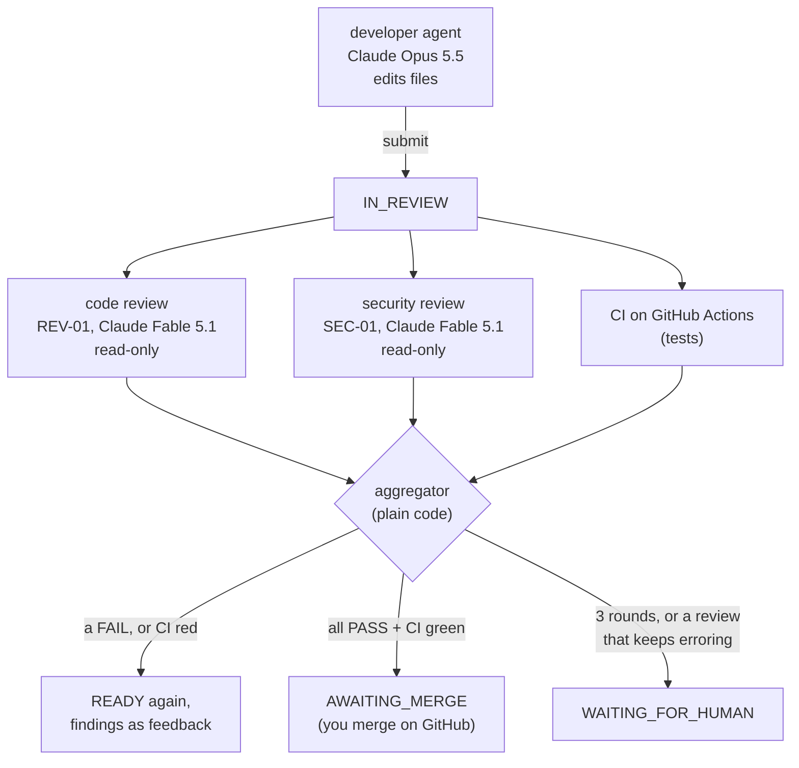
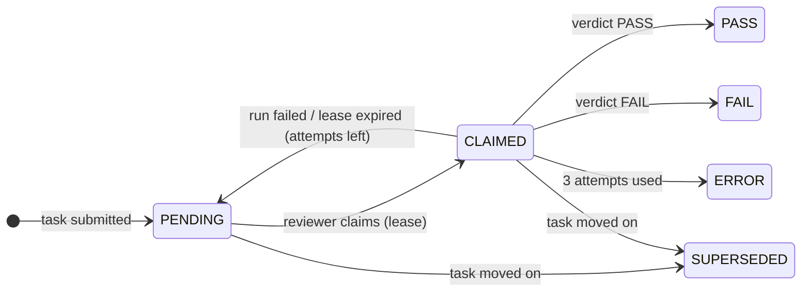
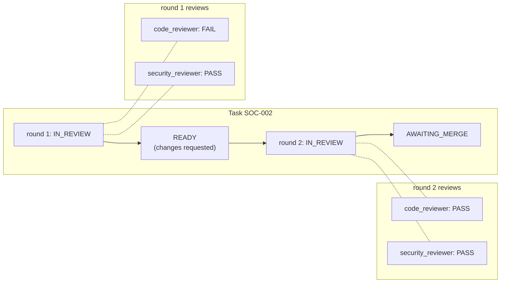
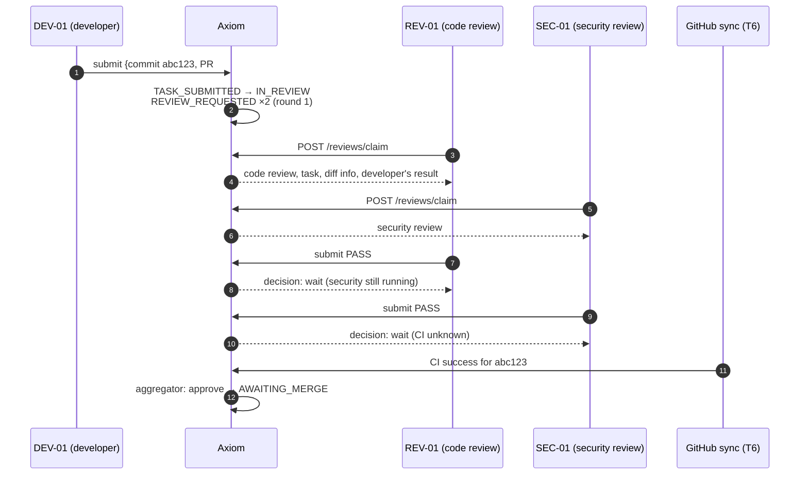
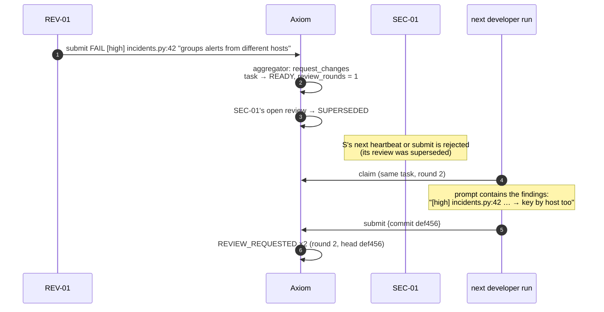
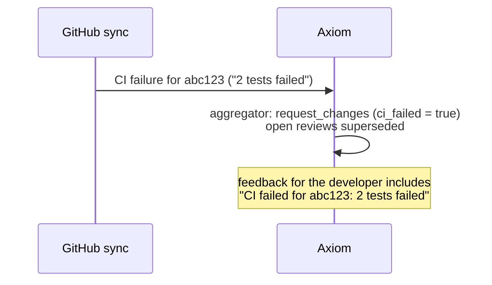
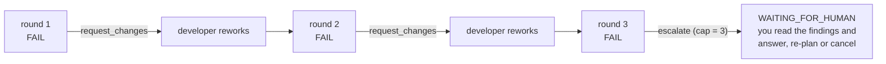
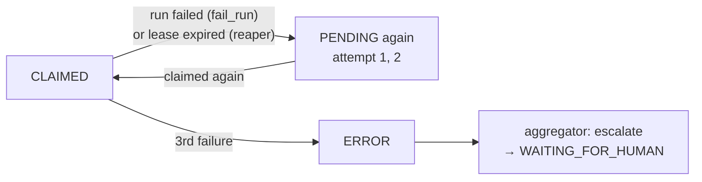

# 12. Independent review and the CI gate (Phase 3)

> This chapter grows with Phase 3. Each section was written in the same commit as the code it
> describes.

## The idea in one picture

In Phase 2, a developer agent's PR went to IN_REVIEW and waited for a human to `approve` it by
hand. Phase 3 puts an independent quality organization in that gap:



Three principles, each enforced in code rather than by a prompt:

1. **Nobody approves their own work.** Reviewers are separate agents with a separate role, on
   a different model. No agent can issue `approve` or `request_changes`.
2. **A model gives an opinion; code makes the decision.** Reviewers return a verdict and
   findings. The *aggregator* (deterministic code) combines the reviews and CI into one task
   transition.
3. **Trust CI, not claims.** The developer's "tests pass" is a claim; the CI result on GitHub
   is evidence, and it is part of the gate.

## Reviews are their own kind of work (T2)

A review is not another execution of the task. It has its own table (`reviews`) and its own
state machine:



Why a separate table, rather than reusing executions:
- A task has **one** developer execution at a time; it has **two** reviews at once (code and
  security). Keeping them apart preserves the Phase 1 invariant "a task is executing iff it has
  exactly one active execution".
- Each review **round** gets fresh reviews. A unique key `(task, round, role)` makes "one code
  review per round" a database guarantee.
- Reviews have their own cost, tokens and contract, so metrics like "cost of review per merged
  task" fall straight out of the table.

### How reviews relate to the task



Review events (REVIEW_CLAIMED, REVIEW_SUBMITTED, …) carry a `review_id` and leave the task's
`from_state`/`to_state` empty. Only the aggregator's task commands move the task, so the
event-log replay check from Phase 1 still holds.

### What changed in the task machine

| Command | Before Phase 3 | Now |
|---|---|---|
| `approve` | agent or human | **system (aggregator)** or human override |
| `request_changes` | agent or human | **system (aggregator)** or human override |
| `escalate` *(new)* | — | system: IN_REVIEW → WAITING_FOR_HUMAN when the round cap is hit or a review cannot complete |

The generated tests from chapter 9 picked this up automatically. Agent `approve` and agent
`request_changes` are now in the "wrong actor" cases, and `escalate` got its legal and
illegal cases without any test being written by hand.

## The aggregator: how a decision is made (T3)

Every time a review finishes, or the CI status changes, the **aggregator**
(`orchestrator/aggregator.py`) looks at the current round and decides. It is a pure function,
`decide()`, plus one call that applies the result. Its decision table:


Rules worth noticing:
- **One FAIL is enough.** The aggregator does not wait for the other reviewer, and the
  still-running review is superseded. This saves money.
- **CI is tied to a commit.** A green CI run for an *older* commit does not count. Every new
  submission resets the CI status.
- **A reviewer cannot wave through a serious problem.** A PASS that lists a `high` or
  `critical` finding is recorded as FAIL. The `policy_override` in the event says so.
- **Loops are bounded.** After three rounds the task goes to you, not round four.

`tests/unit/test_aggregator.py` checks the table as pure data: 13 situations, no database.

## Scenarios

### 1. Happy path: both reviewers pass, CI green



If the project does not require CI, the second PASS approves immediately.

### 2. A reviewer finds a bug



### 3. CI fails



CI can send work back **before** the reviews finish, so reviewers don't spend money on a
change that doesn't even pass its tests.

### 4. Three rounds and still failing



### 5. A reviewer crashes or disappears



Failed review runs still cost money, and that cost is added to the task's spend.

### 6. A human overrides

You can still `approve` or `request_changes` a task in IN_REVIEW yourself (for example if a
reviewer is clearly wrong). Any open reviews are then superseded, and the event log shows
`human:<you>` as the actor.

## Reviewer work, like developer work

Reviewers use the same patterns as developers in Phase 1:

| | Developer | Reviewer |
|---|---|---|
| Claim | `POST /claims` | `POST /reviews/claim` |
| Lease | on the execution | on the review |
| Heartbeat | `POST /tasks/{key}/heartbeat` | `POST /reviews/{id}/heartbeat` |
| Finish | `submit` / `fail` / `ask_human` | `POST /reviews/{id}/submit` / `fail` |
| Reaper | times out executions | times out reviews too |
| Locks | task row → execution → agent | task row → review → agent |
| Who may | developers only (role = task's role) | reviewers only (role = review's role) |

A developer token gets 403 on `/reviews/claim`; reviewer agents can't be assigned developer
tasks (their role doesn't match). Cost: each review gets a run budget (`review_budget_usd`,
default $1, capped by the daily budget). Its cost is counted in the task's spend.

## What the event log looks like for a reviewed task

```text
TASK_SUBMITTED        IN_PROGRESS → IN_REVIEW   agent:DEV-01
REVIEW_REQUESTED      (code_reviewer, round 1)  system:reviews
REVIEW_REQUESTED      (security_reviewer, 1)    system:reviews
REVIEW_CLAIMED        code_reviewer             agent:REV-01
REVIEW_CLAIMED        security_reviewer         agent:SEC-01
REVIEW_SUBMITTED      code_reviewer: FAIL       agent:REV-01
TASK_REOPENED         IN_REVIEW → READY         system:aggregator   (findings in payload)
REVIEW_SUPERSEDED     security_reviewer         system:reviews
```

Each review event carries `review_id`, role, round, and the review's from/to state in its
payload. The task's own `from_state`/`to_state` columns are filled only for task transitions.

## Try it (so far)

1. `uv run pytest tests/unit/test_review_machine.py -v`: every review command × state, checked
   against the table in `docs/state-machines.md`.
2. `uv run pytest -k "wrong_actor and approve" -v`: an agent trying to approve is rejected.
3. `uv run pytest tests/unit/test_aggregator.py -v`: the decision table, one line per situation.
4. `uv run pytest tests/integration/test_reviews.py -v`: every scenario above against a real
   database, including two reviewers racing for one review.
