# 13. Scenario atlas: everything that can happen to a task

Chapters 1–12 explain the machinery. This chapter is the other way round: pick a situation and
see what Axiom does, with the test that proves it. A consistency check verifies that every test
named here exists.

The last column says how far each scenario has been exercised:
- **live**: happened for real, with real models and real GitHub;
- **tested**: a real API, database and git, but the model and/or GitHub is faked;
- Nothing here is "tested" only by a mock of the database.

## The map

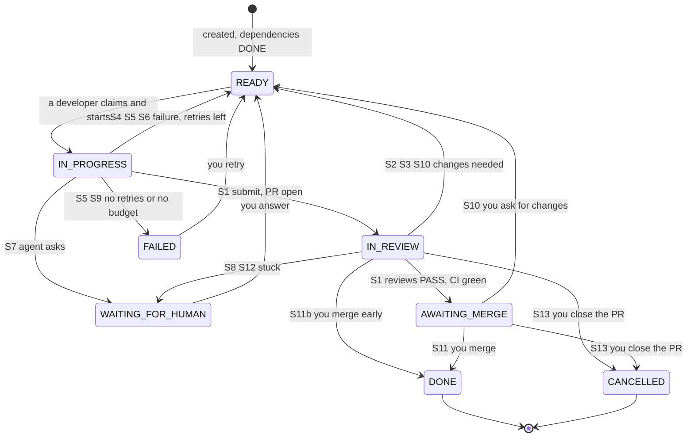

| # | Situation | Outcome | Exercised | Proof |
|---|---|---|---|---|
| S1 | Everything is fine | AWAITING_MERGE, waits for you | **live** (round 2 of SOC-002) | `test_two_passes_approve_the_task` |
| S2 | A reviewer finds a bug | READY, findings as feedback, same PR | **live** (SOC-002) | `test_buggy_change_caught_reworked_approved_merged` |
| S3 | CI fails | READY, failure as feedback | tested | `test_red_ci_sends_the_work_back` |
| S4 | The agent's work fails Axiom's own checks | nothing published; retry | **live** (tests failed, SOC-002); others tested | `test_bad_runs_fail_without_publishing`, `test_failing_verified_tests_block_publishing` |
| S5 | The agent or its run fails | retry, then FAILED | tested | `test_fail_retries_then_fails_after_max_retries` |
| S6 | A worker dies mid-run | lease expires, another worker takes over | tested (real SIGKILL) | `test_killed_worker_process_is_recovered_by_another_worker` |
| S7 | The agent needs a decision | WAITING_FOR_HUMAN | tested | `test_needs_input_asks_the_human` |
| S8 | A reviewer keeps crashing | ERROR, then WAITING_FOR_HUMAN | tested | `test_failed_reviewer_runs_are_retried_then_escalated` |
| S9 | Money runs out | FAILED, or claims refused | tested | `test_budget_exceeded_fails_the_task`, `test_daily_cap_refuses_new_work` |
| S10 | You ask for changes | READY, your words as feedback | tested | `test_axiom_changes_comment_sends_work_back` |
| S11 | You merge | DONE, recorded as you | **live** (SOC-002) | `test_merge_on_github_finishes_the_task` |
| S11b | You merge before the gate | DONE, flagged | tested | `test_merging_before_the_gate_is_recorded_as_a_human_override` |
| S12 | Three rounds and still failing | WAITING_FOR_HUMAN | tested | `test_third_failed_round_escalates_to_a_human` |
| S13 | You close the PR | CANCELLED | tested | `test_closing_the_pr_cancels_the_task` |
| S14 | Axiom itself crashes | nothing lost | tested + demo (real SIGKILL) | `test_restart_preserves_all_state` |
| S15 | A reviewer finishes after being superseded | verdict ignored, cost recorded | **live** (SOC-002) | `test_superseded_review_still_reports_its_cost_but_not_its_verdict` |
| S16 | A run is killed partway | cost estimated from its transcript, marked as an estimate | tested | `test_a_lost_lease_still_reports_what_the_run_cost`, `test_a_restarted_worker_costs_the_run_it_lost_when_killed` |
| S17 | A task's budget runs out during review | WAITING_FOR_HUMAN, no review started | tested | `test_a_spent_task_escalates_instead_of_starting_a_review` |
| S19 | Task or repository text tells the agent to misbehave | ignored and reported | **live** ([drill](../drills/2026-11-06-prompt-injection.md)) | `test_payloads_ask_for_every_attack_and_go_where_agents_read` |
| S20 | Code tells reviewers to approve | FAIL, bug and injection reported | **live** ([drill](../drills/2026-11-06-prompt-injection.md)) | `test_reviewer_approving_a_planted_bug_is_a_breach` |
| S21 | A compromised agent plants code in `.git` | nothing runs, push goes where it should | tested, from the real sandbox | `test_an_attack_planted_from_the_real_sandbox_does_not_reach_the_harness` |
| S22 | An agent's summary contains a credential | run fails, nothing published | tested | `test_a_credential_in_the_agents_summary_is_never_published` |
| S18 | Everything left is reserved by runs in flight | claim refused for now, nothing changes | tested | `test_a_claim_is_refused_when_the_rest_is_reserved`, `test_second_reviewer_waits_when_the_first_reserved_the_rest` |

## S1. Everything is fine

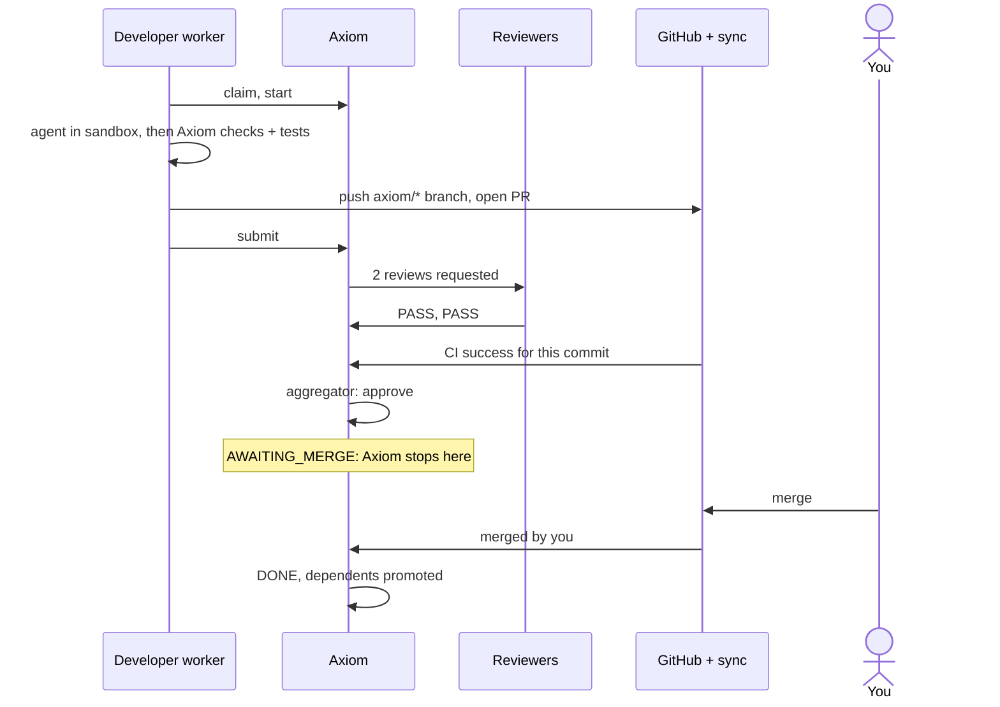

## S2. A reviewer finds a bug

This really happened; see [the real run in chapter 12](12-reviews-and-ci.md#the-real-run-soc-002).

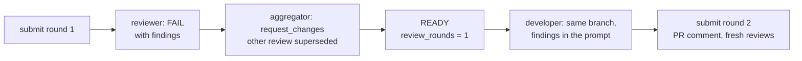

## S3. CI fails

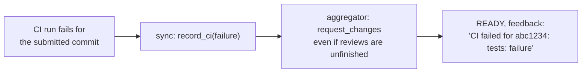

CI for any other commit is ignored. With `require_ci` on and **no CI run at all**, the task waits
in IN_REVIEW: Axiom won't pretend that no result is a pass.

## S4. The agent's work fails Axiom's own checks

Nothing leaves the machine. The attempt counts against `max_retries`.

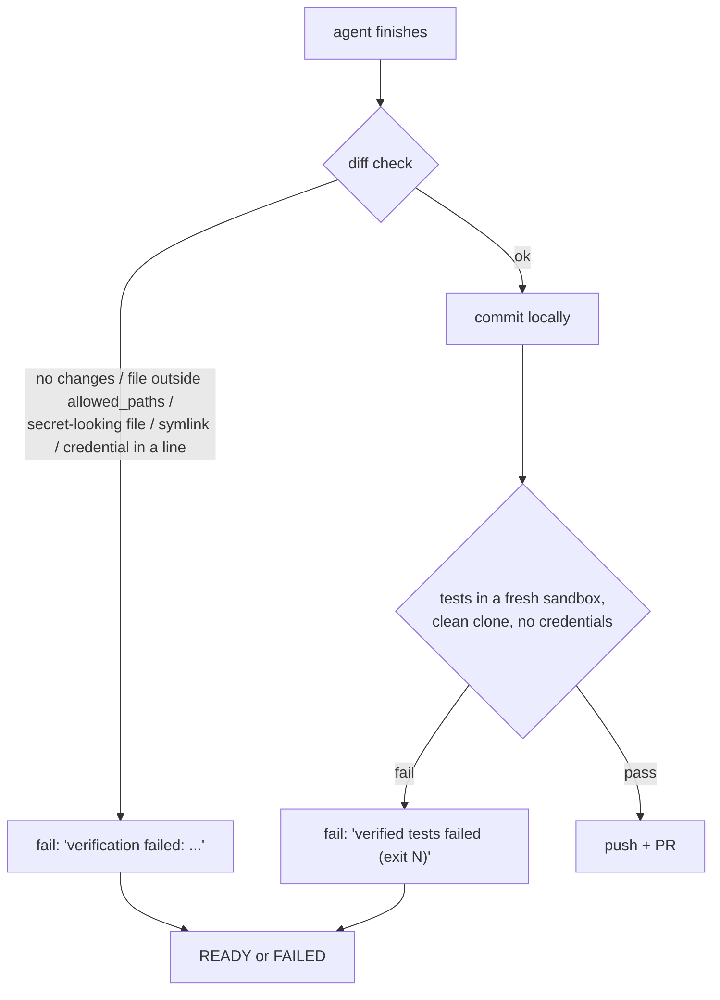

During the real SOC-002 run this stopped a run because of a bug in Axiom's own sandbox: nothing
was published, and the log shows exactly why (chapter 14).

## S5. The agent or its run fails

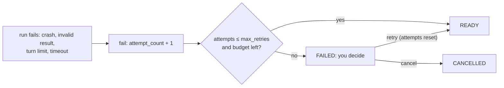

## S6. A worker dies mid-run

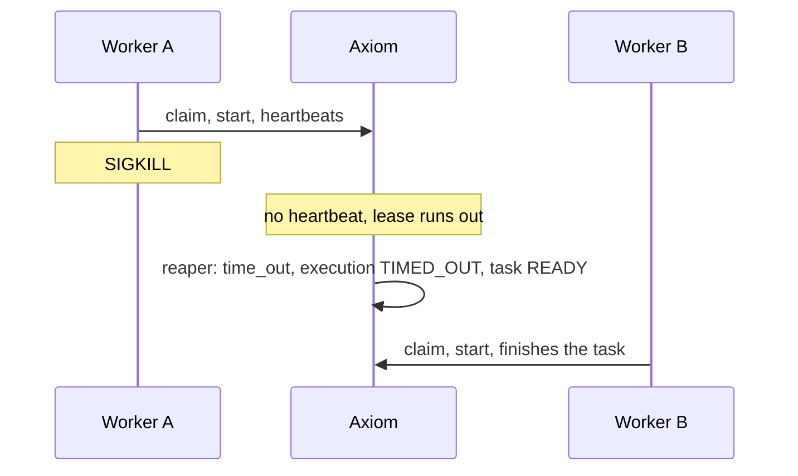

If instead the worker is alive but its lease was lost, its next heartbeat is refused, it cancels
the run, and it reports nothing further about the task.

## S7. The agent needs a decision

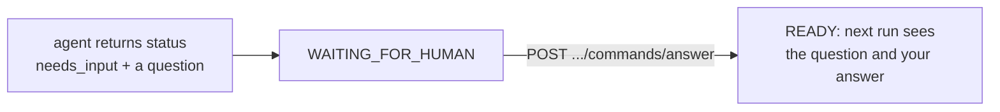

## S8. A reviewer keeps crashing

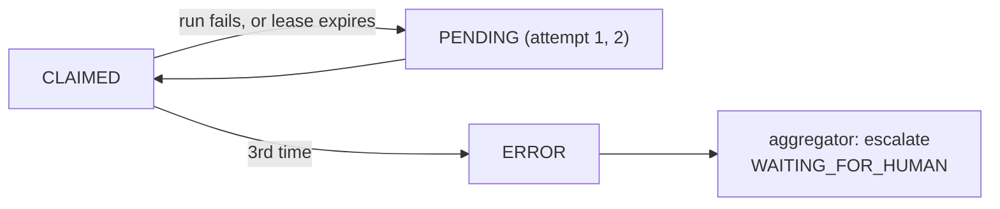

A reviewer that changes the workspace counts as a failed run too: the check is `git status`
after the run (`test_bad_review_runs_are_retried`).

## S9. Money runs out

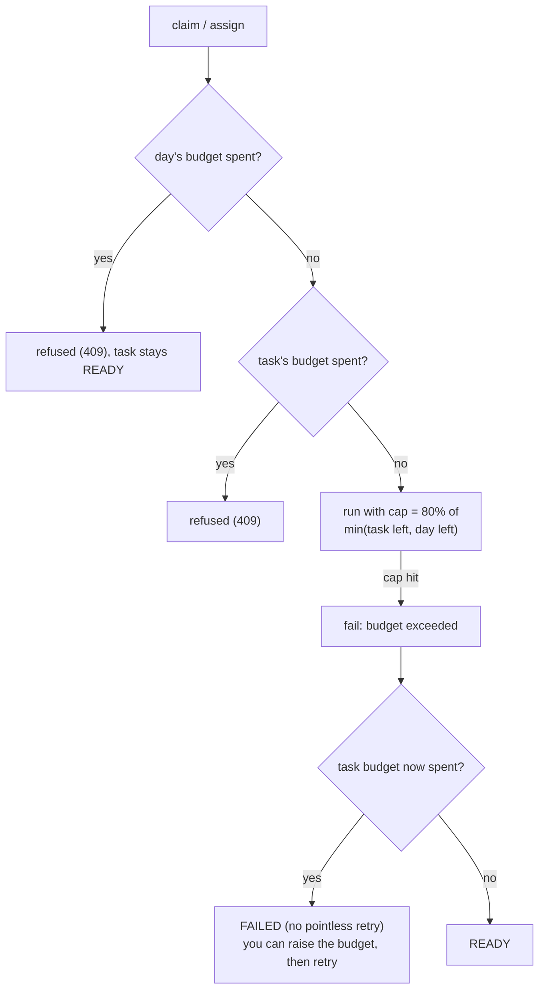

Everything counts toward the task's spend: developer runs, reviews, failed runs, and reviews that
were superseded.

## S10. You ask for changes

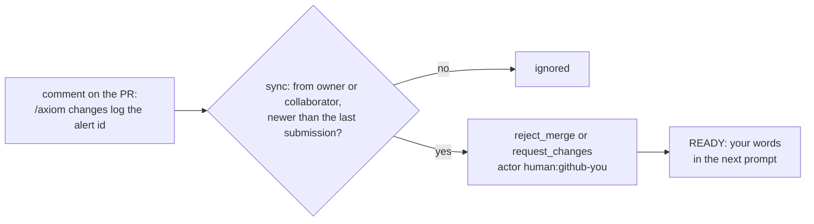

GitHub's "Request changes" review also works, for anyone but the PR's author
(`test_github_request_changes_review_on_the_head_commit`).

## S11. You merge

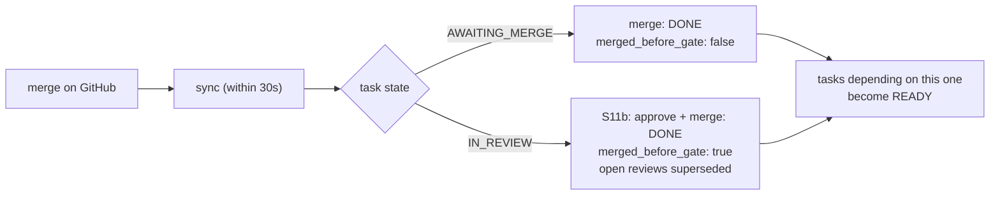

Nothing on GitHub stops an early merge without GitHub Pro (ADR-010), so Axiom records it honestly.

## S12. Three rounds and still failing

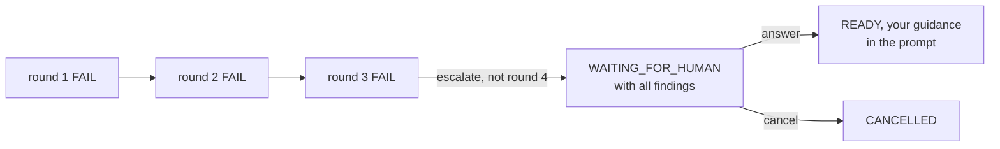

## S13. You close the PR

Closing without merging means you don't want the work: the task becomes CANCELLED. Any open
reviews are superseded and the task stops being watched.

## S14. Axiom itself crashes

All state is in Postgres, so killing everything loses nothing. `make demo-restart` proves it with
SIGKILL on both API and database. Detail: [chapter 7](07-crash-recovery.md).

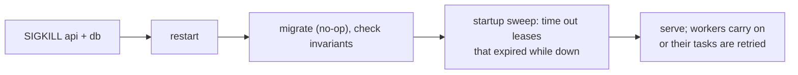

## S15. A reviewer finishes after being superseded

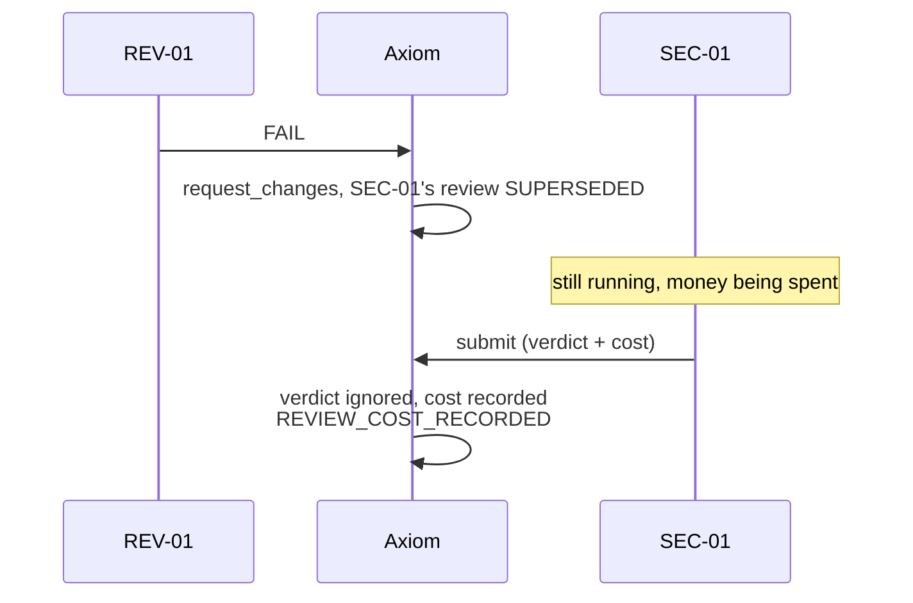

Found in the real run: this cost was being lost, so the budget showed $0.89 instead of $1.19.

## S16. A run is killed partway

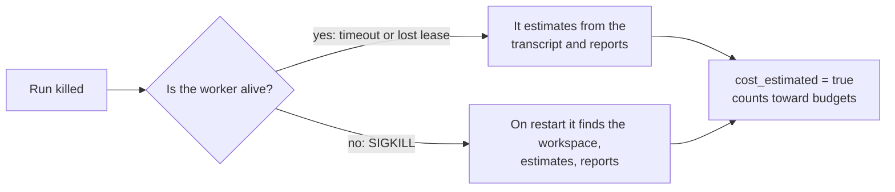

Detail and accuracy: [chapter 15](15-metrics.md#how-far-to-trust-a-cost).

## S17. A task's budget runs out during review

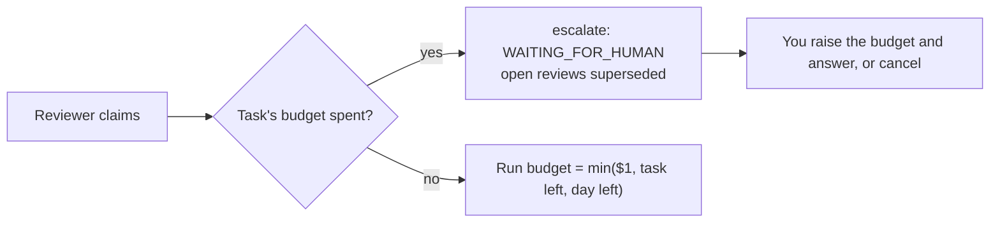

## S18. Everything left is reserved

Not the same as S9. Reserved money may come back when a run finishes under budget, so the claim is
refused and retried, and the task doesn't move.

## Not handled yet

Knowing the edges is part of understanding the system:

- **A sandbox orphaned by a killed worker keeps running** until its own budget stop. Killing the
  worker doesn't kill the container, so a cost estimated on restart can undercount, and the money
  is no longer reserved.
- **The real Anthropic key is in the sandbox.** A compromised agent can read it. A proxy that adds
  the key itself would keep it out.
- **Allowlisted hosts can carry data out.** The proxy filters by host, and it can't tell your use of
  `api.anthropic.com` or PyPI from an attacker's account on the same host.
- **`outcome.json` is written in the sandbox.** Its result is re-validated, but an agent could forge
  its reported cost and get round budgets.
- **The worker is high value:** it holds the tokens and the Docker socket (in effect root on this
  machine), and isn't behind the egress proxy. ADR-014 closes the known way in, not the risk.
- **Prompt-injection resistance is one small run,** with a crude payload (see the drill).
- **A dependency that gets cancelled** leaves its dependents PENDING until you cancel them.
- **A pull request that conflicts after another merges** isn't detected yet (Phase 4 T9).
- **A task with no CI workflow and `require_ci` on** waits forever (S3).
