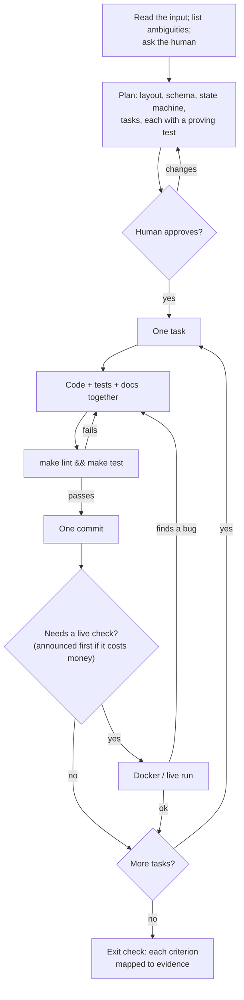
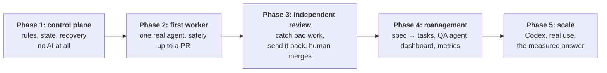
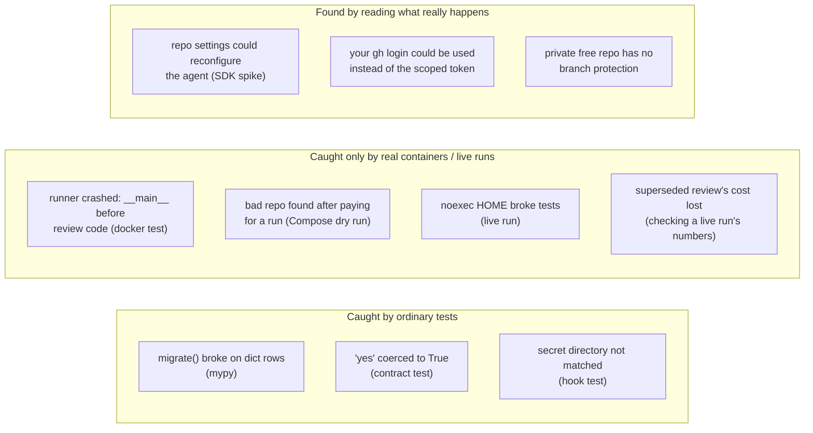

# 14. How it was built: the process, the order, the mistakes

The other chapters describe what exists. This one describes how it got here, because the process
is itself one of the things this project is for (SPEC section 2).

## The working loop

Every phase and every task followed the same loop, with one human gate per phase and a live
check where real money or real GitHub was involved:

## Why this order

Each phase could only be proven because of the one before it.

- **The deterministic part came first, with no AI.** If the state machine, leases and recovery
  weren't trustworthy, nothing built on them could be judged. Agents would have hidden bugs as
  "the model did something odd".
- **One agent before many.** Sandbox, credentials, budgets and verification are all needed for a
  single agent. Multiplying agents adds no new safety question until those are answered.
- **Review after work exists to review.** Reviewers need real PRs and a rework path.

## What each phase delivered and how it was proven

| Phase | Delivered | Exit proof |
|---|---|---|
| 1 | Schema, task + execution machines, leases, reaper, event log, REST API, Compose | Every legal and illegal transition tested from the table; SIGKILL demo with identical before/after snapshots; clean-clone smoke test |
| 2 | Auth, budgets, sandbox + egress allowlist, worker, verification, publisher | [PR #1](https://github.com/bharathcmbox/tiny-agenticsoc/pull/1): a real agent, 51 s, $0.15, no human input |
| 3 | Reviews, aggregator, read-only reviewers on another model, rework on the same PR, CI, GitHub sync | [PR #2](https://github.com/bharathcmbox/tiny-agenticsoc/pull/2): a planted bug caught blind, fixed, re-reviewed, merged by the human; $1.19 |

Evidence and limitations for each: [phase-1](../plan/phase-1.md), [phase-2](../plan/phase-2.md),
[phase-3](../plan/phase-3.md). Read the history with `git log --stat`; every commit is one task.

## Decisions that shaped it

| Decision | Choice | Why | ADR |
|---|---|---|---|
| Where is the truth? | Postgres, not GitHub Issues | Atomic transitions, locks, recoverable | 001 |
| Who decides? | Plain code; LLMs give opinions | Testable, reproducible, cheap | 002, 009 |
| Which agent first? | Claude Code behind an adapter | The project is built with it; Codex later for diversity | 003, 006 |
| Is SOC part of Axiom? | No: a customer project | The first spec mixed them up; that's why it was thrown away | 004 |
| ORM? | No, raw SQL | Locking is the point; keep it visible | 005 |
| How to stop agents merging? | Token never reaches the LLM; no merge code | GitHub's protection isn't available on the free private plan | 007, 010 |
| Where does the LLM run? | A separate sandbox per run | Untrusted input must not sit next to credentials | 008 |
| Who merges? | The human, on GitHub; Axiom observes | Axiom keeps having no merge path | 010 |

## What went wrong

The most useful part. Each of these was found by a test, a live run or a check, and every fix
has a regression test or a documented limitation.

| What | How it was found | What changed |
|---|---|---|
| A repo's `.claude/settings.json` could change the agent's permissions | Reading the SDK | `setting_sources=[]`; CLAUDE.md passed as untrusted text |
| `~/.gitconfig` helper could supply the user's full login | A test failing on this machine | Worker ignores global git config |
| Pydantic coerced `"yes"` to `True` | Contract test | Strict contracts |
| Budget stop raises *after* yielding its result; a cap can overshoot | Live SDK check | Handle both; pass 80% of the budget |
| A bad repo URL was found only after paying for the agent | Compose dry run | Validate before any work |
| Review code defined after `__main__` | Docker test (unit tests passed) | Entry point moved to the end |
| HOME tmpfs is `noexec`, breaking `uv run --with` | Live run; SOC-001 had hidden it | `exec` on that tmpfs, regression test |
| A superseded review's cost vanished ($0.30) | Checking the total by hand | Late cost recorded, tested |
| The rebuilt API crash-looped: login needs `python-multipart`, present only via dev dependencies | Rebuilding the image (tests passed) | Runtime dependency, regression test |
| The plan's lock wouldn't have closed the budget race: a claim doesn't change what was spent | Thinking through the fix | Reservations instead (ADR-013) |
| A race test still passed with the lock removed | Removing the lock on purpose | A reviewer race, which fails without it |
| Per-message usage shows only 0.3-5% of billed output, so naive estimates were about a third too low | Replaying real transcripts before writing the estimator | Output estimated from visible text, compared with real bills |
| A retried review's earlier cost was overwritten on submit | Reading the code for T3 | Costs add up, tested |
| A timed-out review was recorded as costing $0, which blocked its real estimate. Unit tests passed against a fake API | A test through the real API | Unknown stays NULL |
| A failed test's leftover thread kept pytest alive for 1h40m, unnoticed behind a `\| tail` | Being asked whether the run had finished | Daemon threads, hard time limits on long runs |
| **A compromised agent could escape the sandbox through `.git`** and reach every worker credential | Asking what the harness does with sandbox output, while preparing a drill | ADR-014 |
| The agent's summary was published unscanned | The same | Scanned before publishing |
| A regression test passed with its fix removed | Removing the fix on purpose | Rewritten |
| Demo runs left real, active tokens behind | Listing tokens during rotation | The demo revokes its own |
| The agent's key sat in the sandbox, its cost report was its own, and an orphaned sandbox kept spending | The T4 drill's follow-up | The model proxy, ADR-015 |
| A secret scan only printed a count, and the commit went ahead on a match (a dummy value, this time) | Reading the output afterwards | A check against the real values that stops the commit |
| A sandbox could make the worker copy its own tokens into an error, through a symlink in `out/` | Designing how the launcher would handle logs | Safe reads, logs held by the launcher, errors cleaned (ADR-016) |
| Workers held the Docker socket | The hardening plan | The launcher, ADR-016 |
| The first report flattered the system: "$0.03 per merged task" came from old demo tasks | Reading its output on real data | Demo tasks tagged, the demo script tags its own |

**Process mistakes** also happened, and are worth knowing:
- Commits went through twice with failing lint, because piping `make lint` into `tail` hid its exit
  code. Fixed by using `pipefail`.
- A cost breakdown reported to the human was added up wrong ($0.81 for reviews; really $1.02). The
  total was right. Numbers in reports should be computed, not summed by eye.
- Early estimates were far too high: $2–6 for the final demo, which cost $1.19.

**The pattern:** unit tests caught logic errors, but all the costly surprises came from real
containers and real runs. Live runs were few and capped, and were worth far more than they cost.

## What it cost

| Item | API cost |
|---|---|
| SDK spike (Phase 2) | about $0.02 |
| Sandbox live test (Phase 2) | $0.06 |
| SOC-001 (Phase 2) | $0.15 |
| Reviewer live test (Phase 3) | $0.15 |
| SOC-002: four reviews $1.02, rework $0.17 (Phase 3) | $1.19 |
| **Total recorded** | **about $1.57** |

These are the figures the runs reported; the Anthropic Console is the authority on what was billed.
They are also a very small sample: **one reviewed task proves the loop works, not how well it
works.** Whether agents beat one driven session (SPEC section 1) is still unanswered; Phases 4 and
5 exist to measure it.

## Try it

1. `git log --oneline --reverse | less`: the project's history, one task per commit.
2. Pick the T3 commit from Phase 3: `git show --stat f33e462`. Code, tests and docs together.
3. Compare the plan with the outcome: `docs/plan/phase-2.md` sections 5 and 7.
4. Read the two PRs on GitHub, oldest first. PR #2's conversation shows the whole Phase 3 loop.
