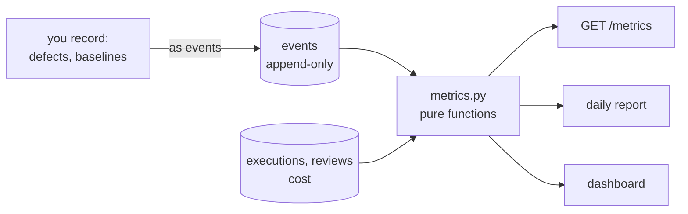
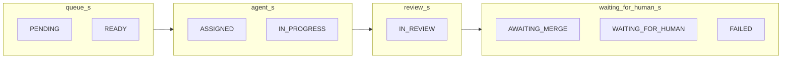
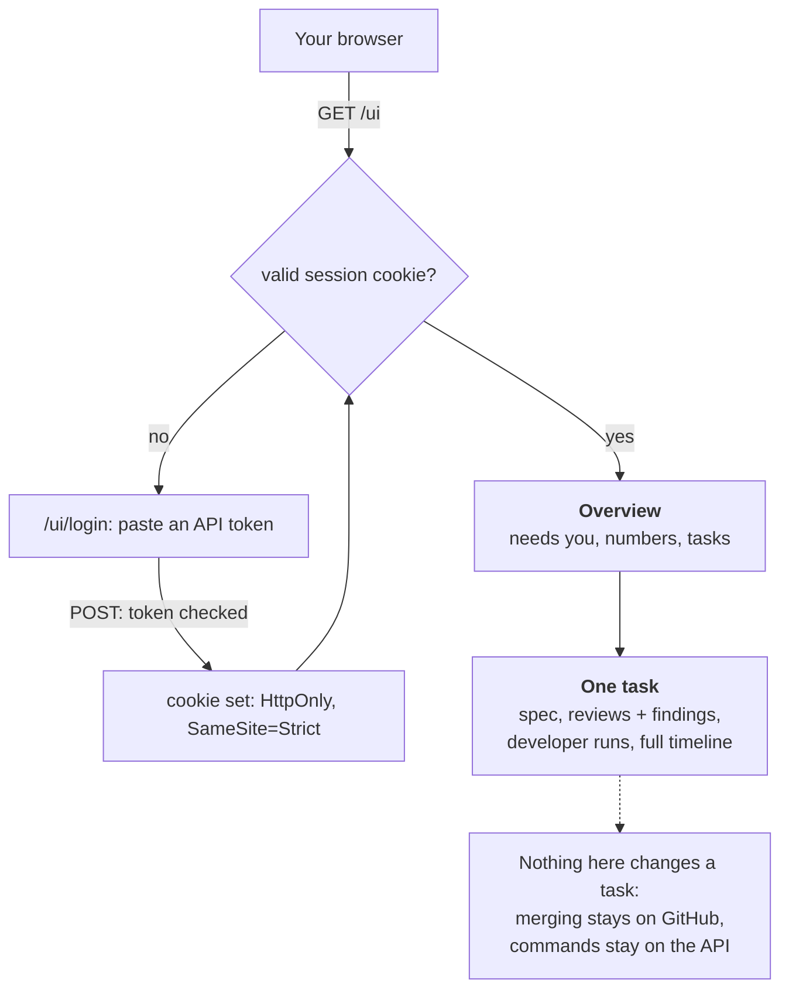

# 15. Metrics: the measured answer

SPEC section 1 says success is "a measured answer, not opinion". This chapter shows where the
numbers come from and how far to trust them.

## One source of truth



Nothing is stored as a counter (ADR-012). Metrics are recomputed from the record every time, so a
corrected definition also corrects history, and each definition has unit tests on scripted histories.

## How a task's time is divided

Each transition event says when the task entered a state; the next one says when it left. Every
second between READY and DONE lands in exactly one bucket:



`test_task_durations_add_up` proves the buckets add up to the cycle time.

## The metrics

| Metric | Definition | Trust it for |
|---|---|---|
| `cycle_s` | first READY → DONE | How long delivery took, including waiting for you |
| `agent_s`, `review_s` | time in those states | What the machines cost in time |
| `waiting_for_human_s` | AWAITING_MERGE + WAITING_FOR_HUMAN + FAILED | **An upper bound.** It's elapsed time: you may have been asleep |
| `first_pass_rate` | merged with `review_rounds = 0` | How often work is right first time |
| `rework_rounds_per_merged` | average `review_rounds` | How much the review loop is used |
| `failed_attempts` | EXECUTION_FAILED + EXECUTION_TIMED_OUT | Reliability of runs |
| `human_interventions` | events by `human:` actors, except creating, merging, tagging and recording defects | How unattended it really is |
| `cost_per_merged_usd` | **all** spend, including failed tasks, ÷ merged tasks | What delivery costs. Not cost per run |
| `review_share_of_cost` | reviews ÷ total | Whether reviewers are worth a look |
| `verdicts` | counts of PASS / FAIL | **Not quality:** a FAIL may be a false alarm |
| `defects_after_merge` | DEFECT_RECORDED | Only as good as your recording |
| `merged_before_gate` | merges flagged by the sync | How often the gate was skipped |

## Recording what only you know

```bash
curl "${H[@]}" localhost:8000/tasks/SOC-002/defects -d '{"description": "…", "severity": "high"}'
curl "${H[@]}" localhost:8000/baselines -d '{"project_key": "SOC", "title": "similar task by hand",
     "minutes": 45, "cost_usd": "0.80", "notes": "one Claude Code session"}'
curl "${H[@]}" localhost:8000/tasks/SOC-002/tags -d '{"tags": ["demo", "planted"]}'
```

**Baselines answer SPEC's main question:** does this beat you driving one session? Without a
comparable hand-driven task there is nothing to compare with. Collecting them is part of Phase 5.

**Demo work is left out by default.** Planted and demo tasks are tagged `demo`, so they can't
flatter or distort the results: `make demo-restart` tags its own. Add `?include_demo=true` to see
them. This matters more than it sounds. Before the old demo tasks were tagged, the first report
said "$0.03 per merged task, 100% first-pass", from tasks no agent ever worked on.

## The daily report

`make report` (or `make report PROJECT=SOC`) prints Markdown: plain numbers, no LLM (Q4 in the
plan), so it costs nothing and can't invent anything. It leads with what needs you, then today's
spend and activity, delivery so far, and baselines.

## The dashboard

The same data as HTML, served by the API itself at <http://127.0.0.1:8000/ui>: no new service.



Three rules, each with a test:

- **Nothing on it can change state.** Every route is GET except the login form, which only checks a
  token and sets a cookie (`test_only_login_is_not_a_get`). The plan said "every route is GET"; a
  browser can't send a bearer header, and a token in a URL would land in logs and history, so login
  is the one exception.
- **Everything shown is treated as hostile.** Titles, specs, findings and errors are written by
  models or found in repositories, so all of it is escaped, and only `https://` links are rendered
  (`test_untrusted_text_is_escaped_everywhere`).
- **Demo work stays out** unless you ask (`test_demo_tasks_are_hidden_unless_asked`).

The cookie holds your API token until you close the browser. It isn't marked `Secure` because this
is plain HTTP on 127.0.0.1; it would need to be before the API ever left localhost. To end access,
revoke the token.

## The first real numbers

SOC-002, the planted-bug run (so tagged `demo`), computed entirely from its event log, reconciling
exactly with what was recorded by hand:

| | |
|---|---|
| Developer | $0.1722 |
| Reviews (4) | $1.0211 |
| **Total** | **$1.1933** |
| Rework rounds | 1 |
| Failed attempts | 2 (Axiom's own sandbox bug) |
| Human interventions | 1 (the `retry` after fixing it) |
| Agents working | 92 s |
| Reviews | 90 s |
| Waiting for a human | about 71 min |

Two early hints, from a sample of one: **reviews are most of the cost** (86% here), and **the human
is the bottleneck by a factor of over 20.** Both are exactly what SPEC wanted to find out, and both
need more data before they mean much.

## Try it

1. `curl "${H[@]}" "localhost:8000/metrics?project=SOC&include_demo=true" | python3 -m json.tool`
2. `uv run pytest tests/unit/test_metrics.py -v`: every definition, on a scripted history.
3. Change a definition in `metrics.py` (say, count FAILED as agent time) and see which test objects.
4. `make report PROJECT=SOC`, then open <http://127.0.0.1:8000/ui> and follow a task to its timeline.
   Issue a token to sign in with: `docker compose exec api python -m axiom.registry.tokens issue human:you`.
