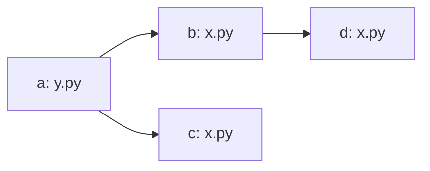
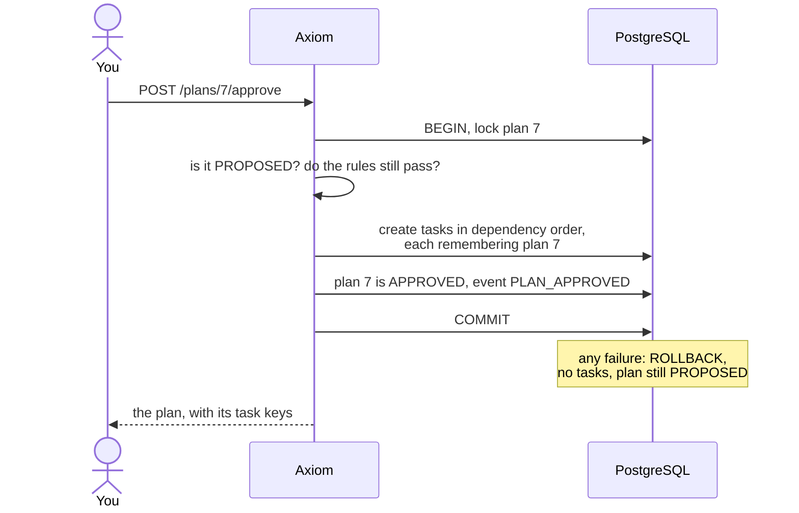

# 16. Planning: from a specification to tasks

Until now a human wrote every task. A planner agent can now propose them from a specification, but it
can't create them: **only a human's approval turns a plan into work** (ADR-011).


## What a plan is

A plan has a state machine of its own, in [state-machines.md](../state-machines.md#plan-phase-4-adr-011).
The proposal is a strict contract: unknown fields are refused, and nothing is coerced.

```json
{
  "summary": "What this plan does and why",
  "tasks": [
    {"ref": "queue", "title": "Add the queue", "specification": "...", "acceptance_criteria": ["..."],
     "role": "developer", "allowed_paths": ["agent/socagent/incidents.py"], "priority": "P1",
     "budget_usd": 3.0, "depends_on": []},
    {"ref": "qa", "title": "Test the queue", "specification": "...", "acceptance_criteria": ["..."],
     "role": "qa", "allowed_paths": ["agent/tests/**"], "budget_usd": 1.0, "depends_on": ["queue"]}
  ],
  "risks": ["..."]
}
```

A plan can't name an agent, create a reviewer, or say it's approved: the contract has no field for any
of these (`test_the_contract_refuses_anything_off_shape`).

## The rules, checked before you see it

A plan is a model's output. Each rule is plain code in `orchestrator/plan_rules.py`, and a failure counts
as a failed attempt, with every problem reported so the next attempt can fix them all at once
(`test_every_problem_is_reported_at_once`).

| Rule | Why | Test |
|---|---|---|
| Dependencies exist, and there are no cycles | Otherwise tasks could never start | `test_a_cycle_is_refused` |
| Paths are in the repository, not secrets, and not the whole repository | Least privilege comes from the plan | `test_unsafe_paths_are_refused` |
| No task may hold `.github/` or `.git/` | Whoever edits CI changes what "passing" means | `test_unsafe_paths_are_refused` |
| QA tasks stay within the project's test paths | QA may not edit what it tests | `test_qa_may_not_change_anything_else` |
| Tasks that can run together don't share files | Parallel edits mean merge conflicts | `test_parallel_tasks_on_the_same_file_are_refused` |
| Budgets total no more than the plan's, with at most 8 tasks | A plan can't spend more than you allowed | `test_the_budgets_may_reach_but_not_pass_the_plans` |
| No credentials in its text | A plan is stored and shown to you | `test_a_credential_in_the_plans_text_is_refused_and_not_repeated` |

### Which tasks can run at the same time?

Two tasks can run together unless one waits for the other, directly or through others. So overlap is
checked only between tasks with no order.



Here `b` and `d` may share `x.py`, because `b` finishes first. But `b` and `c` can run at the same time and
also share it, so this plan is refused. Patterns are compared conservatively. When two could match the
same file, they count as overlapping: a false alarm costs a planning retry, and a miss costs a merge
conflict.

## Approval: all or none

Approval is the only way plan text becomes work. It runs the rules again, because limits or test paths may
have changed since the plan was proposed, then creates every task in one transaction, with you as their
creator. So the rule "only humans create tasks" still holds.



A failure midway leaves nothing behind (`test_a_failure_midway_through_approval_creates_nothing`), and
tasks then run under all the usual limits: budgets, leases, reviews, CI, and you merging.

## Reading and deciding

The dashboard shows the plan at `/ui/plans/{id}`, and it appears under "Needs you". Deciding happens on
the API, because the dashboard can't change anything.

```bash
curl "${H[@]}" localhost:8000/projects/SOC/test-paths -d '{"test_paths": ["agent/tests/**"]}'
curl "${H[@]}" localhost:8000/projects/SOC/plans -d '{"specification": "...", "budget_usd": "15"}'
curl "${H[@]}" localhost:8000/plans/7/approve -X POST
curl "${H[@]}" localhost:8000/plans/7/reject -d '{"feedback": "Split the CLI change out"}'
curl "${H[@]}" localhost:8000/plans/7/cancel -X POST
```

| What happens | Result | Test |
|---|---|---|
| A proposal breaks the rules | Failed attempt; its problems go to the next one; you never see it | `test_an_invalid_plan_never_reaches_a_human` |
| Three failed attempts | ERROR, and it shows under "Needs you" | `test_three_invalid_plans_end_in_error` |
| You reject it | Back to the planner with your words; attempts start over | `test_rejecting_feeds_back_and_starts_the_attempts_over` |
| A planner stops heartbeating | Its lease expires and the plan goes back | `test_an_expired_lease_returns_the_plan` |
| An agent tries to approve | Refused, nothing changes | `test_only_a_human_can_decide` |

A planning run counts against the day's budget, up to $1 per attempt. It isn't charged to the plan's limit,
which covers the tasks.

## What these rules don't do

They check a plan's shape, not whether it's any good. A plan can pass every rule and still be the wrong
work, split badly, or underestimate. That's why you read every plan.
