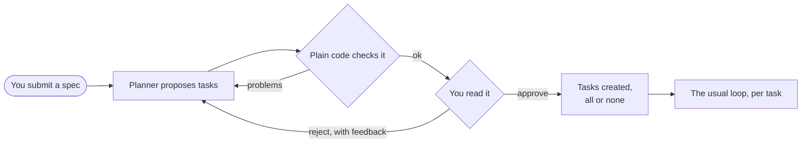
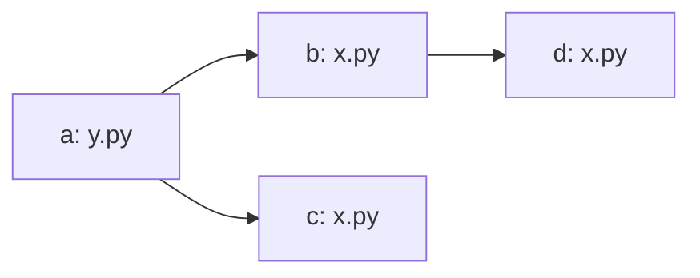
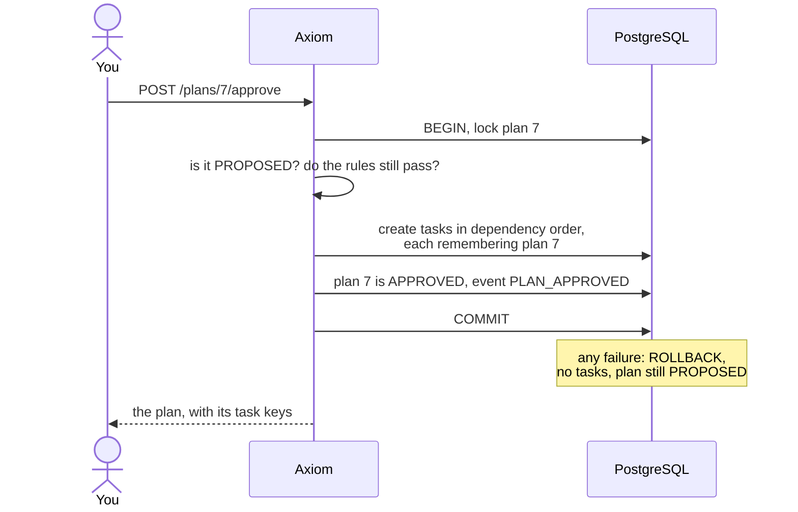
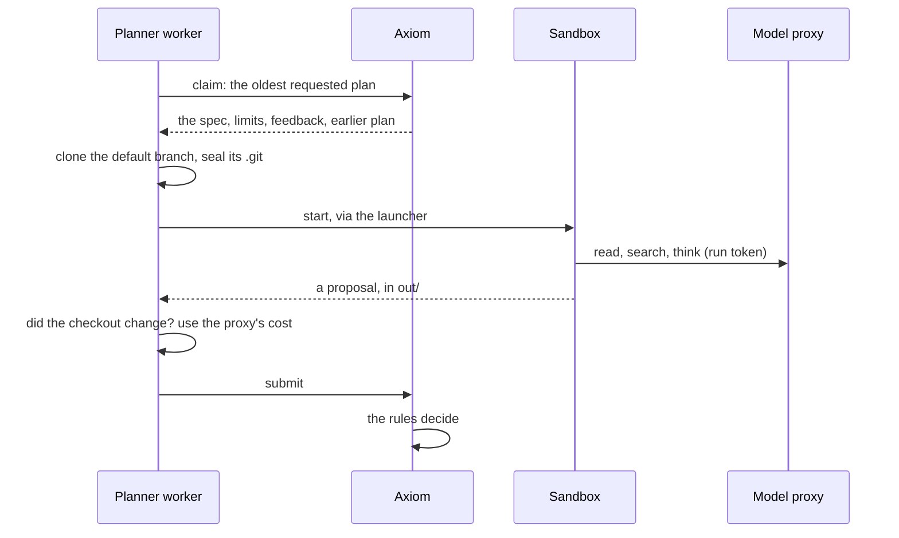
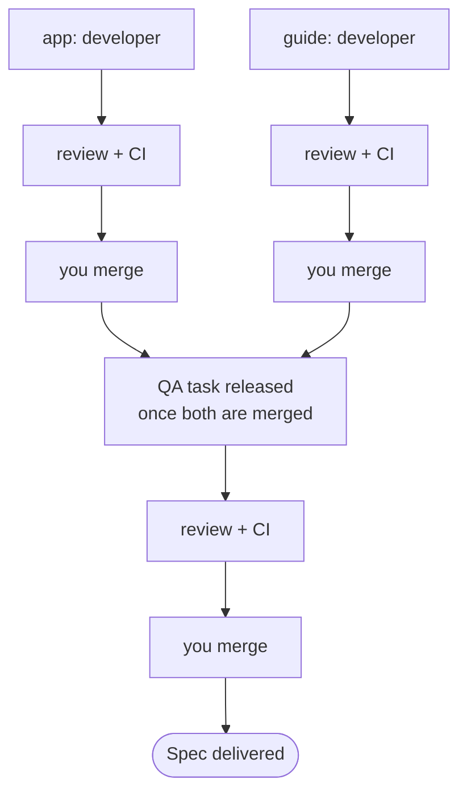
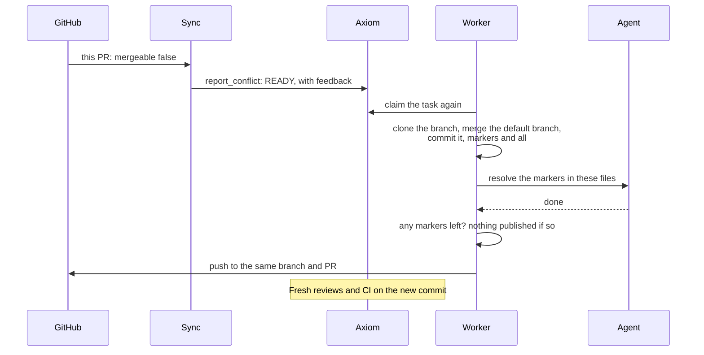
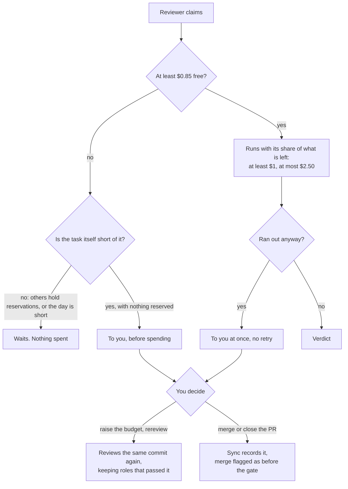

# 16. Planning: from a specification to tasks

Until now a human wrote every task. A planner agent can now propose them from a specification, but it
can't create them: **only a human's approval turns a plan into work** (ADR-011).



## What a plan is

A plan has a state machine of its own, in [state-machines.md](../state-machines.md#plan-phase-4-adr-011).
The proposal is a strict contract: unknown fields are refused, and nothing is coerced.

```json
{
  "summary": "What this plan does and why",
  "tasks": [
    {"ref": "queue", "title": "Add the queue", "specification": "...", "acceptance_criteria": ["..."],
     "role": "developer", "allowed_paths": ["agent/socagent/incidents.py"], "priority": "P1",
     "budget_usd": 3.0, "depends_on": []},
    {"ref": "qa", "title": "Test the queue", "specification": "...", "acceptance_criteria": ["..."],
     "role": "qa", "allowed_paths": ["agent/tests/**"], "budget_usd": 1.0, "depends_on": ["queue"]}
  ],
  "risks": ["..."]
}
```

A plan can't name an agent, create a reviewer, or say it's approved: the contract has no field for any
of these (`test_the_contract_refuses_anything_off_shape`).

## The rules, checked before you see it

A plan is a model's output. Each rule is plain code in `orchestrator/plan_rules.py`, and a failure counts
as a failed attempt, with every problem reported so the next attempt can fix them all at once
(`test_every_problem_is_reported_at_once`).

| Rule | Why | Test |
|---|---|---|
| Dependencies exist, and there are no cycles | Otherwise tasks could never start | `test_a_cycle_is_refused` |
| Paths are in the repository, not secrets, and not the whole repository | Least privilege comes from the plan | `test_unsafe_paths_are_refused` |
| No task may hold `.github/` or `.git/` | Whoever edits CI changes what "passing" means | `test_unsafe_paths_are_refused` |
| QA tasks stay within the project's test paths | QA may not edit what it tests | `test_qa_may_not_change_anything_else` |
| Tasks that can run together don't share files | Parallel edits mean merge conflicts | `test_parallel_tasks_on_the_same_file_are_refused` |
| Budgets total no more than the plan's, with at most 8 tasks | A plan can't spend more than you allowed | `test_the_budgets_may_reach_but_not_pass_the_plans` |
| No credentials in its text | A plan is stored and shown to you | `test_a_credential_in_the_plans_text_is_refused_and_not_repeated` |

### Which tasks can run at the same time?

Two tasks can run together unless one waits for the other, directly or through others. So overlap is
checked only between tasks with no order.



Here `b` and `d` may share `x.py`, because `b` finishes first. But `b` and `c` can run at the same time and
also share it, so this plan is refused. Patterns are compared conservatively. When two could match the
same file, they count as overlapping: a false alarm costs a planning retry, and a miss costs a merge
conflict.

## Approval: all or none

Approval is the only way plan text becomes work. It runs the rules again, because limits or test paths may
have changed since the plan was proposed, then creates every task in one transaction, with you as their
creator. So the rule "only humans create tasks" still holds.



A failure midway leaves nothing behind (`test_a_failure_midway_through_approval_creates_nothing`), and
tasks then run under all the usual limits: budgets, leases, reviews, CI, and you merging.

## Reading and deciding

The dashboard shows the plan at `/ui/plans/{id}`, and it appears under "Needs you". Deciding happens on
the API, because the dashboard can't change anything.

```bash
curl "${H[@]}" localhost:8000/projects/SOC/test-paths -d '{"test_paths": ["agent/tests/**"]}'
curl "${H[@]}" localhost:8000/projects/SOC/plans -d '{"specification": "...", "budget_usd": "15"}'
curl "${H[@]}" localhost:8000/plans/7/approve -X POST
curl "${H[@]}" localhost:8000/plans/7/reject -d '{"feedback": "Split the CLI change out"}'
curl "${H[@]}" localhost:8000/plans/7/cancel -X POST
```

| What happens | Result | Test |
|---|---|---|
| A proposal breaks the rules | Failed attempt; its problems go to the next one; you never see it | `test_an_invalid_plan_never_reaches_a_human` |
| Three failed attempts | ERROR, and it shows under "Needs you" | `test_three_invalid_plans_end_in_error` |
| You reject it | Back to the planner with your words; attempts start over | `test_rejecting_feeds_back_and_starts_the_attempts_over` |
| A planner stops heartbeating | Its lease expires and the plan goes back | `test_an_expired_lease_returns_the_plan` |
| An agent tries to approve | Refused, nothing changes | `test_only_a_human_can_decide` |

A planning run counts against the day's budget, up to $1 per attempt. It isn't charged to the plan's limit,
which covers the tasks.

## The planner

`EM-01` runs Opus 5.5 in the same kind of sandbox as a reviewer. It can read and search the repository, with
no shell and no way to edit. It holds no credentials, and reaches the model through the proxy.



The worker doesn't judge a proposal. It passes it on as it came, so a badly shaped plan and a plan that breaks
a rule get the same treatment: a failed attempt, with the problems in the next prompt. Each run has its own
workspace, so a killed run's record is still there for a restarted worker to report once
(`test_a_restarted_planner_costs_the_run_it_lost_once`).

| If the planner... | What happens | Test |
|---|---|---|
| edits a file somehow | The run fails: the checkout must be untouched | `test_bad_runs_count_as_failed_attempts` |
| is given no project repository | Fails before any spending | `test_a_project_without_a_repository_fails_before_spending` |
| puts a credential in an error | Removed before it's stored | `test_a_credential_in_an_error_is_not_stored` |
| loses its lease | The run is cancelled, and its cost still recorded | `test_a_lost_lease_cancels_the_run_and_still_reports_its_cost` |

### The first real plan

On Nov 6, for a small spec on `tiny-agenticsoc` (a `socagent queue` command): first attempt, 40 seconds, $0.21. It
named the real files and line numbers, kept a QA task to one new test file, ordered it after the developer's
task, and stayed at $3.50 of a $6 limit. Its risks were honest, including that one phrase in the spec could have
meant two more documents, and which it had chosen. This is one small plan, so it says little about how well the
planner does on larger or vaguer work.

## Running the plan: parallel work, conflicts, QA

Approved tasks run through the usual loop. Up to two developers work at once, on tasks with no order between
them. A task waiting on another stays PENDING until that one is merged, which is how QA waits for the work it
tests.



### When merged work makes another PR conflict

The rules keep parallel tasks from sharing files, but another merge can still conflict: a human's commit, say, or
a file nobody predicted. GitHub says so with `mergeable: false`, and the sync acts on it, before CI, because a PR
that can't merge must not reach you as ready to merge.



`report_conflict` only sends work back, and only the sync can issue it. Merging and approving stay out of its
reach, and `reject_merge` stays human-only.

| What happens | Result | Test |
|---|---|---|
| A PR conflicts in review, or while waiting for you | READY, reviews superseded | `test_a_conflict_awaiting_merge_sends_the_work_back` |
| GitHub is still working it out (`null`) | Nothing yet | `test_no_conflict_means_nothing_happens` |
| Conflict and green CI together | Conflict wins | `test_a_conflict_beats_green_ci` |
| The agent resolves it | Same PR, with the default branch in its history | `test_a_real_conflict_is_handed_to_the_agent_with_its_markers` |
| The agent leaves markers in | Nothing published; a failed attempt | `test_unresolved_markers_are_never_published` |
| The default branch changed other files | Not counted as the agent's work | `test_main_s_changes_are_not_counted_as_the_agents` |

A conflict counts as a review round, so repeated ones bring the round cap closer. A conflict in a file the task
may not change can't be resolved by its agent: it's told to ask you.

### What the first real plan taught

Plan 1's QA task had $1.50. It should have cost $0.97. It cost **$1.69** and ended with no code review:

| Step | Budget given | Spent |
|---|---|---|
| QA agent | $1.50 | $0.22 |
| Security reviewer, first to claim | $1.00 | $0.36, PASS |
| Code reviewer, attempt 1 | $0.28 | $0.40, ran out |
| Code reviewer, attempt 2 | $0.52 | $0.43, ran out |
| Code reviewer, attempt 3 | $0.09 | $0.28, ran out |

Budget reservations (ADR-013) stop two runs spending the same money, but nothing said how little a run could be
given, and a run that ran out was retried with less. The budget is only checked between requests, so a run on
very little overshoots it by a large share.



| Fix | Test |
|---|---|
| A reviewer waits rather than start on too little | `test_a_reviewer_wont_start_on_too_little_while_money_may_come_back` |
| A task that can't pay goes to you before spending | `test_a_task_that_cant_pay_for_a_review_escalates_before_spending` |
| Out of budget means no retry | `test_a_review_out_of_budget_isnt_retried` |
| `rereview` reviews the same commit again | `test_rereview_gets_fresh_reviews_on_the_same_commit_without_new_work` |
| Sync sees a merge or close while a task is with you | `test_merging_an_escalated_task_is_recorded_and_flagged` |
| The real sequence, replayed: now $0.97 and approved | `test_the_soc_005_sequence_end_to_end` |

The rereview of SOC-005 then showed two numbers were too low. Its code review passed for $0.64, leaving $0.47 of the
raised budget, and the task stopped before spending more, as designed. But the SDK stops a run at 80% of its budget,
so a $0.50 minimum meant a $0.40 stop, below that review's cost. The minimum is now $0.85, so 80% of it is $0.68. And
a rereview now keeps a role's PASS on the same commit (`test_a_rereview_keeps_a_pass_on_the_same_commit`), instead of
paying to repeat it. Fourteen reviews are a small sample: these numbers should be checked again after more runs.

A `rereview` counts as a round, so such a task won't count as first-pass in the metrics, though the agent's work may
have been fine. While one task's review waits, reviewers holding the next review in the queue wait too: small
enough now, and worth watching with more work in parallel.

### QA tasks

A QA task is an ordinary task with role `qa`, taken by `QA-01` through the same harness. A plan can only keep it to
the project's test paths, and verification enforces that (`test_a_qa_agent_cannot_change_the_code_it_tests`). Its
prompt asks for tests written from the specification. If a test shows a real bug, it asks you rather than weakening
the test. The whole path from a spec to every task merged is in `test_from_a_plan_to_every_task_merged`.

### The exit run: a whole spec, delivered

On Nov 7 the Phase 4 exit spec went through all of this for real: EM-01 split it into three developer tasks and
two QA tasks, you approved the plan as proposed, and you merged five PRs. It took 65 minutes from the request to
the last merge, and cost $8.29, of which $0.45 was the plan. The [run record](../runs/2026-11-07-phase-4-exit-run.md)
has every number.

```mermaid
gantt
    title Plan 2, Nov 7 (UTC): agents' work, then waiting for you
    dateFormat HH:mm:ss
    axisFormat %H:%M
    section SOC-006
    develop and review   :a1, 17:01:27, 143s
    waiting for you      :17:03:50, 824s
    section SOC-007
    develop and review   :b1, 17:01:28, 198s
    waiting for you      :17:04:46, 800s
    section SOC-009 QA
    develop and review   :c1, 17:17:39, 214s
    budget, to you       :crit, 17:21:13, 1580s
    waiting for you      :17:47:33, 241s
    section SOC-008 docs
    develop and review   :d1, 17:18:11, 234s
    waiting for you      :17:22:05, 1639s
    section SOC-010 QA
    develop and review   :e1, 17:19:53, 187s
    waiting for you      :17:23:00, 1619s
```



Two developers started a second apart, and the second wave started as soon as you merged the first. No rework, no
conflict, every review a PASS. One task came to you: SOC-009's code review ran out of its fixed $1.00 run cap on
537 lines of tests. You raised the budget and issued `rereview`; the security PASS carried over and only the code
review ran again. That showed one gap: raising the task's budget didn't raise a review run's cap, which was fixed at
$1. Now a review gets its share of what the task has left, split with the other reviews still waiting, from $1 up to
$2.50 (ADR-013; `test_a_rereview_gets_what_the_raised_budget_left_not_a_fixed_dollar`,
`test_two_waiting_reviews_split_what_is_left`).

## What these rules don't do

They check a plan's shape, not whether it's any good. A plan can pass every rule and still be the wrong
work, split badly, or underestimate. That's why you read every plan.
