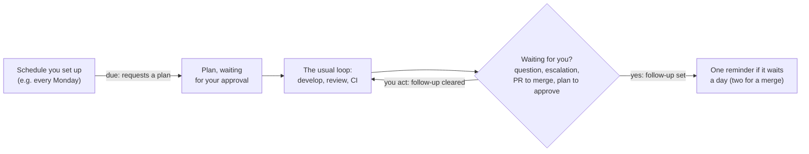
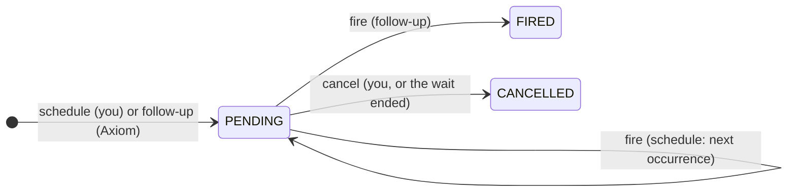
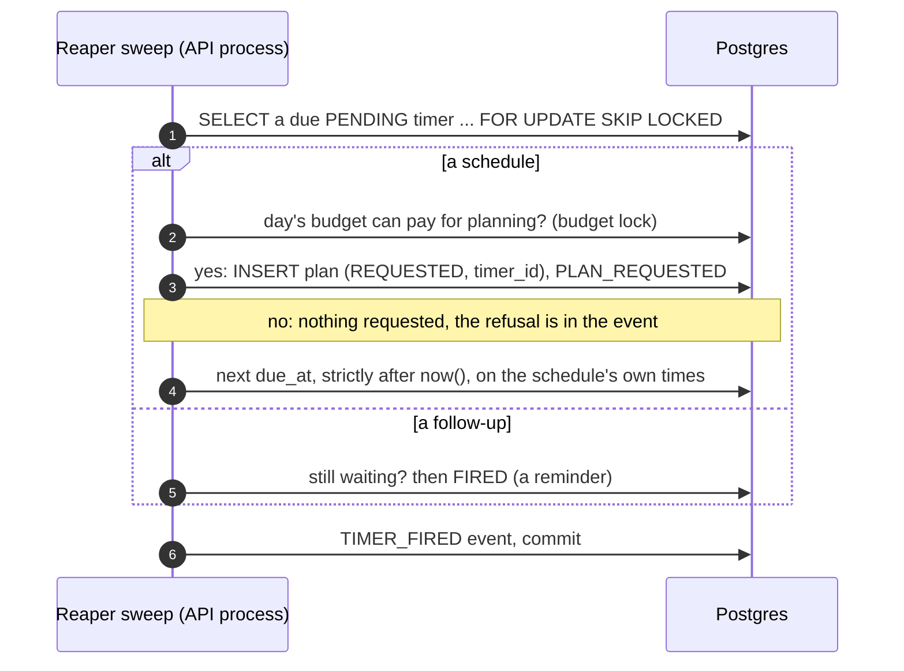
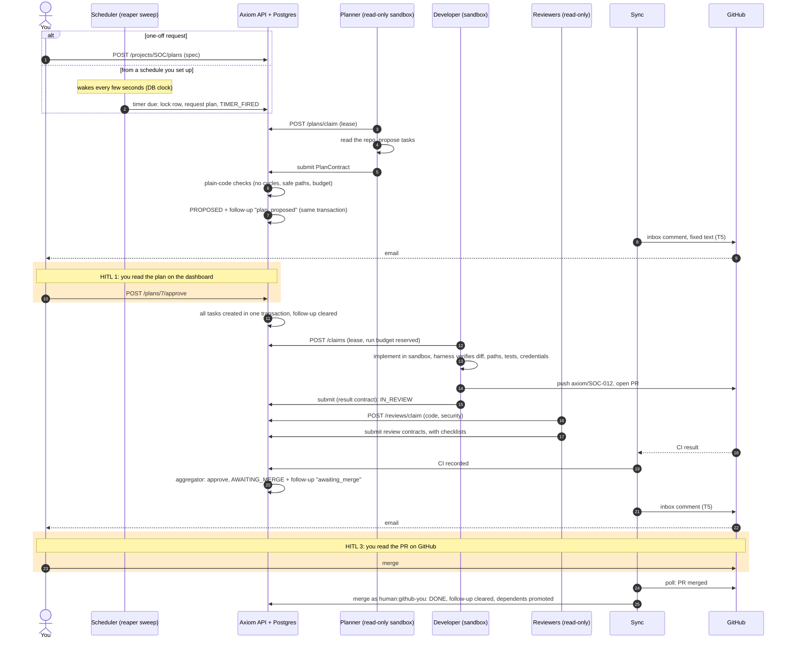
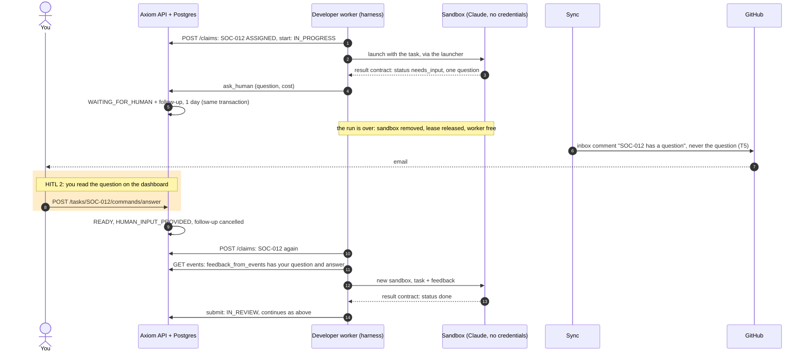
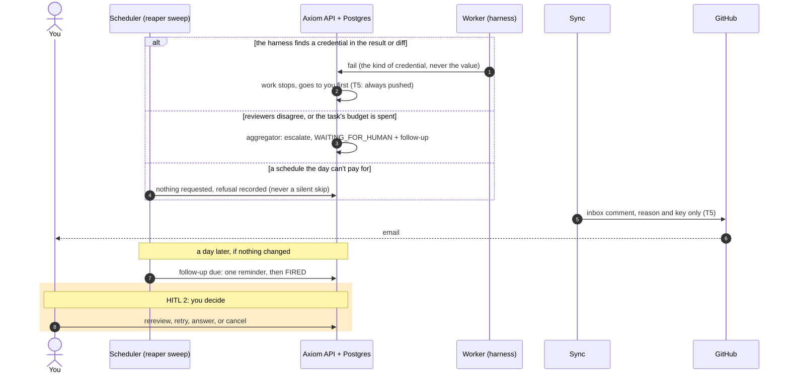
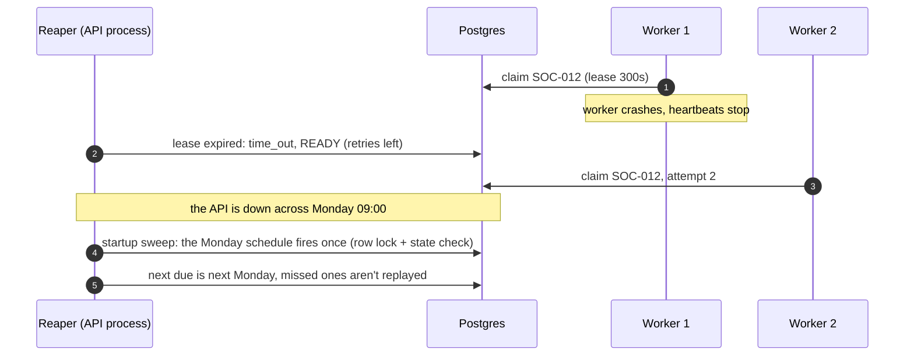

# 17. Continuous operation: schedules, follow-ups, and where you come in

Until Phase 5, Axiom only acted when you did: you requested a plan or created a task, and you found out what
needed you by opening the dashboard. Now it can wake up by itself, on a schedule you set up, and it remembers
to remind you when something has waited too long (ADR-018). **Nothing new can approve or merge.** A schedule
only asks for a plan, and that plan waits for your approval like any other.



## Nothing is really "always on"

Anthropic's ["Building always-on agents"](https://claude.com/resources/articles/building-always-on-agents)
describes the pattern: the agent sleeps, wakes for a short run when an event arrives, saves what happened, and
sleeps again. Axiom already had most of it:

| Pattern | In Axiom |
|---|---|
| A durable inbox, one worker per item, retry when a worker dies | Postgres tasks, claims, leases, the reaper ([chapter 6](06-concurrency-and-leases.md)) |
| Timers in their own store; a scheduler turns due ones into work | **New:** the `timers` table; the reaper fires due timers |
| Memory that outlives a run | The event log: each run reads its history (`feedback_from_events`) |
| Credentials added by a proxy, never in the agent | ADR-008, ADR-015, ADR-017 |
| A "deferred tool call": stop, ask the user, resume on the answer | `ask_human` → WAITING_FOR_HUMAN → `answer` → a fresh run |
| An outbox: send, stay quiet, or ask | PRs and the dashboard; notifications are Phase 5 T5 (ADR-019) |

## Timers

A timer is a row with a small state machine
([state-machines.md](../state-machines.md#timer-phase-5-adr-018)): it waits until it's due, then fires.



| | Schedule | Follow-up |
|---|---|---|
| Created by | you, `POST /projects/{key}/schedules` | Axiom, in the transition that starts a wait |
| When it fires | every N hours (1 hour to 90 days) | once, after a day (two for a PR awaiting merge) |
| What firing does | requests a plan, as `system:scheduler` | records a reminder (delivered by T5's notifications) |
| Ends | when you cancel it | when the wait ends (cancelled in the same transaction), or after firing |

**Agents can't create, change or cancel timers.** The timer machine has no agent actor, the API refuses one,
and the database refuses a timer whose creator is an agent (`test_no_agent_can_touch_a_timer`,
`test_only_a_human_sets_up_a_schedule`, `test_the_database_refuses_a_timer_from_an_agent`).

### Firing: once, on the DB clock

The reaper already runs every few seconds in the API process, and once at startup. Its sweep now also fires
due timers (`fire_due_timers`). Each one is fired in its own transaction:



- **Never twice.** The row lock and the state check happen together, and a second sweeper skips locked rows. Two
  API processes sweeping the same six due schedules request exactly six plans
  (`test_two_schedulers_never_fire_the_same_timer`).
- **Downtime.** A daily schedule missed for three and a half days fires once, not four times, and its next time
  stays on the schedule's grid. The event records how many were missed
  (`test_a_schedule_missed_while_axiom_was_down_fires_once`, `test_the_reaper_fires_timers_on_its_sweep`).
- **Budget.** If the day's budget can't pay for a planning run, the schedule asks for nothing that time and
  says why in its event, never silently (`test_a_schedule_the_day_cant_pay_for_is_refused_and_recorded`).
- **Still your decision.** The scheduler can't approve the plan it asked for
  (`test_a_due_schedule_requests_a_plan_that_still_needs_you`).

### Follow-ups: set and cleared by transitions

`apply_command` (tasks) and the plan service call `on_task_transition` / `on_plan_transition` in the same
transaction as the transition. Leaving a state cancels that state's follow-up; entering a waiting state sets
one. So a reminder can't outlive its reason, and an invariant checks it on every test's teardown: a pending
follow-up's subject is still in the state it was set for.

| Waiting state | Reason | Reminder after |
|---|---|---|
| Task WAITING_FOR_HUMAN (a question, an escalation) | `waiting_for_human` | `AXIOM_FOLLOW_UP_WAITING_SECONDS`, 1 day |
| Task AWAITING_MERGE | `awaiting_merge` | `AXIOM_FOLLOW_UP_MERGE_SECONDS`, 2 days |
| Plan PROPOSED | `plan_proposed` | `AXIOM_FOLLOW_UP_PLAN_SECONDS`, 1 day |

Proof: `test_a_question_gets_one_reminder_and_the_answer_clears_it`,
`test_a_follow_up_fires_once_if_you_havent_acted`,
`test_a_pr_waiting_for_your_merge_gets_a_reminder_until_you_merge`,
`test_a_proposed_plan_gets_a_reminder_until_you_decide`, `test_work_that_doesnt_wait_for_you_sets_no_follow_up`.

Timer events carry `timer_id` and keep their task or plan in the payload, so a task's own events stay its
transitions, which the invariants replay (`test_timer_events_stay_out_of_the_tasks_own_history`).

## End to end: from a request to merged work, and where you come in

There are three places where you come in (HITL), and Axiom stops at each one until you act:

| # | When | What you do | If you don't |
|---|---|---|---|
| HITL 1 | A plan is proposed | approve or reject it | nothing runs; a reminder after a day |
| HITL 2 | An agent needs an answer, or Axiom escalates (reviewers disagree, budget spent, a potential credential exposure) | answer, rereview, retry or cancel | the task waits; a reminder after a day |
| HITL 3 | A PR has passed review and CI | merge it on GitHub, or close it | the PR waits; a reminder after two days |

The diagrams show notifications as they'll work after T5 (ADR-019): a comment with fixed text on an inbox issue
in the project repository, which GitHub emails you. Until then the reminder is an event on the dashboard.

**The whole journey.** A request comes from you or from a schedule you set up, and ends with you merging.



**An agent needs you partway through (HITL 2).** Axiom's version of the "deferred tool call": the run ends,
nothing waits in memory, and your answer starts a fresh run whose history comes from the event log.



**When Axiom stops by itself (HITL 2), and reminders.** No agent can approve, and nothing is skipped silently:
when the rules can't decide, you do.



**Crashes in the middle.** Durability is what makes it safe to leave Axiom running unattended.



## Setting up a schedule

```bash
curl "${H[@]}" $A/projects/SOC/schedules -d '{"every_hours": 168, "budget_usd": 6,
  "first_at": "2026-11-16T09:00:00Z",
  "specification": "Update the Python dependencies to their latest compatible versions; tests must pass."}'
curl "${H[@]}" "$A/timers?status=PENDING"          # schedules and reminders
curl "${H[@]}" -X POST $A/timers/3/cancel           # stop one
```

A schedule is standing permission to *spend on planning* without asking each time. That's why it's capped by the
day's budget, visible on `/timers`, and cancellable at any time. Letting a schedule create tasks without your
approval would be the first thing in Axiom that runs without your yes; it would need its own ADR.
