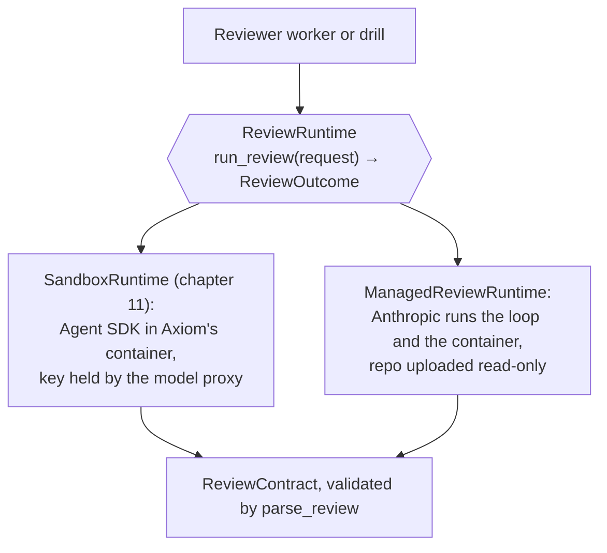

# 18. Runtimes: one interface, two ways to run a review

SPEC principle 2 says agents run through pluggable runtime adapters. Until Phase 5 there was one: the Claude Agent
SDK in Axiom's own sandbox (chapter 11). Phase 5 added a second for reviews, Claude Managed Agents, behind the same
`ReviewRuntime` interface, **without changing any orchestration code** (ADR-020).



## How the managed runtime keeps the rules

| Rule | Sandbox runtime | Managed runtime |
|---|---|---|
| No credentials in the agent's environment | a run token only; egress allowlist | no token at all; files uploaded; `limited` network with no hosts |
| Read-only | Read, Glob, Grep; a hook denies every edit | `read`, `glob`, `grep` only; uploads mounted read-only |
| Strict contract | the SDK's structured output | a custom tool, `submit_review`; an invalid one is sent back (up to 3 tries) |
| Spend cap | the run budget, enforced by the model proxy | a platform-enforced session budget |
| Recorded cost | the model proxy's meter | the session's `list_cost` |
| Who holds the Anthropic key | the model proxy only | the process driving the session |

The last row is why the managed runtime is a drill and not yet a reviewer worker: wiring it in means moving the
driver into the model proxy, not handing the key to a worker.

Proof: `test_the_agent_can_only_read_and_submit`, `test_the_sandbox_has_no_way_out`,
`test_an_invalid_submission_goes_back_with_its_problems_then_a_valid_one_counts`,
`test_the_budget_and_the_deadline_end_a_session`, `test_a_whole_review_through_the_adapter`.

## The result

On the same three reviews as T3, Managed Agents gave the same verdicts and blocking findings, at about the same
cost ([record](../runs/2026-11-14-phase-5-managed-agents.md)). Developers stay on the sandbox: on Managed Agents
they'd need a writable GitHub token given to Anthropic's git proxy, and Axiom's checks on their work would have to
move.

## Running it

```bash
set -a && . ./.env && set +a      # this drill needs the Anthropic key in its own process
uv run --extra managed python -m axiom.drills.managed_review cases.json results.jsonl claude-fable-5-2
```
