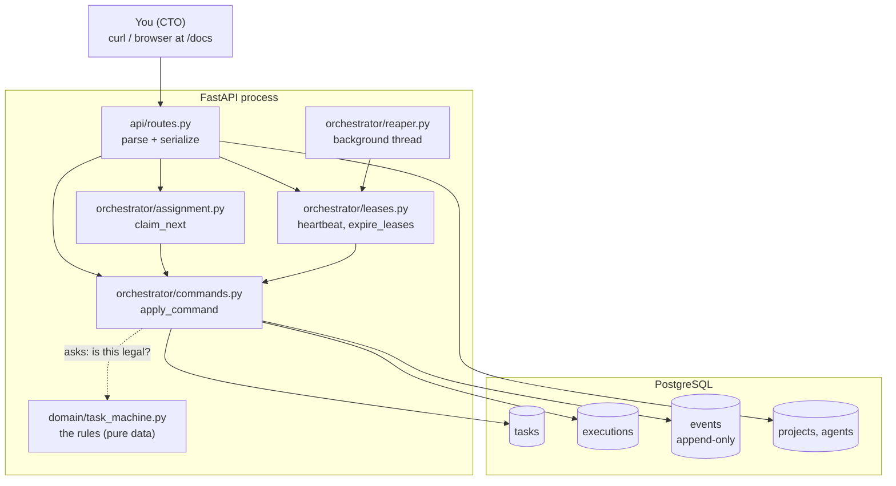

# The Axiom guide: how it is built and how it works

This guide is for learning. It explains what Phase 1 built, why it is built that way, and how
each piece works, with a diagram for almost every idea. It assumes you know Python and SQL,
but not Postgres locking or state-machine design.

Every chapter ends with **"Try it"** exercises against the running stack or the test suite.
Doing them is the fastest way to make the ideas stick.

## Reading order

| # | Chapter | You will learn |
|---|---|---|
| 1 | [The big picture](01-big-picture.md) | What Axiom is, its layers, what Phase 1 covers |
| 2 | [The life of a task](02-life-of-a-task.md) | One task from creation to DONE, call by call, with the events it leaves behind |
| 3 | [State machines](03-state-machines.md) | Why there are two machines, the loops (retry, rework, human input), who may do what |
| 4 | [The data model](04-data-model.md) | Every table, every constraint, and what the database guarantees for us |
| 5 | [The command engine](05-command-engine.md) | The single code path that changes state, step by step |
| 6 | [Concurrency, leases and the reaper](06-concurrency-and-leases.md) | How two agents never get the same task, and how dead workers are detected |
| 7 | [Crash recovery](07-crash-recovery.md) | Why killing Axiom loses nothing, and what happens at startup |
| 8 | [The API layer](08-api-layer.md) | How an HTTP request becomes a command, and how errors map to status codes |
| 9 | [How it is tested](09-testing.md) | Tests generated from the transition table, invariants, race tests |
| 10 | [Code tour and how to extend it](10-code-tour.md) | Where everything lives, and a worked example of adding a feature |

The reference documents sit next to this guide:
- [state-machines.md](../state-machines.md): the transition tables;
- [architecture.md](../architecture.md): a one-page summary;
- [api.md](../api.md): endpoints;
- [decisions/](../decisions/): the ADRs, i.e. why each choice was made.

## The whole system on one page

## Glossary

| Term | Meaning |
|---|---|
| **Task** | A unit of work with a contract: title, specification, acceptance criteria, role, priority, retry limit, dependencies |
| **Execution** | One attempt by one agent to work on a task. A task can have many over its life, but only one active at a time |
| **Agent** | A logical employee in the registry (e.g. `DEV-01`, a developer running on Claude Code). In Phase 1 agents are just rows; you act as them with a header |
| **Actor** | Whoever issues a command: `human:<name>`, `agent:<KEY>` or `system:<name>` |
| **Command** | A request to change a task's state, e.g. `start`, `submit`, `merge`. Legal or illegal depending on the current state and the actor |
| **Event** | A row in the append-only log, written in the same transaction as every state change |
| **Lease** | A time-limited claim on a task held by an execution. Heartbeats renew it; if it expires, the reaper takes the task back |
| **Reaper** | A background loop that times out executions whose lease expired |
| **Invariant** | A rule that must always hold, e.g. "a task is ASSIGNED or IN_PROGRESS iff it has exactly one active execution" |
| **Guard** | A condition checked before a legal command is applied, e.g. "the lease is still live" |
