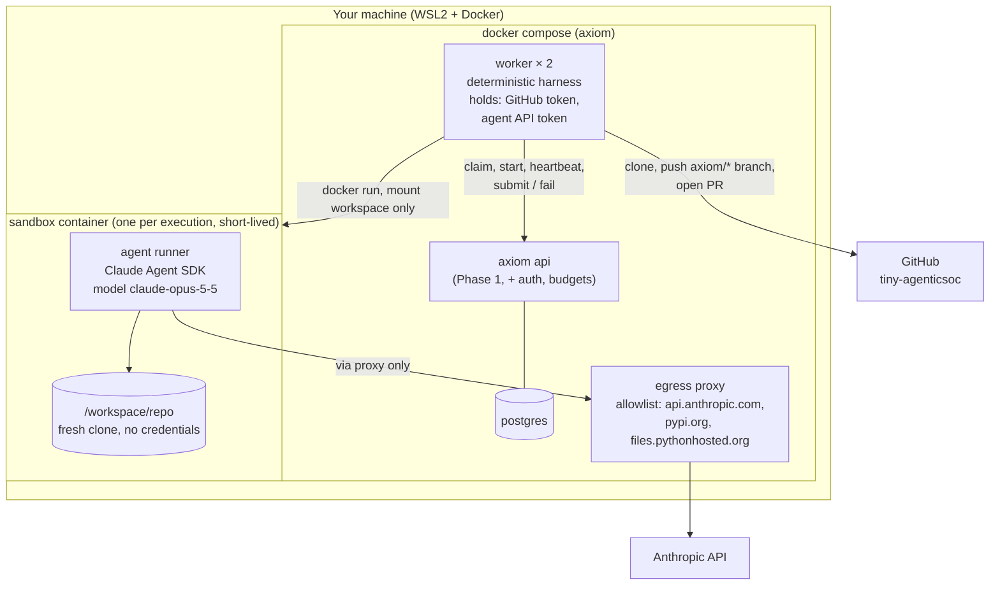
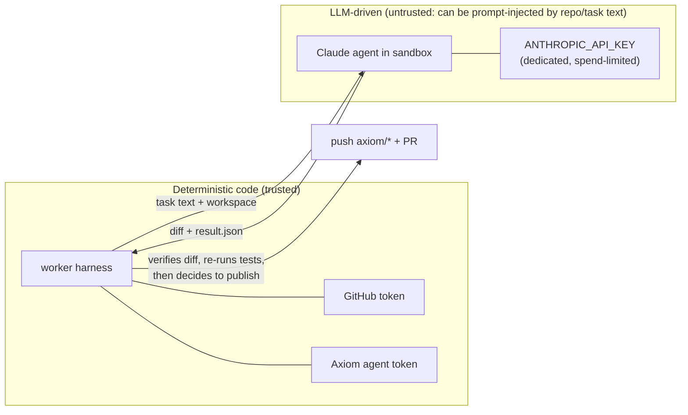
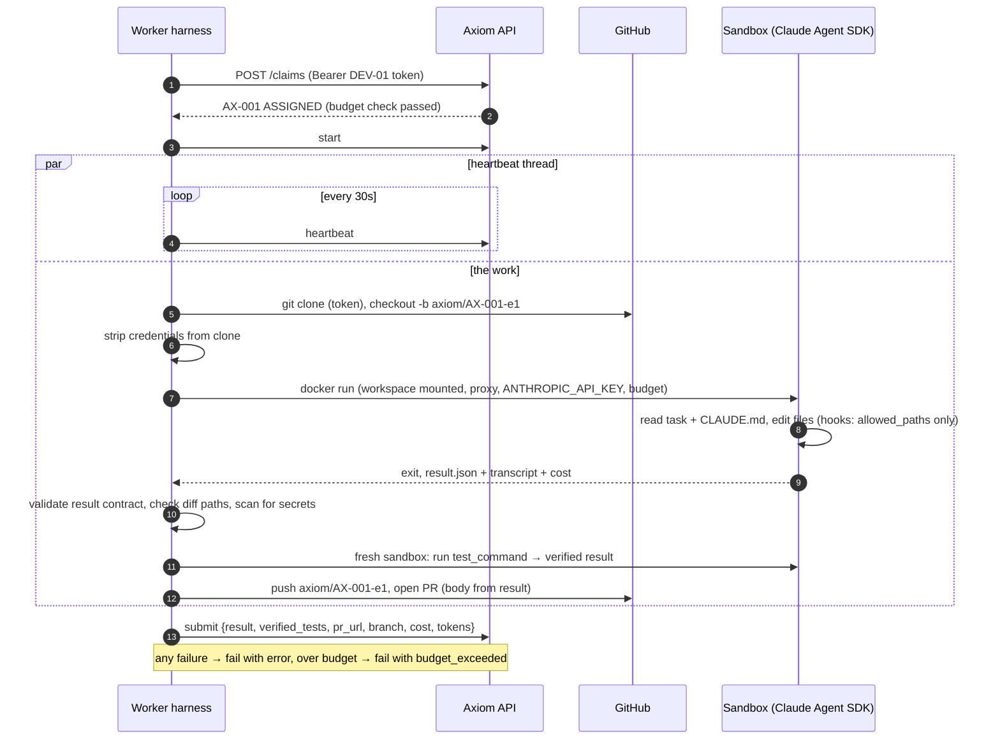

# Phase 2 plan: the first worker

Status: **proposed, awaiting approval** (2026-11-02).
Goal (SPEC.md): *one real task goes from READY to an open PR with no input from me.*
Target repository: `bharathcmbox/tiny-agenticsoc` (private), local checkout
`~/githubcode/tiny-agenticsoc`. Workers run locally in Docker.

## 1. What we found in the target repo

| Finding | Consequence for the plan |
|---|---|
| Private repo on GitHub's **free plan**: branch protection and rulesets return 403 | GitHub cannot stop a token with push rights from pushing to `main` or merging. The guarantee must come from **who holds the token** (section 3, ADR-007) |
| `.env` and `lab/.secrets/` exist locally but are git-ignored; none of the 70 tracked files is a secret | Workers clone from GitHub, so they only ever see tracked files and never the local checkout |
| No GitHub Actions workflows | There is no CI to trust yet, so the worker re-runs the tests itself in a fresh sandbox (section 4) |
| `pytest` is not a declared dependency; 8 tests pass with `uv run --with pytest pytest -q` in `agent/` | Test command for the project: `cd agent && uv run --with pytest pytest -q`. Also a good first task |
| The SOC repo's `CLAUDE.md` says "LLM calls go through OpenRouter", but recent commits call the Anthropic API directly | Worker agents read `CLAUDE.md`, so stale instructions would mislead them. Fixing it is part of the first task |

## 2. Architecture

### Trust boundaries

The rule: **nothing the LLM controls can reach GitHub or the Axiom API directly.** The sandbox
gets a workspace and an Anthropic key, and nothing else. The harness inspects what comes back
before anything leaves the machine.

## 3. Decisions to confirm

| # | Topic | Proposal |
|---|---|---|
| P1 | GitHub enforcement on a free private repo | **ADR-007:** the GitHub token lives only in the worker harness. The harness pushes only to `refs/heads/axiom/*`, opens PRs and never calls merge. The sandbox has no GitHub credentials. Upgrading to GitHub Pro ($4/month) would add GitHub-enforced protection; recommended **before Phase 3** (merge gating), optional now |
| P2 | Sandbox vs harness split | Worker harness as a compose service with the Docker socket (it is our code); one fresh sandbox container per execution with only the workspace mounted. The LLM never runs where the tokens are |
| P3 | Workspace | A fresh `git clone` from GitHub per execution (not a worktree of your local checkout), so your machine's files are never mounted. Credentials are removed from the clone before the sandbox sees it |
| P4 | Auth (fixes the Phase 1 limitation) | Per-agent bearer tokens (stored hashed) and one admin token for humans. `system:` actors are no longer accepted over HTTP |
| P5 | Budgets | Defaults: per task `budget_usd = 3.00`, daily cap `$15`. Checked at claim time (refuse if spent), passed to the run as its ceiling, and the run is stopped when exceeded → `fail` with `budget_exceeded` |
| P6 | Trust CI, not the agent | No CI exists, so the worker re-runs `test_command` in a fresh sandbox after the agent finishes. The verified result goes into the submit payload next to the agent's claim |
| P7 | Issues mirror | **Defer to Phase 3.** Not needed for the exit criterion; keeps Phase 2 focused |
| P8 | Model | `claude-opus-5-5` with explicit effort (`high`), per ADR-006 |
| P9 | First real task | *"Make the agent test suite runnable: add pytest as a dev dependency of `agent/` so `uv run pytest` works, and update CLAUDE.md (test command; LLM calls go to the Anthropic API, not OpenRouter)."* `allowed_paths`: `agent/pyproject.toml`, `agent/uv.lock`, `CLAUDE.md`. Small, checkable, useful |
| P10 | Live API spend during development | Most tests use a **FakeRuntime** (no API calls). Live runs only in T1 (spike), T6 (sandbox check) and T10 (the real task), each announced first. Estimate: under $15 total |

## 4. One execution, end to end

## 5. Tasks

Every task: lint + full test suite + one commit, as in Phase 1. Real-API calls happen only
where marked **LIVE**, and I announce them before running.

| Task | Deliverable | Acceptance criteria | Proving tests |
|---|---|---|---|
| T0 Plan + ADRs | this plan, ADR-007 (GitHub enforcement), ADR-008 (worker/sandbox design), guide chapter outline | approved | — |
| T1 SDK spike **LIVE** | notes on the Claude Agent SDK in a container: options (model, effort, cwd, tools, hooks, turn/budget limits), cost reporting, proxy support | each question answered from docs + one real call (cents) | spike script output recorded in the notes |
| T2 Auth | `agent_tokens` table (hashed), admin token, token CLI; actor derived from token; `system:` rejected over HTTP | no write without a valid token; agent tokens act only as their agent | missing/wrong token → 401; agent token cannot act as a human or another agent; existing tests updated |
| T3 Budgets + contract fields | migration 0002: `tasks.allowed_paths`, project `test_command`/`default_branch`, cost columns filled on submit/fail; claim refuses over daily or task budget | spend is computed from executions; caps enforced at claim | over task budget → claim rejected; daily cap → rejected; cost recorded and summed |
| T4 Runtime adapter + FakeRuntime | `runtimes/base.py` (start, events, cancel, result), FakeRuntime that makes scripted edits, result-contract JSON schema | worker code depends only on the interface | schema accepts a valid result and rejects malformed ones; FakeRuntime scenarios (success, failure, over-budget, edits outside paths) |
| T5 Workspace manager | clone with token into a per-execution dir, branch, scrub credentials, cleanup | no token anywhere in the workspace after setup | against a local bare repo: branch created; `git config` and `.git` contain no token; cleanup removes the dir |
| T6 Sandbox + Claude runtime **LIVE** | sandbox image, runner, ClaudeCodeRuntime (SDK options, hooks blocking edits outside `allowed_paths` and reads of `.env`/secrets), egress proxy | the sandbox has no GitHub token and no route except via the proxy | hook unit tests; container test that env has no GitHub token; proxy blocks a non-allowlisted host; one small live run |
| T7 Verification | diff path check, secret scan, re-run `test_command` in a fresh sandbox | publish only if all pass; otherwise `fail` with reasons | crafted diffs: outside paths → rejected; fake key in diff → rejected; failing tests → rejected |
| T8 GitHub publisher | push only `axiom/*` refs, open PR, idempotent on retry | can never push another ref | local bare repo + mocked GitHub API: ref guard, PR body, existing PR reused |
| T9 Worker loop | claim → start → heartbeat thread → workspace → sandbox → verify → publish → submit/fail; compose service; graceful stop | end to end with FakeRuntime; a killed worker's task is retried after lease expiry | E2E with FakeRuntime + bare repo + fake GitHub; SIGKILL the worker mid-run → task back to READY → second worker completes it |
| T10 First real task **LIVE** | register the SOC project, create task P9, run the worker | a real PR on tiny-agenticsoc, no human input between READY and PR | recorded run: events, cost, PR link, verified tests |
| T11 Guide + exit check | guide chapters on workers, sandboxing and budgets (with diagrams); Phase 2 exit evidence | — | — |

## 6. Phase 2 exit criteria

- [ ] One real task goes from READY to an open PR with no human input (T10).
- [ ] The budget cap stops a run and fails the task cleanly, with a test (T3, T6, T9).
- [ ] The LLM sandbox holds no GitHub or Axiom credentials, demonstrated by a test (T6).
- [ ] Edits outside `allowed_paths` and secrets in diffs are blocked, with tests (T6, T7).
- [ ] Killing a worker mid-run leads to a retry by another worker, with a test (T9).
- [ ] The Axiom API rejects unauthenticated writes (T2).
