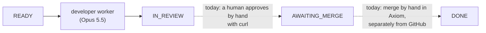
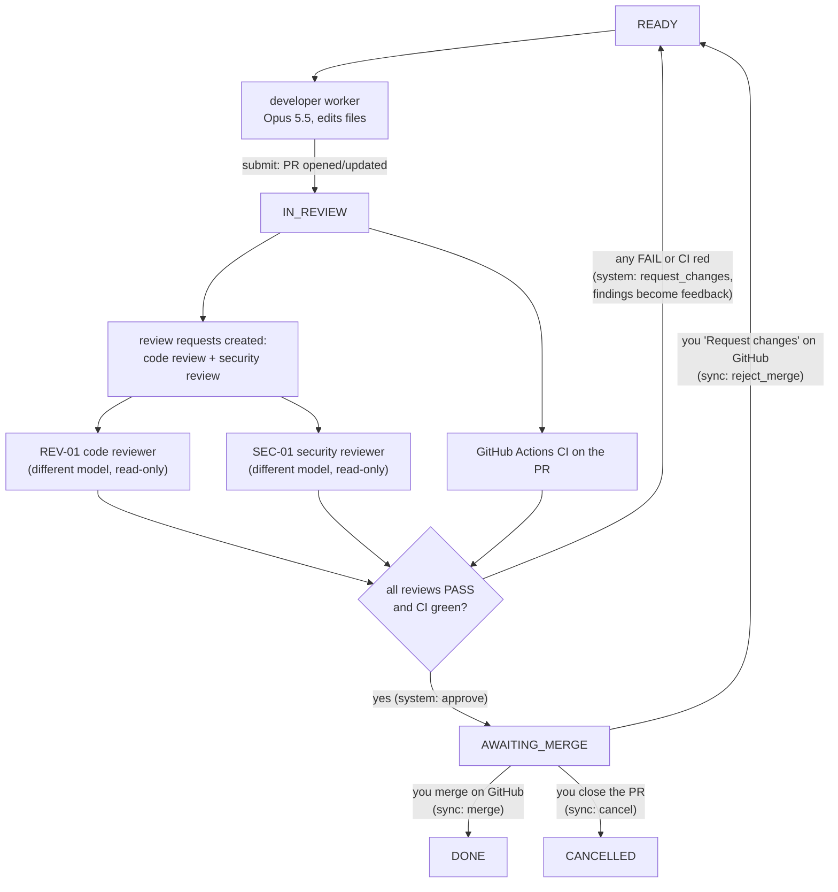
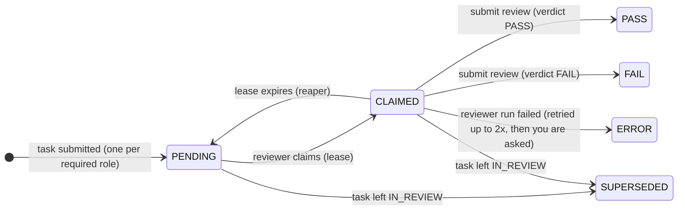

# Phase 3 plan: independent review and the CI gate

Status: **approved 2026-11-03** with these decisions:
- Q1: **no GitHub Pro for now.** The "no direct push to main / merge only by a human" guarantee
  stays harness-enforced (ADR-007) plus convention; revisit before relying on Axiom for real work.
- Q2: **keep the existing fine-grained token** (no GitHub App). PRs keep showing the token owner
  as author.
- Q3: reviewers on **Claude Fable 5.1** (`claude-fable-5-1`).
- Q8: Claude commits the CI workflow to tiny-agenticsoc.
- Q4–Q7, Q9: defaults (code + security reviewers; merge on GitHub observed by sync; 3 rounds;
  PASS with high/critical findings becomes FAIL; Issues mirror in Phase 4).
- Documentation is a deliverable of every task: guide chapter 12 grows with each task, and
  every scenario gets a diagram.
Goal (SPEC.md): reviewer roles, review contracts, a changes-requested loop, results read from CI,
human merge approval. *Exit:* a deliberately buggy task is caught and sent back at least once.

## 1. Where Phase 2 left us



Three gaps:
- **Nobody reviews.** IN_REVIEW waits for a manual `approve`.
- **There is no CI.** Axiom's own test re-run is the only check, and it isn't visible on
  GitHub.
- **GitHub and Axiom are not linked.** Merging on GitHub does not move the task, and
  nothing on GitHub stops a push to `main` (ADR-007).

## 2. Target flow



The next developer run **continues on the same branch and the same PR**, with the review
findings in its prompt. The PR shows the whole conversation.

## 3. Decisions for you

| # | Topic | Options | Recommendation |
|---|---|---|---|
| Q1 | **GitHub enforcement** (needed now that merging is real) | (a) GitHub Pro ($4/month) + ruleset on `main`: PRs required, CI required, 1 approval, no force push. (b) Make the repo public (rulesets free). (c) Stay as-is (harness-only guarantee) | **(a) Pro + ruleset**, combined with Q2 |
| Q2 | **Who authors PRs** | (a) Keep your token: PRs are "yours", so GitHub won't let you approve them, and a required approval is impossible without admin bypass. (b) A **GitHub App** ("axiom-bot"): PRs authored by the bot, you approve and merge; short-lived installation tokens; can't bypass the ruleset. (c) A machine-user account with a classic PAT | **(b) GitHub App.** I'll walk you through creating it (about 10 minutes) |
| Q3 | **Reviewer model** (must differ from the developer's Opus 5.5) | (a) **Claude Fable 5.1**: strongest; $10/$50 per MTok, but reviews read a small diff, so roughly $0.10–0.60 per review. (b) **Claude Sonnet 5.5**: $2/$10, cheaper, less thorough. (c) Codex: needs an OpenAI key and adapter (SPEC puts it in Phase 5) | **(a) Fable 5.1** for both reviewers to start; measure, then decide whether Sonnet 5.5 holds quality |
| Q4 | **Which reviewers** | Code reviewer + security reviewer now. The QA agent (writes tests in a separate PR) is a different workflow | Code + security in Phase 3; **QA in Phase 4** |
| Q5 | **Who merges** | (a) You merge on GitHub; Axiom's sync sees it and records `merge` as `human:<your GitHub login>`. (b) You approve in Axiom and Axiom merges via the API | **(a)**: Axiom keeps having no merge code path |
| Q6 | **Review-round cap** | After N rounds of changes requested, stop and ask you | **3 rounds**, then `WAITING_FOR_HUMAN` with all findings |
| Q7 | **Verdict policy** | Trust the reviewer's verdict, or let Axiom override | Reviewer decides, **but** a PASS with any `high`/`critical` finding is turned into FAIL (a consistency rule) |
| Q8 | **CI workflow** | A GitHub Actions file in tiny-agenticsoc runs `cd agent && uv run pytest`. The worker's token has no Workflows permission (by design), so the workflow file must come from you | I write `.github/workflows/ci.yml`; **you** commit it (or tell me to, using your `gh` login) |
| Q9 | **Issues mirror** (deferred from Phase 2) | Not needed for the exit criterion | **Defer to Phase 4** |

## 4. Design

### 4.1 Reviews become first-class work

A new `reviews` table with its own small state machine. Reviews are not executions of the
task, so the Phase 1 invariant "a task is executing iff it has one active execution" still
holds.



**Review contract** (SPEC §6), strictly validated like the result contract:

```json
{
  "verdict": "FAIL",
  "summary": "…",
  "findings": [
    {"severity": "high", "file": "agent/socagent/incidents.py", "line": 42,
     "issue": "…", "required_change": "…"}
  ]
}
```

### 4.2 Aggregation: deterministic code decides, not a model

The task-machine rules change: `approve` and `request_changes` become **system** commands,
issued by an aggregator when the evidence is complete. A human keeps an override. Agents can
no longer issue either.

| Condition (evaluated when a review completes or CI changes) | System command |
|---|---|
| Any required review FAIL | `request_changes`: all findings become `previous_feedback` |
| CI concluded failure | `request_changes`: failing job summary as feedback |
| All required reviews PASS **and** CI success | `approve` → AWAITING_MERGE |
| Review rounds would exceed 3 | `escalate` → WAITING_FOR_HUMAN (new rule) |

### 4.3 Reviewer runs are read-only

The same sandbox image, in a "review" mode:
- **Workspace:** a clone at the PR's head commit.
- **Prompt:** the task contract, the diff, and the developer's result.
- **Tools:** `Read`, `Glob`, `Grep` only. The hook denies every edit and there is no Bash.
- **Model:** from the reviewer agent's registry row (Q3).

### 4.4 GitHub sync (new service)

A deterministic poller for tasks in IN_REVIEW and AWAITING_MERGE. It reads:
- **CI conclusion** for the PR head commit (Actions runs API);
- **PR state:** merged, closed, or a review requesting changes, including who did it.

It issues the matching command (table above, plus `merge`, `cancel`, `reject_merge`), and it
can never merge itself.

### 4.5 Rework continues the same PR

When a task has a `branch`, the next developer workspace clones **that branch**. New commits
are pushed fast-forward, so the PR updates in place. A round comment is posted on the PR:
"round 2: addressed findings X, Y".

## 5. Tasks

Every task: lint, the full suite, one commit. **LIVE** steps are announced before they run.

| Task | Deliverable | Acceptance | Proving tests |
|---|---|---|---|
| T0 | This plan approved; ADR-009 (reviews + aggregation), ADR-010 (merge on GitHub, observed by sync; no Pro yet) | — | — |
| T1 CI | `.github/workflows/ci.yml` in tiny-agenticsoc (committed by Claude); the token gets **Actions: read** (you edit the token) so the sync can read CI results | CI runs on push to `main` and on PRs | CI run visible; token can list workflow runs |
| T2 Review domain | migration (reviews), pure review state machine, task-machine changes (system approve/request_changes, escalate), docs + diagrams | the tables match the docs; every pair tested | generated legal/illegal tests (as in Phase 1); doc-sync test |
| T3 Review API + aggregation | auto-create reviews on submit, review claims (SKIP LOCKED + lease + heartbeat), submit review, aggregator, round cap | reviews never double-claimed; aggregator outcomes exact | race test; aggregation table tests; developer agents cannot claim reviews; nobody approves their own work |
| T4 Reviewer runtime | ReviewContract, reviewer prompt, read-only hooks, sandbox review mode, FakeReviewer | reviewer cannot edit anything | hook tests; contract tests; docker test |
| T5 Rework on the same PR | workspace from the task branch, feedback in the prompt, fast-forward push, PR round comment | round 2 updates PR #N, not a new PR | E2E with a bare remote + fake GitHub |
| T6 GitHub sync | sync service: CI conclusion for the PR head, merged (by whom), closed, "changes requested" reviews | Axiom state follows GitHub; still no merge path | fake GitHub server: CI red/green, merged by user, closed, review changes |
| T7 Reviewer workers | compose services for REV-01 and SEC-01; reviewer worker loop | full loop with fakes: buggy → FAIL → rework → PASS → CI → merge → DONE | E2E with fake runtimes + fake GitHub |
| T8 **LIVE** exit demo | a planted-bug task on tiny-agenticsoc: a scripted developer submits a subtle bug that the tests don't catch; real reviewers (Q3) must FAIL it; a real developer reworks; reviewers PASS; CI green; **you** merge | sent back at least once, then DONE after your merge | recorded run: events, review contracts, PR conversation, costs |
| T9 | Guide chapter 12 (reviews, aggregation, GitHub sync) + exit check | — | — |

## 6. Phase 3 exit criteria: met (2026-11-05)

| Criterion | Evidence |
|---|---|
| A deliberately buggy change is caught by an independent reviewer and sent back; the reworked change passes | **SOC-002**, [PR #2](https://github.com/bharathcmbox/tiny-agenticsoc/pull/2): a planted `>` for `>=` that all tests and CI passed. Blind, Claude Fable 5.1 returned FAIL with a high finding on the exact line. A real developer (Claude Opus 5.5) fixed it on the same PR; both reviewers then passed it. Automated equivalent: `test_buggy_change_caught_reworked_approved_merged` |
| CI results gate AWAITING_MERGE; red CI sends the task back | Live: approval came only when CI reported success for the round-2 commit. Red CI: `test_red_ci_sends_the_work_back`, `test_ci_must_be_green_for_the_head_commit` (fake GitHub; not exercised live) |
| Nobody approves their own work | Generated `test_wrong_actor_kind_rejected` cases (agents cannot approve), `test_developers_and_humans_cannot_claim_reviews`, `test_developers_cannot_act_as_reviewers`; reviewers ran on a different model |
| Merging only on GitHub by a human, recorded as DONE | Live: TASK_DONE by `human:github-bharathcmbox`, `merged_before_gate: false`. Axiom has no merge path (`test_client_has_no_way_to_merge`, `test_the_sync_never_writes_to_github`). **Not enforced by GitHub** without Pro (ADR-010) |
| Every review stored as a validated contract with events | `test_invalid_contracts_are_rejected_without_changes`; live: 4 reviews with contracts and costs |
| Rework updates the same PR | Live: one PR, two commits, one round comment. `test_rework_continues_the_same_branch_and_pr_with_the_findings` |

Totals: 1004 default tests + 9 Docker tests + 2 live tests, all passing; ruff and mypy (strict)
clean. API spend in Phase 3: $0.15 (reviewer live test) + $1.19 (SOC-002) = $1.34.

## 7. Changes from the plan

- **The token and the GitHub App:** no GitHub Pro and no App (Q1, Q2 changed by the human); the guarantee stays
  harness-enforced plus convention.
- **`/axiom changes` comment command:** added, because GitHub doesn't let a PR's author request
  changes.
- **Scripted developer** (`AXIOM_FAKE_EDITS_FILE`): added so the reviewers' test could be blind. The
  planted patch lives outside this repo (ADR-004).
- **`POST /agents/{key}/model`, `POST /projects/{key}/require-ci`:** added so these changes are
  logged rather than made with SQL.

## 8. Findings (learning log)

Full list with causes: [guide chapter 14](../guide/14-how-it-was-built.md#what-went-wrong).

- **CI was green on the buggy commit.** The whole case for independent review, in one run.
- **Both reviewers found the bug independently,** and each noticed the developer's claim was not
  backed by its evidence.
- **The live run found two bugs unit tests could not:** a `noexec` HOME in the sandbox, and a lost
  cost for superseded reviews.
- **Costs were far lower than estimated:** $1.19, against an estimate of $2–6.
- **Sample size is one.** This shows the loop works. It says nothing yet about catch rates or false
  alarms; Phases 4 and 5 are for measuring.

## 9. Known limitations

- **GitHub doesn't enforce the gate:** no branch protection without Pro. A human can merge early or
  push to `main` (the early merge is recorded). PRs show the token owner as author.
- **A run killed partway has no final report,** so its cost is unknown and budgets undercount it.
- **Review runs aren't capped by the task's budget:** per review ($1) and per day only.
- **The daily budget check isn't serialized:** two simultaneous claims can both pass near the cap.
- **`require_ci` with no CI workflow waits forever.**
- **Exercised with a fake GitHub only:** red CI, closing a PR, `/axiom changes`, GitHub reviews,
  merging early. **Security review has only seen trivial code.**
- **The SPEC's prompt-injection drill has not been run.**
- **SOC-001 predates reviews:** it has no reviews and no `head_sha`, so it stays IN_REVIEW until its
  PR #1 is merged or closed.
- **Sandbox image builds need Docker's credential helper,** which fails when WSL can't reach Docker
  Desktop; a temporary empty `DOCKER_CONFIG` works around it, since all base images are public.

## 10. Recommended next phase: Phase 4, engineering management

1. **Metrics first:** compute SPEC section 2's numbers from the event log, so everything after this
   is measured (cycle time, first-pass acceptance, cost per merged task, human interventions).
2. **Prompt-injection drill**, since it's cheap and overdue.
3. **Spec → tasks** with human approval, dependencies, two developers in parallel.
4. **QA agent**, Issues mirror, dashboard, daily report.

Decision needed then: GitHub Pro or a GitHub App, before relying on Axiom for real work.
