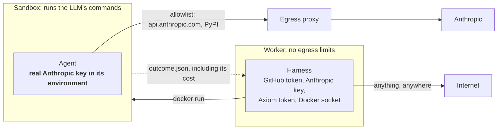
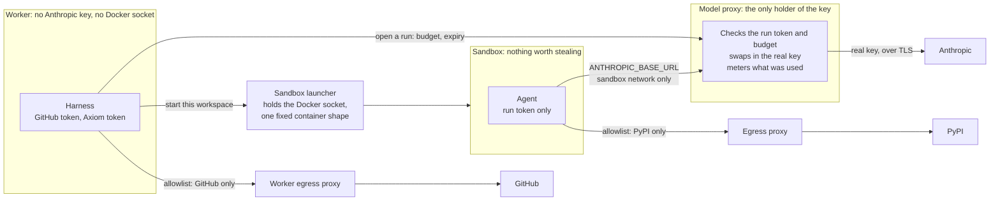
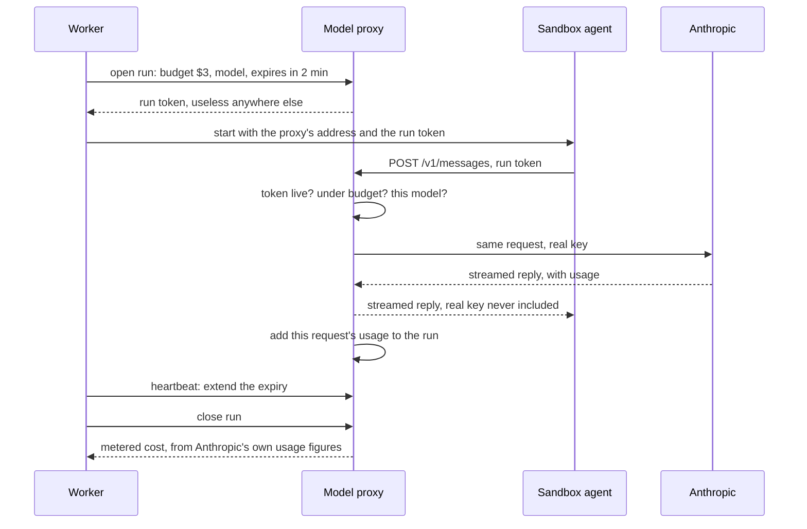

# Phase 4 hardening: credentials outside the sandbox (proposed)

**Status: approved 2026-11-06; runs before T5.** H0 passed: [spike results](../spikes/model-proxy.md).
H1 done: [ADR-015](../decisions/ADR-015-the-model-proxy-holds-the-anthropic-key.md), with live runs on
Opus 5.5 and Fable 5.1 metered identically to the SDK ($0.0596412 and $0.15388175).
H2 done: [ADR-016](../decisions/ADR-016-only-the-launcher-holds-the-docker-socket.md), and it closed a
symlink route to the worker's tokens found on the way.
H3 done: [ADR-017](../decisions/ADR-017-workers-reach-only-github.md). `make check-boundaries` checks it
from inside real worker and sync containers.
H4: the whole layout ran end to end in the [T5 drill](../drills/2026-11-06-edge-drill.md). ADRs and guide
are done; the README's diagram is refreshed at T11.

The drill and the git escape (ADR-014) showed two things. Agents can be asked to steal what is within
reach, and the code around the sandbox is part of the attack surface. So: put nothing worth stealing
in the sandbox, and hold less in the worker.

## Today

| Risk today | Consequence |
|---|---|
| The key is in the sandbox | A compromised agent can read it |
| `api.anthropic.com` is reachable | Data can leave using an attacker's own key |
| The sandbox reports its own cost | It can claim $0 and get round budgets |
| A sandbox outlives a killed worker | It keeps spending, unmetered |
| The worker holds everything | Any way into it means every credential, and root through the Docker socket |

## Proposal

### One model request

## The work

| Task | What | Proof | Live cost |
|---|---|---|---|
| H0 Spike | Confirm the bundled CLI and SDK work through a local proxy: streaming, tool use, structured output, errors | One tiny real request through it | about $0.05 |
| H1 Model proxy | New service holding the key. Forwards only the Messages endpoints. Per-run tokens with budget, model and expiry. Meters usage. Sandbox and worker lose the key; `api.anthropic.com` leaves the sandbox allowlist | A compromised-agent test finds no key in the sandbox and can't reach Anthropic directly; a forged `outcome.json` changes nothing; a dead worker's run stops when its token expires | about $0.25 |
| H2 Sandbox launcher | New service, the only holder of the Docker socket. Takes a workspace and a run, and builds the same locked-down `docker run` as today. Refuses paths outside the workspaces root | The worker has no socket; a request for another path or a host mount is refused | none |
| H3 Worker egress | Worker and GitHub sync go through a second allowlist: GitHub only, plus internal services | A compromised-harness test can't reach another host | none |
| H4 Docs and exit | ADR-015, guide, attack-surface table, then a real task end to end. T5 can double as this | The whole loop runs with the new layout | included in T5 |

About $0.30 of live spend, within the Phase 4 cap. Each task follows the usual process: code, tests,
guide, one commit.

## What this fixes, and what it doesn't

| Risk | After |
|---|---|
| Key in the sandbox | **Closed.** Nothing to read |
| Data leaving with an attacker's key | **Closed.** The sandbox can't reach Anthropic directly |
| Forged cost | **Closed.** Cost comes from the proxy |
| Orphaned sandbox spending | **Closed,** within one token expiry |
| A compromised worker | **Reduced.** No Anthropic key, no root through Docker, GitHub only. It still has the GitHub token and its Axiom token |

Still open afterwards, by design:

- **An injected agent can still use its run.** It can call the model until its budget runs out. The
  loss is capped by the budget, and no key is exposed.
- **Agent output is still untrusted.** Bad code can be proposed; reviews, CI and you are the defence.
- **The agent's model traffic is the agent's.** Whatever it reads, including repository text, goes to
  Anthropic as it does today.
- **The proxy becomes the valuable target.** It runs no LLM and no repository code, accepts only one
  kind of request, and has no route for reading the key. That's a much smaller target than the worker.
- **PyPI stays reachable,** so a malicious package could run in the sandbox, where there is now
  nothing to steal. `upload.pypi.org` is not allowlisted.
- **The launcher can start sandboxes,** so a compromised worker could still run the sandbox image on
  workspace paths and spend up to a run's budget.

## Costs and trade-offs

- **Two or three new services.** More to run and understand; they're small, and the guide covers them.
- **The proxy can fail.** Runs then fail and retry, like any model error. No retry logic is added.
- **Streaming must pass through untouched.** The main technical risk, and why H0 comes first. If H0
  fails, this plan comes back to you changed.
- **Metered cost is computed from the price table,** which can go stale. The check against a real bill
  (`test_prices_reproduce_a_real_billed_run`) stays, and a run's SDK figure can be compared with it.

## Alternatives considered

| Option | Why not |
|---|---|
| `apiKeyHelper` | The key still reaches the sandbox, just by another route |
| Short-lived Anthropic credentials | Narrows the time window; still readable in the sandbox, and no budget or metering |
| An off-the-shelf LLM gateway | Far more than is needed, and a large new dependency holding the key |
| Docker socket proxy instead of a launcher | Filters API calls, but anything allowed to create containers can mount the host |
| Do nothing until Phase 5 | The exit run gives agents the most freedom they've had, on real work |

## Something you can do today

Give the new Anthropic key's Console workspace **a spend limit**, if your plan offers one. It's the
only limit here that holds even if Axiom itself is compromised.
