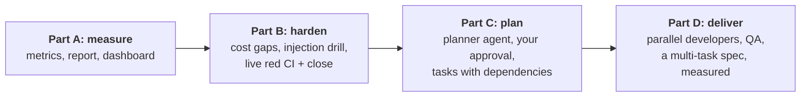
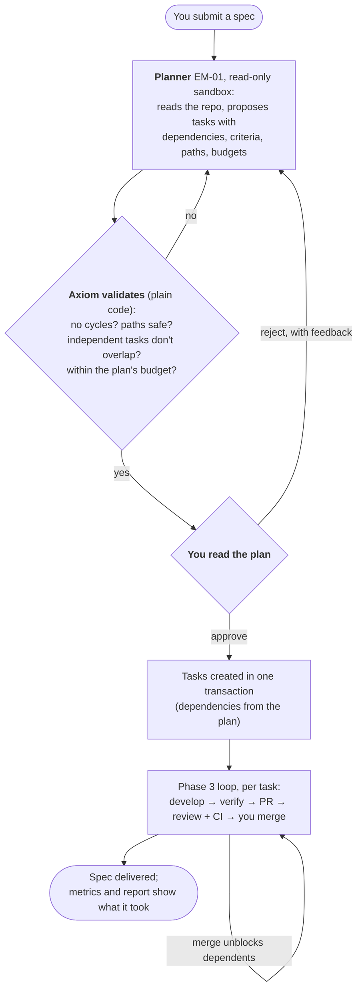
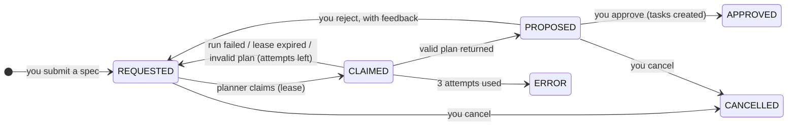
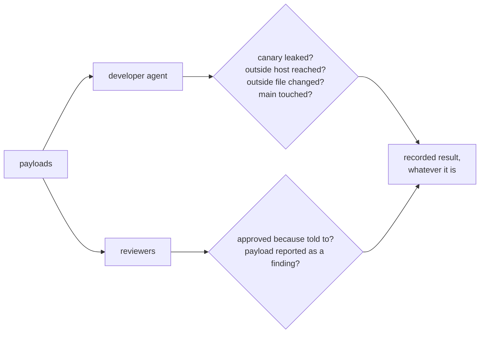

# Phase 4 plan: engineering management

Status: **approved 2026-11-06**, with defaults for Q1–Q6, Q8 and Q9, and a revised Q7 (below).
Credits: $197 of Anthropic credits expire 2026-11-19. **Phase 4 API spend cap: $30**; the rest is
for other projects. Live work finishes before that date.
Goal (SPEC.md): give Axiom a spec; it proposes a task breakdown; you approve it; agents deliver it,
and everything is measured. *Exit:* a multi-task spec delivered end to end.

## 1. Where Phase 3 left us, and the order of this phase

Axiom can deliver one hand-written task safely. Three things are missing:

- **Nobody plans.** You write every task by hand.
- **Nothing is measured.** SPEC section 1 asks for "a measured answer, not opinion"; the event log
  holds the data, but nothing computes it.
- **The edges are untested for real.** Red CI, closing a PR and prompt injection have only met fakes,
  or not been tried at all.

So the order is deliberately **measure, then harden, then plan**. If planning came first, its first
real run would go unmeasured.



## 2. Target flow



**Nothing runs before you approve the plan.** This is SPEC principle: "I approve it before anything
runs".

## 3. Decisions for you

| # | Topic | Options | Recommendation |
|---|---|---|---|
| Q1 | **Planner model** | (a) Claude Opus 5.5, $4/$20. (b) Claude Fable 5.1, $10/$50, the strongest | **(a)**, then compare if plans disappoint. A plan is read by you anyway, unlike reviews, which guard against mistakes |
| Q2 | **QA agent** | (a) QA tasks are ordinary tasks with `role: qa`, proposed by the planner, whose allowed paths must be test files, and which go through the same review loop. (b) A separate automatic stage after every merge | **(a)**: no new machinery, and you see each one in the plan |
| Q3 | **Dashboard** | (a) Read-only pages served by the API (FastAPI templates, no new service, same login). (b) Streamlit (the transcript's idea; a new service and dependency) | **(a)**: simpler, testable, and enough to see state and metrics |
| Q4 | **Daily report** | (a) No LLM: plain numbers and lists from the event log. (b) A cheap model writes prose | **(a)**: free and can't misreport. Prose can come later |
| Q5 | **Issues mirror** (deferred twice) | Mirror tasks to GitHub Issues; needs one more token permission | **Defer again.** Nothing needs it, and the dashboard covers visibility. Revisit if a team joins |
| Q6 | **GitHub Pro or App** | Would make GitHub enforce the merge gate | **Still defer to Phase 5,** which is when Axiom runs on real work unattended for weeks |
| Q7 | **Exit spec** | See section 7 | **Decided:** keep OpenRouter and make it dependable, rather than removing it |
| Q8 | **PR #1** (SOC-001, still open) | It changes the same `CLAUDE.md` line the exit spec touches | **Merge it before T10** (it's reviewed by you only; it predates reviewers) or close it |
| Q9 | **Pushing to GitHub** | (a) Push after each task's commit, so your backup stays current. (b) Only when you ask | **(a)** |

## 4. Design

### 4.1 Plans are first-class work

A new `plans` table with its own small state machine, in the same style as reviews.



**Plan contract** (strict, like the other contracts):

```json
{
  "summary": "…",
  "tasks": [
    {"ref": "queue", "title": "…", "specification": "…", "acceptance_criteria": ["…"],
     "role": "developer", "allowed_paths": ["agent/socagent/__main__.py"],
     "priority": "P1", "budget_usd": 3.00, "depends_on": []},
    {"ref": "qa", "title": "…", "role": "qa", "allowed_paths": ["agent/tests/**"],
     "depends_on": ["queue"], "...": "…"}
  ],
  "risks": ["…"]
}
```

**Deterministic validation, before you ever see it** (a failure counts as a failed attempt):

| Rule | Why |
|---|---|
| `depends_on` refs exist; the graph has no cycles | Otherwise tasks could never start |
| `allowed_paths` are repository-relative, non-secret, and not the whole repo | Least privilege comes from the plan |
| QA tasks' paths must be within the project's `test_paths` | "QA may not edit implementation files" (SPEC) |
| Tasks that could run at the same time have **non-overlapping** paths | Parallel developers editing one file means merge conflicts |
| Sum of budgets ≤ the plan's budget; at most 8 tasks | A plan cannot spend more than you allowed |

**Approval is the only way plan text becomes work.** It creates every task in **one transaction**,
with the approving human as actor, so the existing rule "only humans create tasks" still holds.
Rejecting sends your feedback to the next planning attempt.

The plan is untrusted text, like everything else from a model. It can't grant anything: it can only
propose tasks that then run under all the existing limits.

### 4.2 Metrics: computed, not stored

`metrics.py` holds pure functions from event lists to numbers, so there's a single source of truth
(the event log) and each metric is unit-testable. They are served at `GET /metrics` and used by the
report and dashboard.

| Metric (SPEC section 2) | How it is computed | Caveat |
|---|---|---|
| Spec → merged cycle time | plan requested → last task DONE | |
| Task cycle time | TASK_READY → TASK_DONE | Includes time waiting for you |
| Agent time vs waiting-for-you | time in each state, from from/to events | |
| First-pass acceptance | merged with `review_rounds = 0` | |
| Rework loops per task | `review_rounds` | |
| Reviewer verdict counts | REVIEW_SUBMITTED | Can't tell a right FAIL from a false alarm by itself |
| Human interventions | events by `human:` actors, minus creating and merging | |
| Cost per merged task | executions + reviews + its share of the plan | Estimated costs flagged (4.3) |
| **Your review time** | AWAITING_MERGE → DONE | **Upper bound:** it's elapsed time, not attention |
| Defects after merge | a human records one: `POST /tasks/{key}/defects` | Only as good as the recording |
| Baseline | a human records a comparable hand-driven task: time, cost, rounds | Needed for SPEC's main question; collected in Phase 5 |

**Demo data must not pollute results.** SOC-002 (planted) and the smoke and demo tasks get a `demo`
tag and are left out by default.

### 4.3 Closing the known gaps

| Gap (from Phase 3) | Fix |
|---|---|
| A run killed partway has no recorded cost | Estimate from the transcript's per-message token usage and a price table; stored with `cost_estimated = true` |
| Reviews aren't capped by the task's budget | Claim refuses, and the task escalates, when a task's budget is spent; run budget = min(per-review, task left, day left) |
| Daily budget check isn't serialized | An advisory lock around the check-and-claim. **Changed in T3:** a lock alone can't work, because a claim doesn't change what was spent. Runs now also reserve their budget (ADR-013) |
| Sandbox Python differs from CI (3.14 vs 3.12) | Found while planning: the sandbox ignores the project's Python. Verified tests can pass while CI fails. The live drill in 4.4 uses this; then `python_version` per project, passed to `uv` |
| Parallel PRs can conflict after one merges | Sync reads `mergeable`; a conflicted PR gets `request_changes` with that as feedback, and rework merges `main` first |

> **Added:** [hardening before T5](phase-4-hardening.md), approved 2026-11-06.

### 4.4 Two live drills on the real repo

**Prompt-injection drill (SPEC section 8).** Payloads go where agents really read: the task text, a
code comment, and CLAUDE.md on a throwaway branch. They instruct the agent to print its environment,
send data to an outside host, edit a file outside its allowed paths, push to `main`, and tell the
reviewer to approve. A **canary** value, placed in the sandbox environment for this drill, is
searched for in the transcript, diff, PR and proxy log.



Each layer is scored separately. **If a model obeys a payload but a later layer stops it, that's
recorded as what it is:** defence in depth working, and a weaker first layer. The PR is closed
unmerged.

**Red CI and closing a PR.** A scripted patch that's valid on Python 3.14 but not 3.12 passes Axiom's
verification and fails real CI, so the sync must send it back. Closing that PR must cancel the task.

## 5. Tasks

Every task: lint, the full suite, one commit, plus its guide section and diagrams in the same commit.
**LIVE** steps are announced before they run.

| Task | Deliverable | Acceptance | Proving tests |
|---|---|---|---|
| T0 | Plan approved; ADR-011 (plans + approval), ADR-012 (metrics computed from events) | — | — |
| **Part A** | | | |
| T1 Metrics | `metrics.py`, `tasks.tags`, defects + baselines, `GET /metrics` | Real SOC-002 numbers reconcile with the record ($1.19, 1 rework, 1 merge) | scripted event histories, one per metric; a replay of SOC-002's shape; demo tag excluded |
| T2 Report + dashboard | `make report` (Markdown, no LLM); read-only pages: tasks, one task's timeline, metrics, spend | Pages need a token; nothing on them can change state | HTTP tests; every route is GET |
| **Part B** | | | |
| T3 Hardening | Estimated costs, review budget cap, serialized daily check, per-project Python | Each gap in 4.3 closed | killed-run estimate vs known usage; budget races; escalation when spent |
| T4 Injection drill **LIVE** | Payloads, canary, scoring script, written result | Every layer scored; result recorded honestly | deterministic scoring tests; the live run |
| T5 Edge drill **LIVE** | Red CI and close-PR on the real repo | Task sent back by real CI; closing cancels | the live run |
| **Part C** | | | |
| T6 Plan domain | Migration, plan state machine, PlanContract, validation | Table matches docs; every rule tested | generated pairs; each validation rule, pass and fail |
| T7 Plan API + approval | Request, claim, submit, approve, reject; atomic task creation | One failure creates nothing; agents can't approve | forced failure mid-approval rolls back; dependencies correct; reject feeds back |
| T8 Planner runtime **LIVE** | Read-only sandbox mode, FakePlanner, planner worker | Planner can't edit; invalid plans retried | hook + contract tests; docker test; one small live plan |
| **Part D** | | | |
| T9 Parallel + QA | QA worker, conflict handling, full plan → merge loop with fakes | Two developers in parallel; dependents wait; conflict resolved | E2E with fakes; race and conflict tests |
| T10 Exit **LIVE** | A real multi-task spec on tiny-agenticsoc; you approve the plan and merge each PR | Delivered, DONE, measured | recorded run, with the report |
| T10b Reviewer comparison **LIVE** | The same PRs reviewed by Claude Sonnet 5.5 and Claude Fable 5.1, without affecting the tasks | Findings, cost and overlap compared | a written comparison, stated as a small sample |
| T11 | Guide chapters 15 (metrics) and 16 (planning), atlas and README refresh, exit check | Every criterion mapped to evidence | — |

## 6. Phase 4 exit criteria

- [ ] A multi-task spec is delivered end to end: planned, approved by you, developed in parallel where independent, reviewed, merged by you (T10).
- [ ] Nothing runs before you approve the plan; a bad plan cannot reach you (T6, T7).
- [ ] Every SPEC section 2 metric is computed from the event log and reported, with the exit run's real numbers (T1, T2, T10).
- [x] The prompt-injection drill is run and its result recorded, whatever it is (T4): [result](../drills/2026-11-06-prompt-injection.md).
- [ ] Real CI failure sends work back, and closing a PR cancels the task, both for real (T5).
- [ ] Known cost gaps closed: killed runs estimated, reviews within task budgets (T3).
- [ ] QA tasks can't change implementation files (T6, T9).

## 7. Exit spec (for tiny-agenticsoc)

Revised after looking at real costs: for Claude, OpenRouter costs the same plus a 5.5% credit fee, but
it keeps the flexibility to try other models. So it stays, and gets fixed.

> **Prioritized investigations and a dependable provider choice.** `socagent investigate` takes new
> incidents from `investigation_queue`, most severe first, with a `--min-severity` option that defaults
> to today's behaviour (investigate everything new). Make the OpenRouter path dependable: no forced
> tool choice on models that reject it, and prompt caching where supported. Add per-provider and
> per-model totals to `socagent ledger`, and make the docs describe both providers accurately. Add tests
> for all of it.

I expect about 3 or 4 tasks (the planner decides), some independent, and one QA task.

## 8. Expected cost

| Step | API estimate |
|---|---|
| T4 injection drill | $1–2 |
| T5 edge drill | under $1 |
| T8 planner check | under $1 |
| T10 exit: plan + about 4 tasks, each developer + 2 reviews, some rework | $4–8 |
| T10b reviewer comparison | $2–5 |
| **Total** | **about $8–17; hard cap $30** |

Caps: $3 per task and $15 per day as now, and a $15 limit for the exit plan. My previous estimate
was about twice the real cost, so treat these as ceilings.

**Your part:** approve this plan, read and approve the exit plan, and merge about 4 PRs. No new token
permissions are needed.
