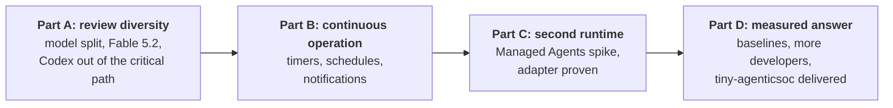
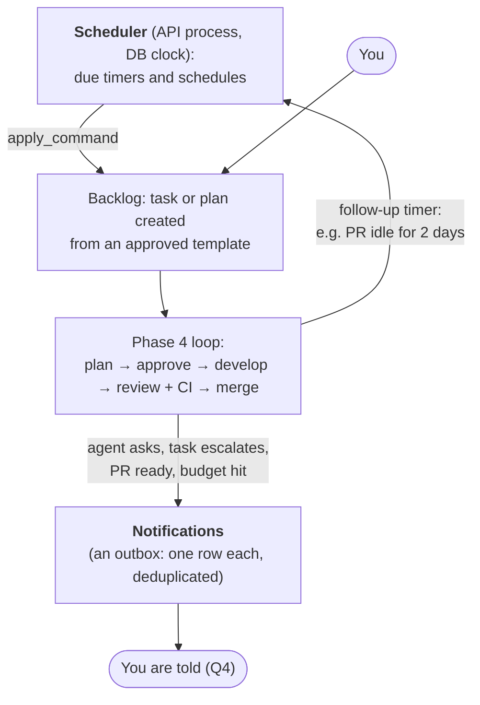
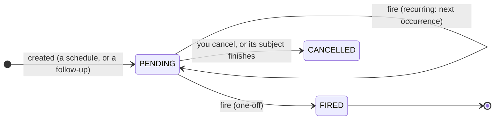
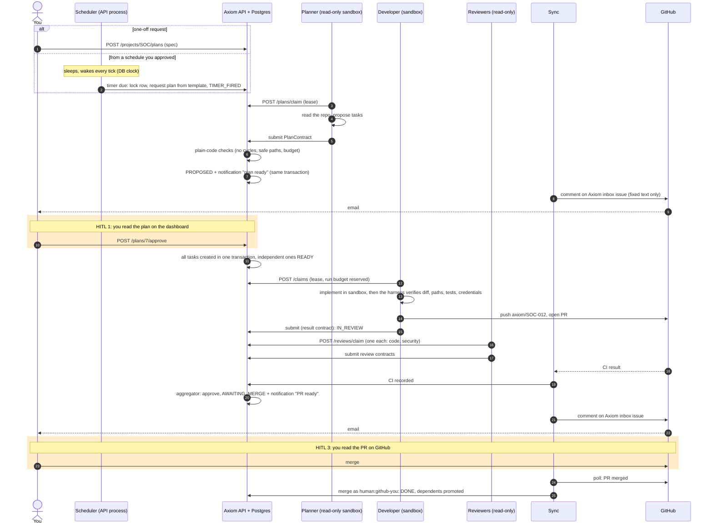
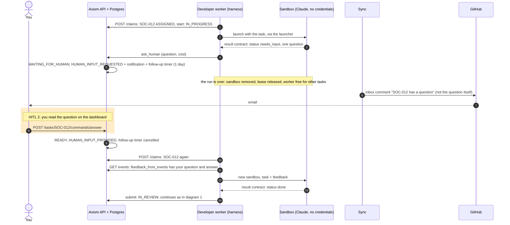
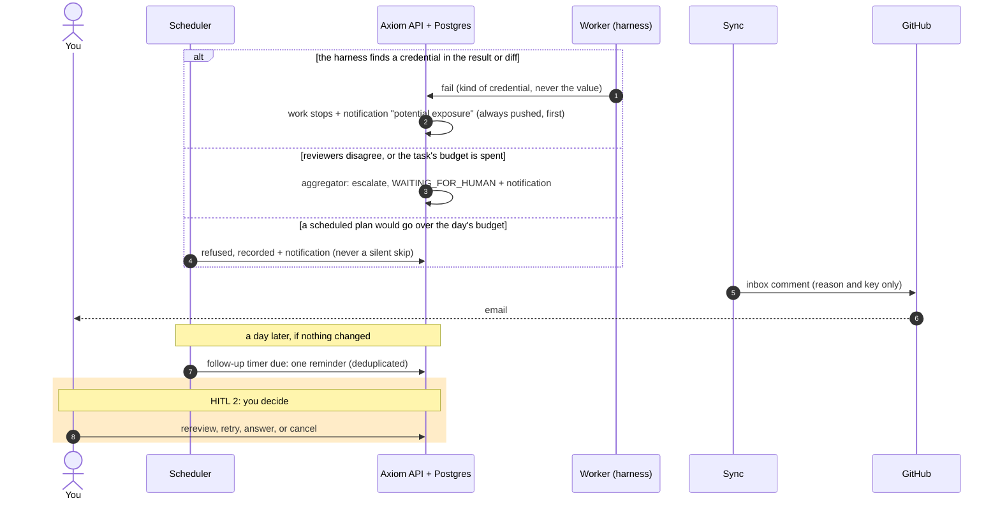
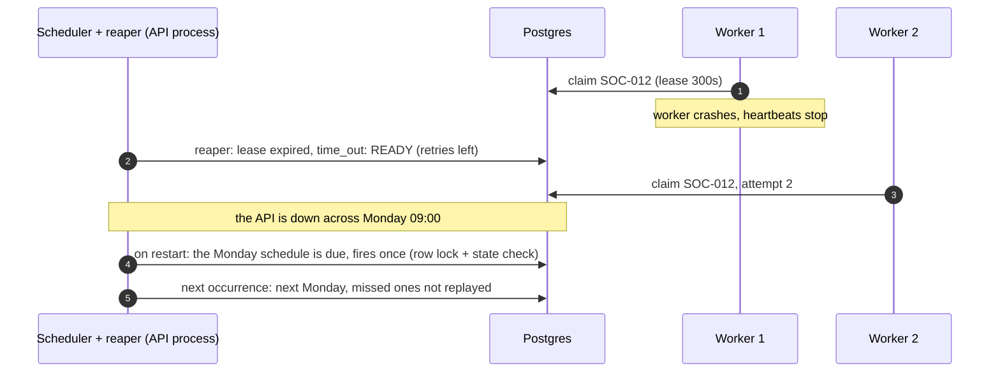

# Phase 5 plan: scale and diversify (Anthropic only)

Status: **approved 2026-11-13**, with the defaults for Q1–Q9. Added at approval: the end-to-end sequence
diagrams (section 4.6) and a schedule that spends the expiring credits first (section 7).
Change of scope: SPEC's Phase 5 started with a Codex runtime for cross-model review. This plan drops that
dependency and builds Phase 5 on Claude and the Anthropic platform only. Codex stays possible later, behind the
same runtime adapter (ADR-003), but nothing here waits for it.
Credits: the Anthropic credits expire **2026-11-19**. Live steps planned before then use them; anything after
is pay-as-you-go against the cap you set (Q1).
Goal (SPEC.md): Axiom runs real work unattended, on more than one runtime, and answers the main question:
does it beat one person working with one AI session? *Exit:* below, section 6.

## 1. Where Phase 4 left us, and the order of this phase

Axiom delivers a multi-task spec end to end, measured, with you approving the plan and merging. Four things are
missing:

- **It only runs when you push it.** Every run starts because you created a task or a plan. Nothing wakes up on
  its own, nothing follows up, and nothing tells you that something needs you. You find out from the dashboard.
- **One runtime.** Every agent runs through the Claude Agent SDK in our own sandbox. SPEC principle 2 (pluggable
  runtimes) has only ever had one implementation, so we don't know if the adapter really is pluggable.
- **Review diversity is narrow.** Reviewers run on Fable 5.1 and developers on Opus 5.5: different models, same
  vendor. Without Codex, diversity has to come from the models, prompts and roles we choose.
- **The main question is open.** No hand-driven baselines exist yet.

Order: **diversify reviews, then continuous operation, then a second runtime, then the measured answer.**
Review changes are small and make every later run better. Continuous operation is the largest change and needs
its own drills. The runtime is an experiment that can be cut without hurting the rest. Baselines come last
because they need the finished system.

## 2. Target flow

The always-on pattern from Anthropic's
["Building always-on agents"](https://claude.com/resources/articles/building-always-on-agents) (2026-11-13)
maps onto what Axiom already has. The new pieces are timers, a scheduler and notifications:

| Pattern in the post | Axiom today | Phase 5 adds |
|---|---|---|
| Durable event inbox, one worker each, retry when a worker dies | Postgres tasks, claims, leases, reaper | nothing |
| Timers and schedules | none | a `timers` table and a scheduler in the API process, beside the reaper |
| Memory | the event log (`feedback_from_events`) | nothing; fresh sandboxes stay (ADR-014) |
| Credentials added by a proxy | ADR-008, ADR-015, ADR-017 | nothing |
| Deferred tool call: stop, ask the user, resume on the answer | `ask_human` → `WAITING_FOR_HUMAN` → `answer` | a notification when it happens |
| Outbox: send, stay quiet, or ask | PRs, dashboard, `make report` | a `notifications` table and a channel (Q4) |

**Nothing new can approve or merge.** A schedule only creates work, and only from a template you approved. A
scheduled plan still waits for your approval unless you chose otherwise for that template (Q3).

## 3. Decisions for you

| # | Topic | Options | Recommendation |
|---|---|---|---|
| Q1 | **Phase 5 spend cap** | Phase 4 cap was $35 (spent $21.79). Credits expire 2026-11-19 | **$40 hard cap**, with about $15 used before 2026-11-19 (Parts A and B live checks). Per task $3 and per day $15 as now |
| Q2 | **Reviewer models** | (a) Both on Fable 5.1, as now. (b) SEC-01 on **Sonnet 5.5**, REV-01 on **Fable 5.2** (the T10b comparison: Sonnet agreed on 15 of 15 verdicts and every blocking finding, at $0.06 vs $0.45 a review, but missed Fable's findings on test quality). (c) Both on Fable 5.2 | **(b)**: code review, where test quality is judged, keeps the strongest model; security gets cheaper; the two reviewers no longer share a model, which is the closest substitute for Codex we have. Measured again in T3. *Corrected in T1: the draft had the roles the other way round, against the comparison's own evidence; you chose to follow the evidence* |
| Q3 | **What schedules may create** | (a) Plans only: every scheduled run waits for your approval of its plan. (b) Plans by default; a template you mark `standing` creates tasks directly, within its own budget | **(a) to start.** Standing approval is the first thing in Axiom that would run without your yes; add it later, with its own ADR, if (a) proves tedious |
| Q4 | **Notification channel** | (a) Dashboard inbox only (no new egress). (b) A comment on a GitHub issue in the project repo (already allowed, ADR-017). (c) Email or Slack (new egress from the API, a new secret) | **(a) + (b)**: GitHub already sends you mail for comments, so you get notified with no new secret and no new egress. Revisit (c) if a team joins |
| Q5 | **Second runtime** | (a) **Claude Managed Agents** (Anthropic-hosted agent loop and sandbox; a self-hosted version is in private beta). (b) The Messages API with our own tool loop. (c) None; keep one runtime | **(a) as a time-boxed spike (T6)**, reviewers first because they are read-only. Go or no-go is written down. It is the test of SPEC principle 2, and a no-go is a valid result |
| Q6 | **More developers** | (a) Stay at 2. (b) 3 developers (SPEC section 11 lists more than two as out of scope) | **(b) only if T9 shows** the planner produces 3+ independent tasks and conflicts stay rare; otherwise (a). It's a config change once the measurements say so |
| Q7 | **Baselines** | You do 2–3 tasks by hand in one Claude Code session each, comparable to tasks Axiom did, and record time, cost and rounds (`POST /baselines`) | **Yes, 3 tasks.** This is the only way to answer SPEC's main question. It costs your time, roughly an hour each |
| Q8 | **Codex in the docs** | SPEC, ADR-003, `agents.toml` and the guide call Codex "next" | **Reword to "possible later, not planned"**, in T0. Not removed, since the adapter keeps the door open |
| Q9 | **GitHub enforcement** (deferred from Phase 4) | (a) GitHub App. (b) GitHub Pro. (c) Nothing more | **(c) for now:** tiny-agenticsoc is public and already has a ruleset requiring a PR and the `tests` check. Revisit for a private customer repo |

## 4. Design

### 4.1 Review diversity (Part A)

- Reviewer models per Q2 (code review on Fable 5.2, security on Sonnet 5.5), set with `make set-model`; the ADR-009 rule (no reviewer shares a model with a
  developer or QA agent) still holds and is checked.
- **Different lenses, not just models.** The two reviewer prompts already differ by role. T2 adds a review
  checklist per role that the aggregator can check for: a review must say which checklist items it looked at,
  so "approve" with nothing examined is rejected as an invalid review, the same way an invalid contract is.
- Fable 5.2 replaces Fable 5.1 in the price table and the estimator (`runtimes/estimate.py`).

### 4.2 Timers and schedules (Part B)

A new `timers` table and a small `timer_machine.py` (pure table, in the style of the review machine):

- **Two kinds**, as in the post: *schedules* (recurring, from a template you approved, e.g. "every Monday:
  propose a plan to update dependencies in tiny-agenticsoc") and *follow-ups* (one-off, set by Axiom itself,
  e.g. "PR idle 2 days: notify"; "WAITING_FOR_HUMAN for a day: remind").
- **Agents can't create timers** in this phase. Only humans (schedules) and deterministic code (follow-ups) do.
- The **scheduler** runs in the API process like the reaper, uses the DB clock, and fires each due timer in
  one transaction: lock the timer row, fire through `apply_command` (or the plan service), advance or close the
  timer, append an event. Firing twice is impossible because the row lock and the state check happen together.
- A missed firing (API down) fires once on restart, not once per missed interval.
- Budgets apply as today: a scheduled plan that would go over the day's budget is refused, and that refusal is
  a notification, not a silent skip.

### 4.3 Notifications (Part B)

- A `notifications` table is the outbox: subject, reason, dedup key, created, delivered. One row per reason
  per subject (deduplicated), so a reminder can't repeat every scheduler tick.
- Reasons: agent asked a question, task escalated, PR ready for you, plan ready for approval, budget refused,
  potential credential exposure (always, and first).
- A notification row is written **in the same transaction** as the event that causes it (inside
  `apply_command` or the plan and timer services), so one can't be lost, and none can exist without its event.
- Delivery per Q4: shown in the dashboard; and posted by the sync service as one comment on a pinned
  `Axiom inbox` issue in the project repo. The sync's token already reaches only GitHub (ADR-017); it needs
  the Issues write permission, which is **one new token permission (you add it)**. This is the sync's first
  write to GitHub, so ADR-010 ("read-only towards GitHub") gets a revision: it may write comments on that one
  issue, and nothing else.
- **What a comment may say.** tiny-agenticsoc is public, so anyone can read the inbox issue. A comment holds
  only fixed text chosen by code: the reason, the task or plan key, and the time. **Never** the agent's
  question, a plan's text, an error message or anything else an agent wrote, which could carry injected text
  or a leaked value. You read the details on the dashboard.
- **Comments are never commands.** Anyone can comment on a public issue, so Axiom never reads replies there.
  You answer, approve and merge exactly as today: the API (with your token) and GitHub's merge button.
- Start quiet: by default only "needs you" reasons are pushed; the rest are dashboard-only.

### 4.4 A second runtime: Managed Agents spike (Part C)

A time-boxed spike, written up whatever the result:

- Implement the existing adapter (`runtimes/base.py`: start, stream events, cancel, collect result) for
  Managed Agents, reviewers first.
- Must keep the rules that matter: no credentials in the agent's environment, read-only for reviewers, cost
  metered and recorded per run, the result is a strict contract, and the harness never trusts what the agent
  leaves behind. Anything that can't keep a rule is a no-go for that role, recorded in an ADR.
- Questions it answers: does the adapter hold without changes to orchestration code; what the cost and latency
  are against our sandbox; where the transcript, workspace and network policy live; whether the self-hosted
  beta changes the answer.

### 4.5 The measured answer (Part D)

- **Baselines** (Q7): you do 3 tasks by hand; `metrics.py` compares time, cost and rework per task.
- **More developers** (Q6) decided from the parallel measurements.
- **tiny-agenticsoc end to end**: a real spec run with schedules and notifications on, over at least a week,
  so "unattended for days" is something that happened rather than something designed.

### 4.6 End to end: from a request to merged work, and where you come in

Like the always-on agents in the post, nothing in Axiom runs all the time. Each piece sleeps until there's work
for it: the scheduler wakes on a tick, workers poll for claims, the sync polls GitHub. Every hand-off goes
through Postgres, so any of them can die and restart without losing work.

There are **three places where you come in (HITL)**, and Axiom stops at each one until you act:

| # | When | What you do | What happens if you don't |
|---|---|---|---|
| HITL 1 | A plan is proposed | approve or reject it (`POST /plans/{id}/approve`) | nothing runs; a reminder after a day |
| HITL 2 | An agent needs an answer, or Axiom escalates (reviewers disagree, budget spent, a potential credential exposure) | answer, rereview, retry or cancel | the task waits in WAITING_FOR_HUMAN; a reminder after a day |
| HITL 3 | A PR has passed review and CI | merge it on GitHub, or close it | the PR waits; a reminder after 2 days |

**Diagram 1: the whole journey.** A request comes from you or from a schedule you approved, and ends with you
merging.

**Diagram 2: an agent needs you partway through (HITL 2).** This is Axiom's version of the post's "deferred
tool call": the run ends, nothing waits in memory, and your answer starts a fresh run with the history read
from the event log.

**Diagram 3: when Axiom stops by itself (HITL 2), and reminders.** No agent can approve, and nothing is skipped
silently: when the rules can't decide, a human does.

**Diagram 4: crashes in the middle.** Durability is what makes it safe to leave Axiom running unattended.

## 5. Tasks

Every task: lint, the full suite, one commit, its guide section and diagrams in the same commit.
**LIVE** steps are announced before they run.

| Task | Deliverable | Acceptance | Proving tests |
|---|---|---|---|
| T0 | Plan approved; SPEC and ADR-003 reworded (Q8); ADR-018 (timers and the scheduler), ADR-019 (notifications) | — | — |
| **Part A** | | | |
| T1 Models | Fable 5.2 pricing and estimate; reviewer models per Q2 | ADR-009 rule still enforced | price-table and estimate tests; model-guard legal and illegal paths |
| T2 Review checklists | Per-role checklist in review contracts; aggregator rejects an empty review | An "approve" that examined nothing is invalid | contract tests, pass and fail |
| T3 Review check **LIVE** | The new reviewers on the SOC-002 planted bug and two recent PRs | Bug caught; cost recorded | the live run, written up: [record](../runs/2026-11-14-phase-5-review-check.md) ($1.81) |
| **Part B** | | | |
| T4 Timers | Migration, `timer_machine.py`, scheduler in the API process, follow-ups for idle PRs and waiting questions | Fires once under concurrency and after downtime | generated pairs; two schedulers racing; restart after a missed interval; budget refusal. Done: [chapter 17](../guide/17-continuous-operation.md) |
| T5 Notifications | Migration, outbox, dashboard inbox, GitHub inbox-issue delivery by the sync | Deduplicated; credential exposure always pushed | dedup, delivery retry, sync tests with a fake GitHub. Done; the sync got its own token, and a possible credential exposure now stops work (FAILED) |
| T5b Unattended drill **LIVE** | A weekly schedule on tiny-agenticsoc, the API restarted mid-week | Fires on time, once; you are notified at each step | the live run |
| **Part C** | | | |
| T6 Managed Agents spike **LIVE** | Adapter for reviewers; go or no-go ADR-020 | Rules in 4.4 kept, or the gap recorded | adapter contract tests with a fake; the live comparison |
| **Part D** | | | |
| T7 Baselines | Your 3 hand-driven tasks recorded; comparison in the report | Comparison shown, stated as a small sample | metrics tests for the comparison |
| T8 Exit **LIVE** | A real multi-task spec on tiny-agenticsoc with schedules and notifications on | Delivered, measured, notified | recorded run, with the report |
| T9 Developers | Decide 2 or 3 from T8's numbers (Q6) | Decision recorded | — |
| T10 | Guide chapters 17 (continuous operation) and 18 (runtimes), chapter 13 scenarios, exec summary, exit check | Every criterion mapped to evidence | — |

## 6. Phase 5 exit criteria

- [x] Codex is no longer on any critical path; SPEC and ADR-003 say so (T0).
- [x] Reviewers on two different models from each other and from developers, with the planted bug still caught (T1–T3): [record](../runs/2026-11-14-phase-5-review-check.md), `test_the_two_reviewers_default_to_different_models`.
- [ ] Schedules and follow-ups fire once, on time, through `apply_command`, including after a restart (T4, T5b).
- [ ] You are told when something needs you, without opening the dashboard; credential exposure always first (T5, T5b).
- [ ] A second runtime has been tried for real, and the result is written down whatever it is (T6).
- [ ] The main question has a measured answer from baselines, stated as a small sample (T7, T8).
- [ ] A real spec is delivered with Axiom running unattended between your approvals and merges (T8).

## 7. Expected cost, and using the credits before they expire

The credits expire on **2026-11-19**, so every live step that can run before then does. Work that needs a calendar
week (the unattended part of T8) starts before the 19th, so most of its spend lands on the credits too.

| Step | When | API estimate |
|---|---|---|
| T3 review check | by 2026-11-14 | $1–2 |
| T5b unattended drill: first scheduled plan and its tasks | starts by 2026-11-16 | $3–6 |
| T6 Managed Agents spike | by 2026-11-17 | $2–4 |
| T7 baselines: your 3 tasks, in Claude Code **on the API key**, so cost is metered like Axiom's | by 2026-11-18 | $2–5 |
| T8 exit: the plan and its first tasks | starts by 2026-11-18 | $5–10 |
| After 2026-11-19: the rest of T5b and T8 (rework, reminders, the second scheduled run) | 2026-11-19 on | $2–5, pay-as-you-go |
| **Total** | | **about $15–32; hard cap $40 (Q1)** |

Order of building changes to fit: Part C (T6) is built before T5b's week runs, not after it, and the
guide (T10) is written last, after the money is spent. My development estimates have run about twice the
real cost, but the Phase 4 reviewer comparison ran over, so treat these as ceilings.

**Your part:** add the Issues write permission to the sync token (T5), do 3 baseline tasks before 2026-11-19
(T7), and approve the plans and merge the PRs that come out of T5b and T8.
