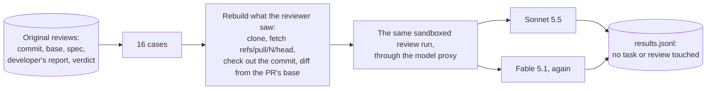

# Reviewer comparison (T10b), Nov 7 2026

**Question:** would Claude Sonnet 5.5 review as well as Claude Fable 5.1, the reviewers' model since ADR-009, for
less? **Short answer, from a small sample:** Sonnet caught the one real bug and agreed with every verdict, at about
a seventh of the cost. But it reproduced only about half of Fable's smaller findings, missing the subtler ones about
test quality. Fable, run again, found mostly the same things, but changed one verdict by rating the same issue more
severely.

## What ran

Sixteen reviews that had already happened: both roles on eight real PRs on `tiny-agenticsoc`, as the original
reviewers saw them. Seven were clean PRs that were merged (#6–#12). One, SOC-002's first round (#2), held a bug planted
on purpose (Phase 3): a `>` that should have been `>=`, and a test that didn't cover it.

`src/axiom/drills/review_compare.py` runs it inside a reviewer container, with the same sandbox, prompt, read-only
tools and metered model proxy as a real review. It writes only to a file, so no task moved. The rebuilt diffs
matched GitHub's to within one character. It has its own spending cap, and stops if any review text holds a
credential. None did. Every workspace and result (2,365 files) was also scanned for the values in `.env`, and none
was found.

## Results

| | Fable 5.1, original | Fable 5.1, again | Sonnet 5.5 |
|---|---|---|---|
| Reviews | 16 | 15 (one skipped at the drill's cap) | 16 |
| Cost | $7.18 | $6.93 | **$0.98** |
| Cost per review | $0.45 | $0.46 | **$0.06** |
| Median turns | | 7 | 5 |
| Verdicts agreeing with the original | — | 14 of 15 | **15 of 15** |
| Planted bug (SOC-002) | FAIL (code) | FAIL (both roles) | FAIL (both roles) |
| Original findings reproduced | — | 12 of 15 | 7 of 15 |
| Original blocking findings reproduced | — | 3 of 3 | 3 of 3 |
| Findings the original didn't have | — | 10 | 5 |

"Reproduced" is matched by file and nearby line (within 8), or as a finding about no particular file: a rough
measure, checked by reading the findings below. SOC-002's original security review had no verdict (it was
superseded when code review failed), so verdicts are compared on 15 cases.

### Per case

H, M, L: high, medium and low findings.

| PR | Role | Fable, original | Fable, again | Sonnet |
|---|---|---|---|---|
| #2 SOC-002 (planted bug) | code | FAIL HHML $0.26 | FAIL HM $0.35 | FAIL HML $0.04 |
| | security | (superseded) $0.30 | FAIL HL $0.36 | FAIL HML $0.04 |
| #6 SOC-004 | code | PASS L $0.40 | PASS L $0.24 | PASS $0.04 |
| | security | PASS L $0.27 | PASS L $0.22 | PASS L $0.04 |
| #7 SOC-005 | code | PASS L $0.64 | **FAIL M** $0.54 | PASS $0.07 |
| | security | PASS $0.36 | PASS $0.37 | PASS $0.04 |
| #8 SOC-006 | code | PASS LL $0.45 | PASS LL $0.47 | PASS $0.05 |
| | security | PASS $0.44 | PASS $0.33 | PASS $0.03 |
| #9 SOC-007 | code | PASS LLL $0.48 | PASS LLLL $0.59 | PASS LLL $0.09 |
| | security | PASS $0.39 | PASS LL $0.35 | PASS $0.04 |
| #11 SOC-008 | code | PASS $0.60 | PASS LL $0.82 | PASS L $0.15 |
| | security | PASS $0.43 | PASS $0.42 | PASS $0.04 |
| #10 SOC-009 | code | PASS LL $0.72 | PASS LLL $0.78 | PASS $0.11 |
| | security | PASS $0.44 | PASS $0.66 | PASS $0.07 |
| #12 SOC-010 | code | PASS L $0.48 | PASS L $0.42 | PASS $0.08 |
| | security | PASS $0.51 | (skipped at the cap) | PASS $0.06 |

## Reading the findings

- **The planted bug:** all three named it at the same line (`incidents.py:157`, `>` where `>=` was meant), and
  the missing boundary test. Sonnet's security reviewer caught it too, as did Fable's on the rerun.
- **What Sonnet missed:** findings about whether tests really test. On SOC-005, Fable (both times) saw that every
  id assertion would still pass if the id weren't printed, because each title contains its id. On SOC-009, it
  saw an assertion that checks a value the test had set itself. Sonnet raised neither.
- **What Sonnet found too:** the dead branch and the unrequested cost-handling change in SOC-007, the same as Fable.
- **Fable is consistent in substance, not in severity.** Its rerun found most of the same issues, but rated
  SOC-005's weak assertions `medium` instead of `low`, and this time chose FAIL for it. A reviewer's FAIL stands
  even without a high finding (only the reverse, a PASS with a high finding, is overruled), so the same issue would
  have sent the work back: a rework round of about $1, for a finding the first run left to the human.

## What this suggests (small sample)

Eight PRs and one planted bug can't settle this. They show:

1. **Sonnet is a cheap first reviewer.** It's about 7 times cheaper per review, partly its price (a fifth of
   Fable's) and partly fewer turns. On this sample it caught the bug that mattered and never disagreed on a verdict.
2. **Fable finds more about test quality,** the kind of finding that keeps a test suite honest. On QA tasks
   that's the point of the work.
3. **Borderline verdicts are noisy** for any one model. One run of one model is not a measurement of a
   PR.

A possible split, for the human to decide: Sonnet for the security role (no model found a security issue in any
clean PR here), and Fable for code review, at least on QA tasks. That would have cost about $4.39 instead of $7.18
for these 16. Nothing is changed by this record: reviewer models are set per agent, and ADR-009 only requires a
model other than the developer's (Opus 5.5), which both are.

## Cost

$7.91 for T10b ($0.98 Sonnet, $6.93 Fable), above the $2–5 estimate because the Fable rerun was added to tell
model differences from run-to-run noise. Without it, the Sonnet results couldn't be read.
