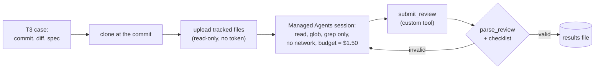

# Phase 5 T6: reviews on Managed Agents, Nov 14 2026

**Question:** can Axiom's reviews run on Claude Managed Agents, through the same runtime interface, keeping the rules
that matter? **Short answer:** yes, with the same verdicts and findings as Axiom's own sandbox, for about the same
cost. Decision in [ADR-020](../decisions/ADR-020-managed-agents-as-a-second-runtime.md).

## What ran

`src/axiom/drills/managed_review.py`: the comparison drill's cases (the same commits and diffs T3 reviewed), with
`ManagedReviewRuntime` in place of the sandbox. Like the other drills it touches no task: results go to a file.

## Results

| Case | Managed Agents | Sandbox (T3) |
|---|---|---|
| SOC-002 code review, Fable 5.2 (planted bug) | **FAIL** H M L, $0.25 | FAIL H M, $0.24 |
| SOC-005 code review, Fable 5.2 | **FAIL** M L, $0.43 | FAIL M L, $0.53 |
| SOC-002 security review, Sonnet 5.5 | **FAIL** H L, $0.03 | FAIL H L, $0.04 |

- **Same verdicts, same blocking findings.** Both reviewers named `incidents.py:157` as high on the planted bug; on
  SOC-005 Fable found the same weak assertion as in T3.
- **About a minute per review.** The repository's 77 files upload before each session.
- **One malformed contract.** The first Sonnet security review submitted its checklist and findings in the wrong
  shape: the platform doesn't enforce a custom tool's schema. It failed as invalid ($0.05). The adapter now sends
  an invalid review back with its problems (up to 3 tries); the re-run passed on its first submission ($0.03).
- **Cost:** $0.76 in all, on the credits, under the drill's caps.

## Checks

- No GitHub token was sent: the files were uploaded, and the environment had no network.
- The Anthropic key was in the drill's process on the admin machine only (ADR-020 explains why this blocks
  wiring it into workers as is).
- The uploaded files (the public repository's contents at two commits) remain in the Files API; they can be deleted.
