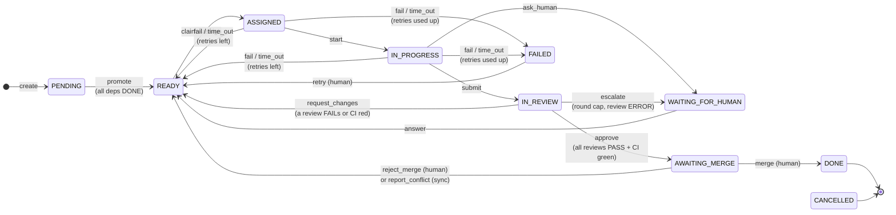
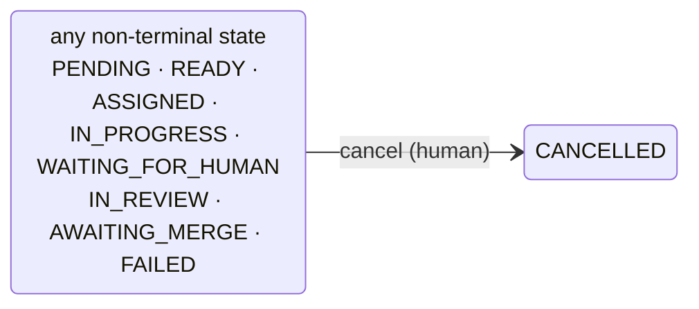
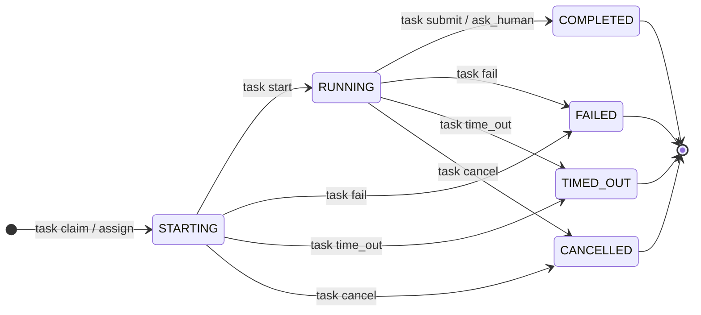
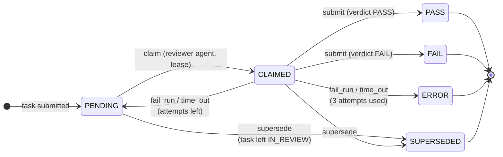
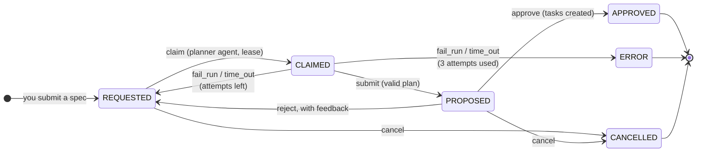

# State machines

Axiom has two state machines:

- **Task**: where a unit of work is in the delivery pipeline.
- **Execution**: one agent run on a task. A task can have many executions over its life (retries,
  rework), but at most one active execution at a time.

The code is the source of truth: `src/axiom/domain/task_machine.py` and
`src/axiom/domain/execution_machine.py`. Unit tests check that the tables in this document and the
code agree.

## Task

`cancel` (human) is legal from every non-terminal state. It is left out of the diagram above to
keep it readable:

Terminal states: **DONE**, **CANCELLED**. FAILED is not terminal; a human can `retry` or `cancel`.

### Transition table

| # | Command → event | From | To | Actor | Guard | Side effects |
|---|---|---|---|---|---|---|
| 1 | `create` → TASK_CREATED | — | PENDING | human | dependencies exist, same project | then #2 |
| 2 | `promote` → TASK_READY | PENDING | READY | system | every dependency DONE | — |
| 3 | `claim` / `assign` → TASK_ASSIGNED | READY | ASSIGNED | agent (pull) / human (push) | agent enabled; role = `assigned_role`; agent under `max_concurrent`; global developer cap | execution created in STARTING with a lease |
| 4 | `start` → AGENT_STARTED | ASSIGNED | IN_PROGRESS | agent | owns execution, lease live | execution → RUNNING |
| 5 | `submit` → TASK_SUBMITTED | IN_PROGRESS | IN_REVIEW | agent | lease live | execution → COMPLETED; result stored |
| 6 | `ask_human` → HUMAN_INPUT_REQUESTED | IN_PROGRESS | WAITING_FOR_HUMAN | agent | lease live | execution → COMPLETED; question stored |
| 7 | `answer` → HUMAN_INPUT_PROVIDED | WAITING_FOR_HUMAN | READY | human | — | answer stored |
| 8 | `fail` → EXECUTION_FAILED | ASSIGNED, IN_PROGRESS | READY / FAILED | agent | lease live | execution → FAILED; `attempt_count += 1` |
| 9 | `time_out` → EXECUTION_TIMED_OUT | ASSIGNED, IN_PROGRESS | READY / FAILED | system:reaper | lease expired (DB clock) | execution → TIMED_OUT; `attempt_count += 1` |
| 10 | `approve` → REVIEW_APPROVED | IN_REVIEW | AWAITING_MERGE | system (aggregator) / human override | aggregator: all required reviews PASS and CI success | open reviews superseded |
| 11 | `request_changes` → TASK_REOPENED | IN_REVIEW | READY | system (aggregator) / human override | aggregator: a review FAIL or CI failure | `review_rounds += 1`; findings stored as feedback; open reviews superseded |
| 12 | `reject_merge` → TASK_REOPENED | AWAITING_MERGE | READY | human | — | `review_rounds += 1` |
| 13 | `merge` → TASK_DONE | AWAITING_MERGE | DONE | human | — | #2 on dependents |
| 14 | `retry` → TASK_RETRIED | FAILED | READY | human | — | `attempt_count = 0` |
| 15 | `cancel` → TASK_CANCELLED | any non-terminal | CANCELLED | human | — | active execution → CANCELLED; open reviews superseded |
| 16 | `escalate` → TASK_ESCALATED | IN_REVIEW | WAITING_FOR_HUMAN | system (aggregator) | review round cap reached, or a review ERROR | open reviews superseded; reason stored |
| 17 | `report_conflict` → TASK_REOPENED | IN_REVIEW, AWAITING_MERGE | READY | system (github-sync) | GitHub says the PR conflicts with the default branch | `review_rounds += 1`; open reviews superseded; the next run merges the default branch first |

For `fail` and `time_out`, the target is READY while `attempt_count` (after the increment) is
≤ `max_retries` **and** the task's budget is not exhausted (summed execution cost < `budget_usd`);
otherwise FAILED. With the default `max_retries = 2`, a task gets 3 attempts. A human can raise
the budget (`POST /tasks/{key}/budget`) and then `retry`.

`claim` / `assign` are also refused (409 `assignment_rejected`) when the task's budget or the
daily budget is spent.

## Execution

| Execution transition | From | To | Caused by task command |
|---|---|---|---|
| create | — | STARTING | `claim` / `assign` |
| start | STARTING | RUNNING | `start` |
| complete | RUNNING | COMPLETED | `submit`, `ask_human` |
| fail | STARTING, RUNNING | FAILED | `fail` |
| time_out | STARTING, RUNNING | TIMED_OUT | `time_out` |
| cancel | STARTING, RUNNING | CANCELLED | `cancel` |

Active states: STARTING, RUNNING. Only active executions hold a lease. Heartbeats extend the
lease and write no event.

## Review (Phase 3, ADR-009)

When a task is submitted, one review per required role (`code_reviewer`, `security_reviewer`)
is created for the new round. Reviewer agents claim reviews with a lease, like developers
claim tasks.

| Review command | From | To | Actor | Event |
|---|---|---|---|---|
| `claim` | PENDING | CLAIMED | agent | REVIEW_CLAIMED |
| `submit` | CLAIMED | PASS / FAIL | agent | REVIEW_SUBMITTED |
| `fail_run` | CLAIMED | PENDING / ERROR | agent | REVIEW_RUN_FAILED |
| `time_out` | CLAIMED | PENDING / ERROR | system | REVIEW_TIMED_OUT |
| `supersede` | PENDING, CLAIMED | SUPERSEDED | system | REVIEW_SUPERSEDED |

Review events carry `review_id` and keep the task's `from_state`/`to_state` empty: they do not
move the task. The aggregator moves the task, using rows 10, 11 and 16 above.

## Plan (Phase 4, ADR-011)

A human submits a specification. A planner agent claims it with a lease and proposes tasks. Plain code
checks the proposal, and only then does a human see it. Only a human's approval creates tasks.

| Plan command | From | To | Actor | Event |
|---|---|---|---|---|
| `claim` | REQUESTED | CLAIMED | agent | PLAN_CLAIMED |
| `submit` | CLAIMED | PROPOSED | agent | PLAN_PROPOSED |
| `fail_run` | CLAIMED | REQUESTED / ERROR | agent | PLAN_RUN_FAILED |
| `time_out` | CLAIMED | REQUESTED / ERROR | system | PLAN_TIMED_OUT |
| `reject` | PROPOSED | REQUESTED | human | PLAN_REJECTED |
| `approve` | PROPOSED | APPROVED | human | PLAN_APPROVED |
| `cancel` | REQUESTED, PROPOSED | CANCELLED | human | PLAN_CANCELLED |

A plan that fails validation counts as a `fail_run`. A rejection isn't a failure, so the attempts start
over. Plan events carry `plan_id`.

## Invariants

- A task is ASSIGNED or IN_PROGRESS **iff** it has exactly one active execution.
- An execution has a lease **iff** it is active (DB CHECK constraint).
- At most one active execution per task (DB partial unique index).
- Every state change writes at least one event, in the same transaction.
