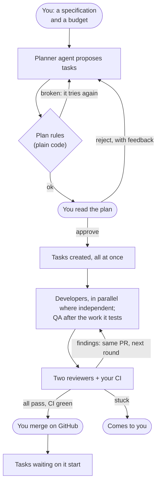

# Axiom user guide

How to get work done with Axiom: give it a specification, approve its plan, and merge what it delivers. Setting
Axiom up (credentials, services, models, budgets) is in the [admin guide](admin-guide.md).

You are the CTO. Agents plan, write, test and review. Plain code decides what happens next. Three things are
only ever yours: **approving a plan, merging a pull request, and deciding when something goes wrong.**

## The loop



Agents usually take minutes per task. Most of the elapsed time is waiting for you: to approve the plan, read each
pull request, and merge it.

## Before you start

You need a human token (the [admin guide](admin-guide.md#your-human-token) shows how), and in a shell:

```bash
set -a; . ~/.axiom/human.env; set +a          # HTOK=...
H=(-H "Authorization: Bearer $HTOK" -H "Content-Type: application/json")
A=http://127.0.0.1:8000
```

The dashboard at <http://127.0.0.1:8000/ui> shows the same things as the API, without the typing. Sign in with
the same token.

## 1. From a specification: plans

Use a plan for anything bigger than one change. Write what you want, not how to split it:

```bash
curl "${H[@]}" $A/projects/APP/plans -d '{"budget_usd": 15, "specification":
  "investigate takes new incidents most severe first, with a --min-severity option that defaults to
   today'\''s behaviour. Add per-provider totals to the ledger. Docs describe both providers. Tests for all of it."}'
```

**A good specification** says what changes for a user, what must keep working, and what "done" means. Name files
or commands if you know them. The planner reads the repository (read-only) and splits the work into at most 8
tasks: each with a specification, acceptance criteria, the files it may change, a budget, and what it waits for.

**The budget** is the most all the tasks may total. Allow about $2.50 a task, reviews included (see
[Costs](#costs)).

**Before you see it,** plain code has checked the plan: no cycles, safe paths, no `.github/` or `.git/`, QA
only in the project's test paths, tasks that run in parallel never share a file, budgets within your limit, and
no credentials in the text. A plan that breaks a rule goes back to the planner, never to you.

### Reading a plan

Open it at `/ui/plans/<id>`. Read it as you would a colleague's: is this the right work, split sensibly, in a
sensible order? The rules can't judge that. Look for the planner's stated risks and assumptions. Watch any task
that touches a file agents read as instructions, such as `CLAUDE.md`. Then decide:

```bash
curl "${H[@]}" -X POST $A/plans/2/approve                                  # creates every task, or none
curl "${H[@]}" $A/plans/2/reject -d '{"feedback": "Split the docs from the code change"}'  # it tries again
curl "${H[@]}" -X POST $A/plans/2/cancel
```

Approval creates all the tasks in one transaction, with you as their creator. Nothing runs before that.

## 2. A single task

For one well-understood change, skip the plan:

```bash
curl "${H[@]}" $A/projects/APP/tasks -d '{
  "title": "Reject empty incident ids",
  "specification": "socagent investigate <id> with an empty id should exit 2 with a clear message.",
  "acceptance_criteria": ["exit code 2", "message names the problem", "a test covers it"],
  "allowed_paths": ["agent/socagent/__main__.py", "agent/tests/**"],
  "budget_usd": 2.5, "priority": "P2"}'
```

| Field | What to put |
|---|---|
| `specification` | What and why, in plain words. The agent treats it as untrusted text, so don't put secrets in it |
| `acceptance_criteria` | Checkable statements. Reviewers judge against them |
| `allowed_paths` | Files or globs the agent may change. Anything else is refused before a PR exists |
| `budget_usd` | Developer runs and reviews together. Default $3 |
| `dependencies` | Task keys that must be merged first; the task waits as PENDING |
| `assigned_role` | `developer` (default) or `qa` for tests only |

## 3. While it runs

Nothing to do. `make report` or the dashboard shows what's happening and what needs you. Every task has a
timeline (`/ui/tasks/APP-007`) with each step, who made it, its cost, and every review's summary and findings.

## 4. A pull request is ready

A task in AWAITING_MERGE has passed both reviewers, its tests ran on a clean copy, and CI is green on that exact
commit. Read the PR on GitHub and the reviews on the task's page. Reviewers often leave `low` findings that don't
block, and they're worth a look. Then, on GitHub:

| You | Axiom |
|---|---|
| **Merge** the PR | Records it as you, marks the task DONE, starts tasks waiting on it |
| Comment `/axiom changes <what to change>` (as the repository's owner or a collaborator) | Sends it back with your words as feedback: a new round on the same PR |
| **Close** the PR | Cancels the task |

Axiom notices within 30 seconds. It never merges, and no agent can approve.

## When something comes to you

A task that can't go on by itself stops in WAITING_FOR_HUMAN or FAILED. Its timeline says why. Most cases are one
command:

| Why it stopped | What to do |
|---|---|
| The agent asked a question | `curl "${H[@]}" $A/tasks/APP-007/commands/answer -d '{"payload": {"answer": "…"}}'` |
| A review couldn't finish (ran out of budget, crashed) | Raise the budget if that was it, then rereview: the same commit is reviewed again, keeping any role that already passed it |
| Reviewers still fail it after 3 rounds | Read their findings. Merge it yourself if you disagree, rereview if a review looks wrong, or cancel and write a clearer task |
| The task's budget is spent | Raise it, then `rereview` if it stopped in review, or `retry` if it FAILED; or cancel |
| FAILED: its attempts ran out (a crash, a refused change) | Read the errors; fix the cause or the task; `retry` |
| The PR conflicts with `main` | Nothing: Axiom sends it back and the agent resolves the conflict on the same PR |

```bash
curl "${H[@]}" $A/tasks/APP-007/budget -d '{"budget_usd": "3.50"}'
curl "${H[@]}" -X POST $A/tasks/APP-007/commands/rereview -d '{}'
curl "${H[@]}" -X POST $A/tasks/APP-007/commands/retry -d '{}'
curl "${H[@]}" -X POST $A/tasks/APP-007/commands/cancel -d '{}'
```

Merging or closing the PR on GitHub also works while a task is with you. A merge made before the reviews passed
is recorded and flagged as "merged before the gate".

## Costs

Typical costs for small, well-scoped changes (a few files, a few hundred lines):

| Item | Typical cost | Budget to allow |
|---|---|---|
| A plan | $0.20–$0.50 | the plan's own limit covers it |
| A developer run | $0.30–$0.60 | — |
| A code review, with Fable 5.2 | $0.20–$0.60 | at least $1 per review |
| A security review, with Sonnet 5.5 | $0.03–$0.10 | at least $1 per review |
| A whole task, two reviews included | $1.20–$2.50 | $2.50; $3.50 for large test suites |

Reviews are a large share of a task's cost, so the reviewer model matters most: a Sonnet 5.5 review costs
roughly a seventh as much as a Fable review. Your administrator can change it
([admin guide](admin-guide.md#6-agents-and-models)). Larger changes cost more; size the budget to the diff, not
the title.

Budgets stop work before money is spent, not after: per run, per task and per day. A task out of budget comes to
you; it doesn't quietly overspend. If that happens, raise its budget and continue (see
[When something comes to you](#when-something-comes-to-you)).

## Good habits

- **Read every plan.** The rules check its shape, not whether it's the right work.
- **Keep tasks small, with tight `allowed_paths`.** Small diffs review well and cost less.
- **Give QA its own tasks.** Developers' own tests are checked, but tests written from the specification by
  another agent catch more.
- **Treat a `CLAUDE.md` or instruction-file change as sensitive.** Agents read those files as guidance.
- **Merge promptly.** You're the slowest step: work waiting on a task can't start until you merge it.
- **Record what only you know:** a defect found after merge (`POST /tasks/{key}/defects`), or how long a
  comparable task took by hand (`POST /baselines`). Without baselines, nobody can say whether Axiom beats doing
  it yourself.
